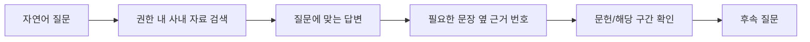
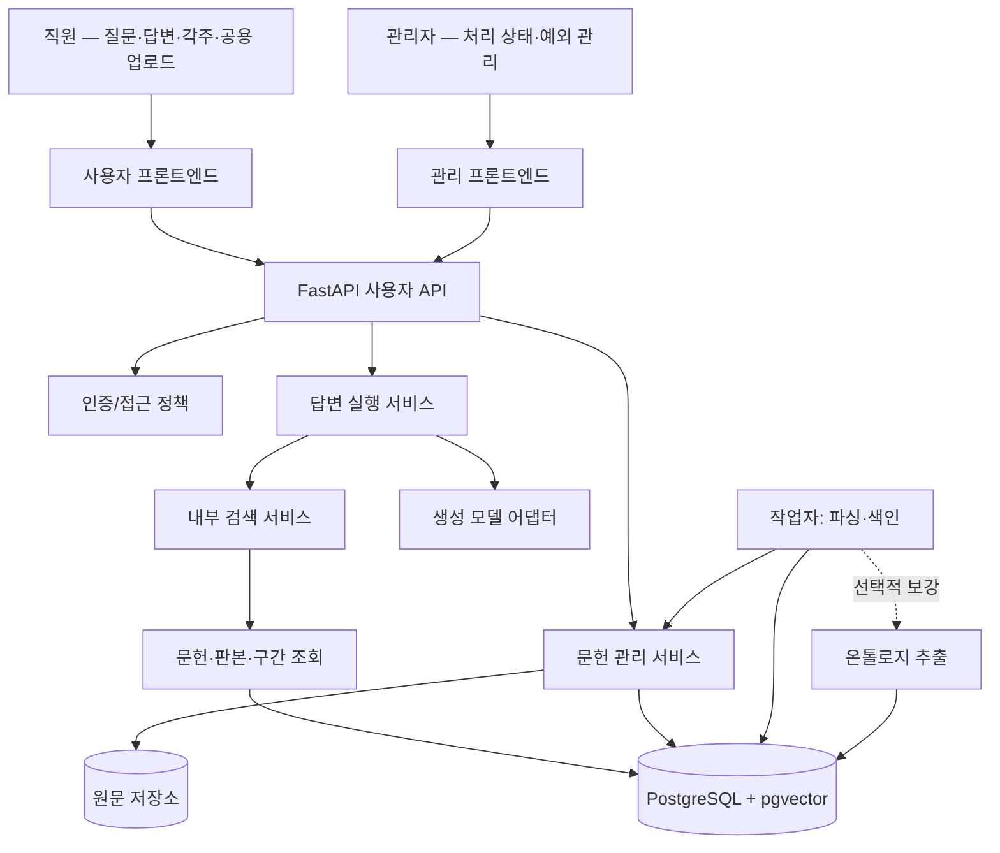

# 사내 지식 기반 AI 어시스턴트 — 목표 아키텍처

> **문서 유형:** 새 서비스의 목표 설계안(Target Architecture), **구현 기준 v0.3 · 핵심 설계 원칙 1~4 합의 완료**  
> **기준일:** 2026-10-28  
> **구현 현황 대조 기준:** `68ccd5f3bc98abd480d5a413947974aa02843a66` (문서 전처리 개선이 통합된 커밋)  
> **우선순위:** 이 문서의 **미래 목표 구조가 우선**한다. 기존 코드와의 차이는 10장의 이전·변경표에서만 설명한다. 이전 구현에 설계를 억지로 맞추지 않는다.  
> **주의:** 설계 원칙의 합의가 구현·테스트·DB 초기화·배포 완료를 뜻하지 않는다. 큰 방향은 확정했으며, 세부 계약과 수치는 구현·실사용 평가에서 보완한다.
>
> **2026-10-28 추가 결정:** 과거 위키/분석 답변, 개인 위키 페이지 및 이전 스키마의 호환·이관은 요구하지 않는다. 새 서비스는 새 데이터 모델과 초기 스키마를 독립적으로 설계할 수 있다. Git 기록은 코드 복원에만 사용하고, Git에 없는 실제 DB/원문 저장소는 별개로 취급한다. 기존 환경에서 파괴적 DB 명령을 실행한 것은 아니다.

## 0. 신규 합의 — AI 보조 공용 개념 위키 (2026-10-29)

> **상태:** 부사장님 피드백과 사용자 논의를 반영하여 확정한 **제품 방향·운영 철학**이다. 기술 상세/구현 계획이 아니며 **아직 구현됐다는 뜻도 아니다**.
>
> **기존 범위와의 관계:** 아래 1~10절은 2026-10-28 당시 **대화·공용 문헌 RAG를 우선 완성하기 위한 설계**를 기록한다. 당시의 “별도 위키 제품을 만들지 않는다”는 판단은 **이번 신규 공용 위키 방향에 한해서 변경**한다. 제거된 **개인 위키, 구 응답 모드, Extended, 외부 조사, 과거 호환 기능**을 되살린다는 뜻이 아니다. 이미 동작하는 채팅·RAG 흐름은 유지한다. 방향의 충돌이 있으면 이 최신 합의를 우선하고, 실제 신규 위키 구현 전에 관련 하위 절을 일관되게 갱신한다.

### 0.1 한 문장 정의와 역할

**직원이 업무 중에 얻은 지식과 경험을 공유·수정하고, AI가 개념의 발견·정리·연결·보강을 도와 지속적으로 성장하는 사내 공용 위키.** 다른 온톨로지 프로젝트는 위키를 **지식 데이터 소스**로 사용한다. 이 위키 안에 별도의 완성된 온톨로지 그래프·추출 플랫폼을 구축하는 것은 현재 목표가 아니다.

- **원본 문헌:** 기술자료·고객 요구사항 등 실제 자료를 원문·출처·판본과 함께 보존하는 근거.
- **공용 위키:** 여러 문헌과 직원의 경험을 바탕으로 개념의 설명·적용 조건·고객사별 관점·관련 개념을 함께 축적하는, 사람이 읽고 편집하는 지속적인 지식 자산.
- **기존 채팅:** 사용자 질문에 **위키와 원본 문헌을 함께 검색**하여 맥락 있는 답변과 확인 가능한 근거를 제공하고, 명시적인 위키 작성·수정 요청을 받는 인터페이스. **개인 대화는 자동으로 공용 위키에 반영하지 않는다.**

대표 경험은 **모르는 용어 발견 → 사내 위키/채팅에서 이해 → 프로젝트에서 얻은 요구사항·활용 경험 보강 → 다른 직원이 열람·수정 → 변경 이력/이전 버전 확인 → 타 프로젝트가 재사용**이다. 직원은 위키를 읽기 위해 매번 채팅을 거칠 필요가 없다.

### 0.2 확정한 운영 원칙

1. **개념 중심이지만 고정 목차는 없다.** 기술 용어·개념을 기본 단위로 삼고 실제 프로젝트의 목적, 고객별 요구사항·해석 차이, 기존 방식과의 비교, 관련 개념 등을 **해당할 때만** 보강한다. 얕은 정의만 반복하거나 모든 문서에 고객사 항목을 강제하지 않는다. 문서 수보다 실제 재사용 가치를 중시한다.
2. **자유 편집이 기본이며 관리자 승인 대기열은 없다.** 로그인한 직원은 일반 문서를 바로 작성·수정할 수 있고 최초 작성자가 편집을 독점하지 않는다. 중요 문서는 선택적으로 편집 보호/잠금을 둘 수 있다. 수정자·시각·변경사항·이전 버전 열람과 복구는 핵심 사용 경험이다. 같은 문서의 동시 수정이 다른 사람의 작업을 조용히 덮어써서는 안 된다.
3. **AI는 먼저 발견하고 제안할 수 있지만 공개는 사람이 결정한다.** 새 문헌·변화에서 기존 문서의 실질적 누락, 새로운 활용 사례, 새로운 개념을 발견하면 AI가 수정안 또는 **신규 개념 초안**을 제안한다. 직원이 확인·수정·적용한 뒤에만 공용 위키에 반영한다. 직원이 직접 작성한 문서는 별도 관리자 승인을 기다리지 않는다.
4. **모든 발견을 페이지·제안으로 만들지 않는다.** 기존 내용의 반복이나 실무 가치가 낮은 단어마다 새 페이지를 만들지 않는다. 제안은 무시해도 되고 처리 의무가 없다. AI 제안이 밀리거나 실패해도 문헌 자동 색인, 기존 RAG, 사용자 질문·답변은 정상 동작해야 한다.
5. **제안은 지식을 사용하는 맥락에서 자연스럽게 보여준다(C안).** 업로드한 사람에게 관련 발견을 알릴 수 있고 다른 직원이 관련 위키·검색 결과를 볼 때도 해당 제안을 확인할 수 있다. 별도 승인 대기열이나 매일 처리해야 하는 업무함이 주요 사용자 경험이 되어서는 안 된다. 필요할 때만 확인·반영한다.
6. **출처와 맥락을 보존하되 일률적인 신뢰도 점수를 강제하지 않는다.** 문헌 근거, 직원이 직접 들은 요구사항, AI의 해석·제안을 구별할 수 있어야 한다. 작성자·수정 시점·관련 원문을 확인할 수 있어야 한다. 직원의 의견·고객의 검토 중 요구사항·공개 위키 문장을 회사의 공식 확정 입장으로 자동 승격시키지 않는다.
7. **관점 차이는 조건과 함께 남긴다.** 회사·고객·시기·적용 조건에 따른 유효한 차이를 하나의 정답으로 억지로 합치지 않는다. 명백한 오류는 고치되 근거 없는 이유로 다른 설명을 조화시켜서도 안 된다.
8. **AI 요약을 반복 사용해 근거가 증폭되는 일을 방지한다.** 위키의 설명과 그 설명이 기반한 원문·직원 입력의 계보를 추적할 수 있어야 한다. 채팅은 위키와 원본 문헌을 함께 활용하고, 위키에 적혔다는 이유만으로 독립된 검증 근거로 간주하지 않는다.
9. **Markdown이 기본 지식 교환 형식이다.** 사람이 읽고 편집하는 완전한 Markdown은 보존한다. 외부 프로젝트에는 안정적인 문서 식별·판본·출처와 함께 Markdown을 제공한다. 검색 품질을 위해 헤더·편집 기록·불필요한 표현을 문맥에 맞게 다룰 수 있지만 **원본 Markdown을 삭제하거나 헤더의 적용 범위까지 무조건 제거해서는 안 된다**. 구조화된 온톨로지 추출과 모델별 해석은 이를 소비하는 프로젝트가 담당할 수 있다.
10. **자유 편집과 정보 공개 범위는 별개다.** 고객·프로젝트의 민감한 정보가 공용 위키나 외부 API로 자동 유출되어서는 안 된다. 구체적인 접근 범위는 실제 사내 자료를 공유하기 전에 별도 합의한다.

### 0.3 대표 사용자 경험

- **개념 이해:** 프로젝트에서 처음 본 용어를 위키로 찾아 정의·관련 개념·현재 업무의 활용 맥락을 이해한다. 질문이 더 있으면 기존 채팅에서 물어본다.
- **경험 축적:** 고객 미팅에서 알게 된 조건을 직원이 직접 수정하거나 AI에게 해당 개념의 보강을 요청한다. 다른 직원은 누가 언제 무엇을 바꿨는지 확인한다.
- **문헌 기반 개선:** 새 자료를 올리면 AI가 의미 있는 새로운 개념이나 기존 페이지의 보강점을 찾아 제안한다. 관련 화면에서 직원이 검토하고 선택적으로 반영한다.
- **지식 재사용:** 외부 온톨로지 프로젝트가 위키의 Markdown·관계 링크·판본·출처를 데이터 소스로 읽는다. 위키가 완전한 온톨로지 그래프를 강제로 생성할 필요는 없다.
- **문헌과 위키의 불일치:** 최신 자료와 위키가 다르면 채팅은 그 차이를 숨기지 않으며 위키 수정 제안을 할 수 있다. 위키 갱신을 기다리느라 기본 답변을 중단하지 않는다.

### 0.4 구현 전 남은 제품 의사결정

아래는 **미확정**이며 제품 정책에 대한 후속 논의 대상이다. 기술 타입·알고리즘은 그 이후에 결정한다.

- 편집 보호를 누가 어떻게 부여·해제하는지, 보호 문서의 일반 직원 제안 경험.
- 고객사/프로젝트별로 어떤 정보를 전 직원 및 외부 프로젝트에 공유할 수 있는지.
- 사용자를 방해하지 않으면서 AI 제안을 표시·정리·사라지게 하는 경험과 제안 과잉 억제 기준.
- AI가 만든 신규 문서·수정안의 확인 경험과 사람의 직접 편집이 만나는 경계.
- 위키와 문헌이 다르거나 최신성이 불확실할 때 직원·외부 프로젝트에 어떤 표시가 필요한지.
- 다른 프로젝트가 변경된 판본을 언제 수용하는지, 사용한 판본의 확인·추적 경험.

**범위 보호:** 위 원칙은 **향후 공용 위키의 제품 방향**이며 지금 동작하는 채팅·RAG를 재구현하거나 즉시 모든 후속 기능을 추가하라는 지시가 아니다. 개념 탐색·편집·판본·AI 제안·Markdown 재사용의 기본 경험을 먼저 검증하고 실제 필요에 따라 확장한다.

---

## 1. 제품의 목적

### 1.1 한 문장 정의

**회사가 보유한 내부 문헌과 도메인 지식을 이용해 사용자의 업무 질문에 사내 맥락을 반영한 답변을 제공하는 AI 어시스턴트.**

직원은 온톨로지를 만들거나 문헌을 위키 페이지로 정리하려고 서비스에 들어오지 않는다. 회사에 이미 있는 문서를 바탕으로 **왜, 어떻게, 어떤 조건에서** 특정 판단이나 기술이 사용되는지 빠르게 이해하고 업무에 활용하기 위해 사용한다.

- 주요 사용 사례: 내부 기술자료·프로젝트 자료·업무 지침·검토 기록을 바탕으로 한 질의응답, 선택적 문헌 비교, 과거 결정과 적용 조건 확인.
- 부차적 사용 사례: 기술 개념 학습. **이를 별도의 위키 제품으로 개발하지 않는다.**
- 지금 검증할 제품 가설: 일반 AI 혹은 수동 문서 검색보다 **사내 맥락의 정확성과 업무 유용성**이 실제로 개선되는가?
- 전사 배포 여부는 현업 질문과 권한·자료 관리 조건을 검증한 뒤 판단한다.

### 1.2 하나의 대표 사용자 흐름

정상 답변의 성공 조건은 **정해진 목차를 모두 채우는 것**이 아니라, 사용자의 질문에 도움이 되는 설명과 검증 가능한 사내 근거를 제공하는 것이다. 비교표는 필요할 때, 다이어그램은 가능할 때만 나온다.

## 2. 확정된 범위와 비범위

| 기능 | 목표 상태 | 제품 관점의 의미 |
| --- | --- | --- |
| 질문·후속 대화·대화 이력 | **유지** | 핵심 사용자 기능 |
| 사내 자료 접근 정책·검색·문맥 구성 | **유지·개선** | RAG의 중심 |
| 전 직원 문헌 업로드·전처리·색인 | **유지·개선** | 업로드 후 정상 구간을 자동 공용 검색 반영; 필수 관리자 승인 없음 |
| 문장별 각주형 인용과 원문 확인 | **유지·간소화** | 사용자가 원할 때 검증 |
| 고정 다섯 섹션 답변 / 위키·분석 선택 | **제거** | 기존 위키/분석 답변 보존·복원·호환 불필요, 자유 형식 답변만 제공 |
| Extended 사용자 선택 및 별도 실행 경로 | **제거** | 하나의 내부 검색 정책만 운영 |
| 외부 문헌 검색·fetch·대화로 전송 | **제거** | 사용자의 실시간 웹 조사 도구는 MVP 밖 |
| 개인 위키·개인 위키 페이지·자동 정리 | **제거** | 신규 서비스에 불포함; 기존 페이지·자동 정리·데이터 이관 불필요 |
| 온톨로지 추출·관리 | **내부 운영/선택적 지식 보강으로 이전** | 기본 답변의 필수 선행 조건이 아님 |
| 관리자 기능 | **별도 관리 영역으로 이전·간소화** | 문헌 현황·품질 보류·색인 실패·비활성화·재처리 등 예외 관리 |
| 다이어그램 | **후순위·선택적 제공** | 이해 보조. 없어도 정상 답변 |

**명시적으로 하지 않는 일:** 별도 그래프 DB 도입, 질문마다 완전한 노드/엣지 구축, 개인 위키 자동 축적, 자동 외부 조사, 신규 다중 에이전트 플랫폼 구축, 모든 문서의 완전한 추출을 기본 답변 선행 조건으로 강제.

외부 조사 기능 제거는 과거에 수집·검토하여 내부 문헌으로 보관 중인 **자료 자체를 반드시 삭제한다는 뜻이 아니다.** 자료를 남길지는 새 지식 베이스의 실제 가치와 원본 보관 위치를 기준으로 별도 판단한다. 과거 대화·개인 위키·분석 결과를 복구하기 위해 스키마를 유지하지 않는다.

**문서 정책:** `docs/ARCHITECTURE.md`만 현재 목표 아키텍처의 정본으로 관리한다. 옛 설계 보고서와 실행 기록은 Git 역사에서 필요할 때만 조회한다. 새 구현이 완성되기 전, 보고서성 파일을 정본 문서처럼 다시 쌓지 않는다.

## 3. '엄격함' 대신 '튼튼함'의 기준

### 3.1 반드시 지켜야 하는 경계

1. **접근 권한:** 검색 단계, 모델에 보내는 문맥, 인용 열람, 과거 답변 표시 모두 현재 문헌 접근권한을 따른다. 접근 불가 자료는 추측·캐시·이전 기록을 통해 우회 노출하지 않는다.
2. **원문과 판본 무결성:** 출처가 가리키는 문헌·구간·판본을 임의로 바꾸지 않는다. 철회/교체된 자료를 현재 유효한 기준처럼 제시하지 않는다.
3. **사내 사실의 신뢰 범위:** 일반 지식을 사내 규정·사내 수치·사내 의사결정인 것처럼 표시하지 않는다. 동일한 문헌의 반복 추출을 독립 증거 여러 건으로 집계하지 않는다.
4. **외부 모델 데이터 사용:** 공급자에게 전달할 수 있는 내부 자료의 범위와 계약/정책을 확인한다. 전사 배포 전에 해결할 별도 운영 요건이다.
5. **실제 성공 상태:** 실패·중단·미확인·부분 성공을 성공으로 위장하지 않는다.

### 3.2 유연해야 하는 경계

- 일부 문서/구간이 처리에 실패해도 **유효한 다른 문헌/구간은 사용**한다.
- 모든 메타데이터, 온톨로지 관계, 수식, 다이어그램이 완성되어야 답변할 수 있는 것은 아니다.
- 내부 근거가 부분적으로만 있으면 **확인된 부분은 답하고, 부족한 부분은 표시**한다. 사내 정책·수치·결정 근거가 없는 질문에 가상의 답을 만들지 않는다.
- 범용 배경 설명이 적절한 질문이라면 일반 지식으로 설명할 수 있으나 **사내 문서 기반 내용과 구분**한다.
- 질문 종류에 맞춰 설명·표·목록을 선택하고, 고정 목차/필수 카드/필수 시각화는 강제하지 않는다.
- 추출 보류는 가급적 **문제 있는 구간 단위**로 관리하고 다른 정상 구간의 사용까지 무조건 막지 않는다. 단 원문 자체의 정합성을 확인할 수 없는 경우 해당 입력은 안전하게 보류한다.
- 불확실한 파싱·수식·표는 원문·보류 이유를 보존한다. 우회하여 모델에 넣는 것이 '유연함'은 아니다.

**운영 원칙:** 보안·기밀·무결성 오류는 안전하게 거부(fail closed). 독립된 부가기능·부분 데이터·표현의 실패는 나머지 정상 결과를 살린다(fail soft). 문제를 숨기는 '무조건 성공' 정책은 사용하지 않는다.

## 4. 목표 시스템의 경계

**기본 구성:** React/TypeScript, 모듈형 FastAPI, PostgreSQL/pgvector, 지속 원문 저장소, 백그라운드 작업자, 생성/임베딩 공급자 어댑터. 운영 규모의 병목이 관측되기 전에는 불필요한 서비스 분산·브로커·그래프 DB를 도입하지 않는다.

### 4.1 핵심 답변 파이프라인

1. **접수:** 요청 ID, 대화 소유권, 현재 사용자 권한, 중복/진행 중 요청 상태를 검사한다.
2. **검색:** 사용자가 접근 가능한 현재 유효 문헌 판본만 대상으로 검색한다. 필요한 근거를 찾아 문맥 예산에 맞게 구성한다. 구간/그룹이 일부 부족해도 확보한 근거를 무조건 버리지 않는다. 기존 전처리와 Passage 단위 검색을 재사용하고, 필요한 앞뒤 구간을 가져오는 기본 문맥 확장은 Extended 제거와 무관하게 유지한다.
3. **생성:** 질문 목적에 맞는 형태로 답변한다. 사내 자료에서 확인한 주장과 일반 배경 설명을 구분하고, 확인 가능한 사내 주장에 실제 구간을 연결한다.
4. **출력:** 본문을 스트리밍하고 인용 번호·문헌/구간 정보·미확인 사항을 표시한다. 특정 다이어그램 포맷은 필수가 아니다.
5. **보관:** 요청/결과/부분 생성/사용량/실패를 적절히 저장하고, 재연결·명시적 취소·재시도를 지원한다. 원문 열람에는 최신 권한을 다시 적용한다.

**원칙:** 질문 처리 중에 새 온톨로지를 만들어야 한다거나, 외부 웹 검색을 해야 한다거나, 개인 위키를 갱신해야만 답변이 끝난다는 요구는 없다.

### 4.2 문헌 등록·갱신·검색 반영 — 2026-10-28 합의

**최소 운영 흐름:** **로그인한 직원 누구나 문헌 업로드 → 원문 저장 → 자동 전처리/구간 품질 확인 → 사용 가능한 Passage의 임베딩·색인 → 공용 지식 베이스에 자동 활성화.** 업로드자와 관리자 사이에 별도 등록 권한을 나누거나, **정상 문헌마다 관리자 승인 버튼을 눌러야 하는 대기열을 만들지 않는다.**

- **공유 범위:** 이 기능으로 등록한 문헌은 **전 직원에게 공유되는 공용 검색 자료**다. 개인 전용/부서 전용 업로드 저장소는 MVP에서 만들지 않는다. UI는 업로드 전에 회사 전체가 열람해도 되는 문서만 등록하도록 명확하게 안내한다. 사내 공유가 허용되지 않은 자료는 등록 대상이 아니다.
- **등록·색인 상태 분리:** 업로드 완료는 곧바로 검색 가능하다는 뜻이 아니다. 파일 저장 후 전처리와 색인을 비동기로 실행하고, **사용 가능한 구간이 활성화된 시점**부터 검색된다. 업로드 화면에는 처리 중·일부 사용 가능·사용 가능·실패 등의 실질적인 상태와 조치 가능한 이유를 표시한다.
- **부분 실패:** 파싱·표·수식 오류가 있는 Passage는 이유를 남겨 검색에서 보류한다. **정상 Passage는 문헌 전체가 완벽하지 않아도** 자동 색인·공유할 수 있다. 전체 원문 정합성이나 안전한 내용 추출을 확인할 수 없는 입력은 검색에 노출하지 않는다.
- **문헌 수정:** 동일 문헌의 새 Revision을 저장하고 새 정상 구간의 색인이 준비되면 활성 판본을 교체한다. 새 변환·임베딩이 실패해도 기존 **유효한** 활성 판본을 유지하며, 문헌이 철회/비활성화되었다면 이전 판본으로 우회 노출하지 않는다.
- **관리자/운영 공간:** 승인자가 아니라 운영 문제의 해결 담당이다. 실패 이유·보류 구간·색인 상태를 보고 재처리하거나 비활성화한다. 모든 문헌과 구간을 일일이 검토하도록 강제하지 않는다. **업로드 자체에 별도 관리자 권한은 요구하지 않는다.**
- **문헌의 업무상 지위:** 공용 검색 반영은 원문이 회사의 공식 결정·지침이거나 기술적으로 검증되었다는 인증이 아니다. 확인된 문헌 출처·시점·실제 업무상 지위를 답변에서 구분한다.
- **경량 운영:** 제목·원본·필요한 최소 메타데이터로 등록하고, 중복 처리/재시도/실행 상태는 공통 Job·Indexing 모듈에서 관리한다. 임베딩은 문서 전체 벡터 하나가 아니라 기존 **Passage 단위**를 사용한다. 온톨로지 자동 추출은 필수 후속 작업이 아니다.

**MVP에서 구현하지 않을 것:** 문헌 등록 신청서, 등록자 역할별 승인 단계, 문헌별 신뢰도 점수, 직원/부서별 공개 범위 편집 UI, 모든 문헌의 수동 검수. 향후 조직 운영상 필요해졌을 때만 가벼운 권한/검토 단계를 추가한다.

### 4.3 문헌 메타데이터와 답변 생성 정책 — 2026-10-28 합의

**핵심 철학:** 사내 지식을 우선하되 하나의 정답을 강요하지 않는다. 서로 다른 설명이 있으면 적용 조건·시점·업무상 지위를 고려한다. 두 설명이 동시에 타당할 수도 있으며, 이유를 확인할 수 없는 차이는 불확실성으로 남긴다.

**답변 생성 시 고려하는 세 가지 맥락:**

1. **사용자 질문:** 정의·원리 설명인지, 회사의 선택 이유인지, 문헌 비교인지 등 질문의 실제 목적.
2. **문헌의 맥락:** 문헌에 기록된 주장과 그 조건·대상·실험 목적·시점·작성 주체. 본문과 인접 구간에서 확인 가능한 만큼만 활용.
3. **사내 업무 맥락:** 실제 회사의 지침·검토·선택·적용 조건. **회사 사실이라고 말하려면 회사 자료의 근거가 필요함.**

세 요소는 답변을 내부적으로 구성할 때 참고하며 **사용자에게 고정된 세 개의 카테고리나 다섯 파트로 출력하지 않는다.** 간단한 정의는 짧게, 비교 질문은 필요한 표나 비교 설명으로, 회사 결정에 대한 질문은 확인 가능한 내부 근거를 중심으로 자연스럽게 답한다.

**지식 사용 정책:**

- 사내 자료는 서비스의 주요 근거이지만 **자료를 보유했다는 이유로 그 주장을 절대적인 진실로 취급하지 않는다.**
- 모델의 **일반 지식은 배경 설명·용어 풀이 등에 보조적으로 사용**할 수 있다. 다만 일반 지식이나 추론으로 사내 수치·업무 지침·실제 결정 이유·현재 적용 상태를 만들어내지 않는다.
- 사내 근거가 부분적이라면 확인된 부분은 답하고 나머지 한계를 밝힌다. 관련 자료가 없다고 해서 가능한 일반 설명 전체를 불필요하게 거절하지 않는다.
- 서로 다른 설명이 있으면 **대상·조건·목적·시점·업무상 지위**를 함께 살핀다. 차이만으로 어느 한쪽을 틀렸다고 하지 않으며, 반대로 **모두 옳다고 가정하거나 억지로 조화시키지도 않는다.**
- 설명의 차이가 질문에 중요할 때만 알리고, 조건 차이인지 실제 상충인지 확인할 수 없는 경우에는 이를 구분해 표현한다. 답변을 매번 강제적으로 '충돌 분석'으로 만들지 않는다.
- **별도의 충돌 해결 에이전트나 문헌별 신뢰도 점수 시스템을 MVP의 필수 구성으로 도입하지 않는다.** 질문과 근거를 받은 기존 답변 생성 AI의 책임으로 처리한다.
- 사내 근거에 기반한 핵심 주장은 필요한 경우 **문장 옆 클릭 가능한 각주**로 연결한다. 일반 배경 설명을 사내 출처의 주장처럼 인용하지 않는다.

**메타데이터의 역할과 최소 범위:**

| 종류 | 초기 취급 |
| --- | --- |
| 식별·관리 | 문헌 ID, 제목, 판본, 원문/가공본 구분, 자료 계보 |
| 접근·검색 운영 | 자료의 열람 범위, 검색 가능/보류/철회 상태 |
| 문헌 자체의 서지 정보 | 확인 가능한 경우 작성자·발행 주체·작성/발행 시점, 자료 유형 |
| 회사 업무상 지위 | 실제로 확인된 경우에만 현행 지침·검토안·참고자료 등 구분 |
| 기술 조건·주장·관계 | **초기에는 별도 메타데이터 필드로 전부 추출하지 않음.** 실제 문단·절·표·인접 구간에 보존하고 답변 시 해석 |

메타데이터는 문헌 자체를 식별하고 문서의 출처·업무상 지위를 이해하는 보조 정보다. **모든 필드를 강제 입력하거나 모든 기술적 적용 조건을 정규화하지 않는다.** 값이 없으면 추측해서 채우지 않는다. 문헌이 자동으로 공용 검색에 반영되었다는 사실과 회사가 문헌 내용을 공식 기준으로 채택했다는 사실은 별개다. 외부 문서의 발행 주체와 문서 안에서 인용된 제삼자의 입장도 구분한다.

**모듈 책임:** `Documents`는 메타데이터와 판본/접근 정책, `Preprocessing`은 조건·표·문단·출처 위치 보존, `RAG`는 여러 문헌의 관련 근거와 필요한 이웃 구간 제공, `Answers`는 질문 목적·문헌 및 사내 맥락을 종합하여 자연스럽게 작성하고 확인되지 않은 사내 사실을 추측하지 않는 정책을 소유한다. **하나의 원칙을 여러 서비스에 복사해 각각 구현하지 않는다.**

## 5. 백엔드 목표 아키텍처 — 5계층

현재 코드 경로에 맞추어 설계를 제한하지 않는다. 다음은 **새 아키텍처가 가져야 할 책임**이다.

| 계층 | 목표 책임 | 하지 말아야 할 일 |
| --- | --- | --- |
| **Controller** | 사용자/관리자 API·인증 의존성·DTO 입력/출력·HTTP/SSE 상태 전달 | 검색 로직, LLM 프롬프트, 직접 DB 조작, 대규모 오케스트레이션 |
| **Service** | 답변 실행, 검색 문맥 구성, 문헌 자동 등록·색인 및 운영, 작업 정책 등의 사용 사례 조율 | 중복된 권한 규칙, 임의 SQL, 모든 기능을 하나의 거대 서비스로 집중 |
| **Repository** | DB 원자적 읽기/쓰기, 권한이 반영된 문헌/판본/구간 조회, 실행 이력·색인 상태 저장 | 모델 호출, 답변 작성, UI 형식 결정 |
| **Entity** | 문헌·판본·원문 계보·구간·임베딩·대화·실행·작업·보강 지식의 영속 구조 | UI 레이아웃, 프롬프트 문자열, 파생 답변 형식의 임의 혼합 |
| **DTO** | 사용자/관리자 요청·응답·SSE 이벤트와 신규 서비스 계약 | 영속 Entity 직접 노출, 폐기한 구 기능의 호환 필드 유지 |

**기능별 모듈 내부에 위 5계층의 책임을 둔다.** 무조건 전역 Controller 폴더/Service 폴더로 모든 코드를 흩뿌리지 않는다. 공통 코드는 실제 중복과 공유되는 정책이 있을 때만 단일 책임 모듈로 추출한다.

### 5.1 백엔드 단일 책임 모듈

| 모듈(논리 이름) | 소유권 | 의존/제약 |
| --- | --- | --- |
| **Identity** | 계정·인증·권한 주체 | 사내 인증 연동은 후속 논의 |
| **Documents / Corpus** | 직원 업로드·공용 문헌 원본·판본·열람 정책·메타데이터·비활성화 | 다른 서비스의 **유일한 문헌 접근 정책** 제공; 관리자 승인과 사실 인증을 혼동하지 않음 |
| **Preprocessing** (Documents 하위) | 형식별 파싱·표/수식/블록 보존·출처 위치·구간 품질 표식 | 원문/구간 저장 구조와만 연결; 답변 생성 금지 |
| **Retrieval / RAG** | 문헌 후보 검색·선정·문맥 예산·검색 진단 | Documents 접근 정책을 사용; 답변 생성 금지 |
| **Answers** | 요청 멱등성·대화 응답·근거 인용 연결·스트림·취소·재연결 | Retrieval을 사용; 검색 SQL 자체 소유 금지 |
| **Conversations** | 대화·메시지 이력·사용자별 복원 | 공용 지식 원천으로 자동 승격 금지 |
| **Jobs / Indexing** | 업로드 후 자동 색인·후처리 큐·상태·재시도·복구·부분 실패 기록 | API 요청 중 장시간 DB 트랜잭션 유지 금지; 온톨로지 완료를 검색 활성화 조건으로 만들지 않음 |
| **Ontology Enrichment** | 선택적 개념·관계·조건 추출/검토 | 주 RAG를 가로막는 필수 의존성 금지 |
| **Administration** | 운영자 사용 사례를 조합하는 얇은 경계 | Documents/Jobs/Ontology의 핵심 로직 복제 금지 |
| **Provider adapters** | 생성·임베딩 API, 호출 오류·사용량 어댑터 | 각 Agent/Service의 SDK 재구현 금지 |

### 5.2 데이터와 계약의 최소 형태

신규 질문의 의미상 필수 데이터는 **요청 식별자, 질문 문자열**, 기존 대화의 연속 질문이면 대화 ID이다. 별도 재시도를 지원할 경우 이전 실행 ID를 선택적으로 전달한다.

응답은 **답변 본문, 상태, 확인된 인용, 필요한 경고, 실행/메시지 식별자**로 충분하다. 사용자의 질문에 따라 표/목록이 생길 수 있지만 다섯 파트·출처별 관점 카드·관계 카드·다이어그램은 필수 계약이 아니다.

- 과거 저장 메시지의 `responseMode`/`extended`/관계 카드 및 위키/분석 결과는 **읽기 호환 대상이 아니다**. 새 DTO, 서비스, 화면을 과거 필드에 맞추지 않는다.
- 제거된 기능을 구 클라이언트가 실행하지 못하도록 서버에서 진입점을 제한한다. 이때 명확한 4xx 오류와 이전 안내를 주되 비활성 기능이 내부적으로 실행되지 않게 한다.
- 신규 DTO와 새 실행/이벤트 계약은 단순하게 다시 정의해도 된다. 단, **새 서비스 내부의** 멱등성·스트리밍·취소·재연결 일관성은 테스트로 검증한다.
- 새 시스템에서 등록하는 원문과 판본은 식별·추적 가능한 방식으로 관리한다. 단, **이전 시스템의 이력이나 참조 관계를 이관할 의무는 없다**.

### 5.3 인용 처리의 단일 책임

- 서버는 사용한 근거의 **실제 문헌 판본 ID + passage ID + 위치**를 보관한다.
- 생성 본문의 인용 표식은 실제 허용 근거 ID와 비교한다. 존재하지 않는 ID로 링크를 꾸며내지 않는다.
- 프론트에서는 공통 인용 매핑으로 화면 번호 **[1], [2]** 등을 부여한다. 본문·인용 목록·원문 패널의 번호가 다르면 안 된다.
- 모든 문장에 형식적으로 출처를 강요하지 않는다. **사내 사실·사내 적용 조건을 주장하는 핵심 부분**을 추적 가능하게 한다.
- 출처가 빠졌다는 이유만으로 근거 있는 다른 문장까지 무조건 폐기하지 않는다. 다만 근거 없는 사내 단정을 검증 완료로 표시하지 않는다.

### 5.4 새로운 데이터 모델과 초기화 원칙

기존 테이블에 맞추어 Entity를 설계하지 않는다. 새 요구에 필요한 최소 개념부터 정한다.

| 기본 Entity(논리명) | 목적 |
| --- | --- |
| User / Permission | 사용자 인증과 열람 가능 범위 |
| Document / DocumentRevision | 직원이 올린 공용 원문, 현재 활성 판본 및 검색·처리 상태 |
| Passage / Embedding | 근거 구간, 문서 내 위치, 검색 표현 |
| Conversation / Message | **새 서비스에서 생성된** 질문과 답변 |
| AnswerRun / RetrievalRun | 실행 상태, 실패·취소·검색 진단과 복원 |
| Job | 색인·전처리/추출의 비동기 상태 |

인용은 실제 `DocumentRevision`과 `Passage`를 가리킨다. 독립 Citation 테이블이 정말 필요한지는 저장·성능 조건으로 결정한다. 온톨로지 Entity는 **관리 기능의 실제 요구가 있을 때** 최소 형태로 추가한다.

**초기 스키마에 포함하지 않을 것:** PersonalWikiPage/Revision, ResearchItem/Transfer, 구 위키 모드, Extended 설정, 과거 답변 이관용 LegacyArchive/LegacyMapping 등. 이미 필요하지 않다고 결정한 기능을 위해 빈 테이블을 만들어두지 않는다.

- 신규 개발 환경은 기존 개발 DB를 **별도 폐기·재생성하고 새 초기 migration으로 시작**할 수 있다. 과거 migration을 억지로 순차 실행하거나 과거 Entity FK를 유지할 필요는 없다.
- Git에서 삭제한 파일은 다시 받을 수 있지만 **실제 DB 행, 원본 PDF/XML, 인덱스 볼륨, 비밀키는 Git으로 복원되지 않는다.** DB 초기화 작업은 실제 대상 DB·파일 볼륨·계정 범위를 확인한 후 별도 실행한다.
- 이 문서 변경만으로 개발·공용·운영 DB 데이터를 지우지 않는다. 운영 DB 삭제나 실제 사내 자료 파기는 별개의 명시적 작업이다.
- **마이그레이션 규칙은 새 스키마에 적용한다.** 이미 운영 중인 새 스키마의 migration은 소급 수정하지 않지만, 버릴 기존 개발 스키마의 레거시 migration 보존을 위해 새 설계를 희생하지 않는다.

## 6. 프론트엔드 목표 아키텍처 — 5계층

일반 직원은 **하나의 대화 중심 화면**에서 질문과 출처 확인을 진행한다. 운영자는 같은 제품의 **별도 관리 영역**에서 자료를 운영한다. 둘을 별도 프론트 앱/배포로 분리할 필요는 아직 없다.

| 계층 | 목표 책임 | 하지 말아야 할 일 |
| --- | --- | --- |
| **View** | 질문·메시지·표/Markdown·각주·원문 패널·관리 UI 렌더링 | 모델 호출, 문헌 접근 허용 판정, DB/네트워크 직접 호출 |
| **Controller** | 대화 submit/cancel/reconnect, 입력·선택·라우트, 관리자 화면 사용자 동작 | 여러 개의 같은 네트워크 호출과 데이터 가공 복제 |
| **Service** | 요청 구성·대화 reducer·표현 정규화·공통 각주 번호 매핑 | fetch/localStorage 직접 호출, 서버 권한 정책 재구현 |
| **Repository** | 인증된 HTTP·SSE, 재연결·취소·브라우저 임시 상태 등 I/O | 별도 생성/근거 의미 판단, 화면 JSX 구성 |
| **DTO** | 단일 신규 질문 계약, 메시지/인용/이벤트/관리 상태 타입 | 구형 위키/분석·Extended 답변 조회 계약 유지 |

### 6.1 사용자 화면 구성

- 왼쪽: 대화 목록과 새 대화. 중앙: 질문 입력/자연어 답변. 필요한 경우: 인용 문헌/해당 구간을 여는 패널. **로그인한 직원 누구나 공용 문헌을 업로드하고 처리 상태를 확인**할 수 있다.
- **상시 노출하지 않을 것:** 외부조사, 개인 위키, 위키/분석 모드, Extended, 온톨로지 카드/그래프 편집, 모델 내부 진단값.
- 답변은 기본적으로 안전한 Markdown을 이용한다. 근거 번호는 **문장 옆**, 문헌 상세는 **클릭할 때** 로드한다.
- 검색 중/답변 중/중단/실패/자료 부족을 사용자에게 이해 가능한 메시지로 표시한다. 일부 자료 오류 때문에 전체 UI가 사라지는 일은 피한다.
- 과거 위키/분석 답변·개인 위키의 열람/복원을 지원하지 않는다. 신규 대화와 새 응답만 저장·표시한다. 구 브라우저 초안/URL은 안전하게 초기화한다.

### 6.2 관리자 화면 구성

- **문헌 목록/상세:** 직원이 등록한 원본·판본·메타데이터·사용 가능/보류 구간.
- **검색 반영 운영:** 자동 색인·반영 상태 확인, 재처리·비활성화·품질 보류 예외 처리. 일반 업로드의 수동 승인 절차 없음.
- **실행/문제 진단:** 실패 이유·부분 성공·중복/재시도·오래된 활성 판본 확인.
- **선택적 추출 관리:** 온톨로지 생성·진단을 고급 관리 기능으로 제공. 일반 대화 사용자는 알 필요가 없다.

관리자 화면도 5계층을 적용하되, **서비스의 핵심 비즈니스 규칙은 Documents/Jobs/Ontology가 소유**한다. Admin 화면 전용 중복 도메인 서비스를 만들지 않는다.

### 6.3 다이어그램은 플러그인 같은 보조 렌더러

초기 출시의 필수 기능이 아니다. 후속 추가한다면 제한된 형식(예: Mermaid flowchart)만 안전하게 지원하고, 파싱·렌더 실패 시 원래 설명 텍스트를 표시한다. 시각화 전용 LLM/그래프 저장소/관계 DB를 제품 MVP의 필수 요소로 만들지 않는다.

## 7. 실패 처리와 서비스 품질 평가

### 7.1 장애·불확실성에 대한 사용자 경험

| 상황 | 기대 동작 |
| --- | --- |
| 관련 내부 근거가 충분함 | 자연어 답변 + 최소한의 클릭 가능한 각주 |
| 관련 문헌은 있으나 핵심 조건/수치 부족 | 확인 가능한 설명 제공, 부족한 부분 명시. 임의 수치 보충 금지 |
| 관련 사내 자료가 전혀 없음 | 내부 자료로는 확인 불가 안내; 일반 배경지식은 필요하면 분명히 구분 |
| 일부 표/수식/구간이 보류됨 | 해당 구간은 사용하지 않고 유효 구간으로 가능한 답변 제공. 보류 범위를 과장하지 않음 |
| 새 색인 실패 | 새 문헌은 실패 상태로 표시하고 검색에 노출하지 않음. 기존 개정 문헌이면 유효한 활성 판본 유지; 철회 자료는 노출하지 않음 |
| 온톨로지 추출 실패 | 답변 검색·인용·대화는 정상. 관리자 진단만 남김 |
| 다이어그램 오류 | 설명 본문 유지, 텍스트로 안전하게 대체 |
| 모델 API 중단/실패 | 성공 답변을 꾸며내지 않고 상태·부분 결과·명시적 재시도 제공 |
| 인용이 실제 허용 구간에 연결되지 않음 | 잘못된 링크 생성 금지. 검증 가능한 다른 근거/부분 설명만 남김 |
| 문헌 접근 권한 변경 | 현재 권한을 재검사하여 비인가 원문/과거 인용을 차단 |

### 7.2 실제 서비스 품질 평가 — 2026-10-28 확정

**평가 원칙:** 우리 서비스의 품질은 정해진 답변과 얼마나 비슷한지로 판단하지 않는다. **필요한 근거를 찾고, 문헌의 맥락을 올바르게 해석하며, 실제 업무에 도움이 되는 답변을 제공하는지** 평가한다. 평가는 부족한 부분을 찾고 개선 효과를 확인하는 수단이지, 답변 형식이나 새로운 승인 절차를 강제하는 장치가 아니다.

같은 질문과 실행 결과를 다음 세 관점에서 확인한다. 별도의 평가 서비스 세 개를 만들지 않는다.

| 평가 관점 | 확인할 내용 |
| --- | --- |
| **검색 품질** | 질문에 필요한 문헌·구간·조건을 찾았는가? 검색 후보뿐 아니라 실제 답변 모델에 전달된 문맥에도 남아 있는가? |
| **답변 품질** | 근거의 조건·시점·업무상 지위를 보존했는가? 인용이 실제 주장을 뒷받침하는가? 일반 지식으로 회사 사실을 추측하거나 서로 다른 설명을 억지로 하나로 합치지 않았는가? |
| **업무 유용성** | 질문에 직접 답하며 업무 판단·자료 확인을 돕는가? 직원이 다시 문서를 찾거나 설명을 고쳐야 하는 부담이 줄었는가? |

### 7.3 소규모 질문과 수동 검토로 시작

초기에는 **실제 업무를 반영한 고정 질문 약 15~20개**를 출발점으로 삼는다. 숫자는 구현·출시의 고정 통과 조건이 아니다. 기술 개념, 사내 선택 이유·기준, 여러 문헌 비교, 조건에 따라 양쪽 설명이 성립하는 경우, 실제 상충·조건 불명, 근거 부족, 후속 질문을 포함한다. 잘 답할 수 있는 질문만 골라 평가하지 않는다.

질문마다 **질문 의도, 필요한 핵심 사실·근거 위치, 허용 가능한 해석과 불확실성, 피해야 할 오류**를 기록한다. 모범 답변 문장·문단 순서·표현의 일치를 정답 기준으로 고정하지 않는다. 그렇다고 원문의 수치·단위·조건·귀속에 명백히 어긋난 답을 다양성으로 인정하지 않는다.

업무를 아는 직원이 답변의 **도움 여부, 잘못된 부분, 부족한 부분**을 간단히 검토한다. 개발자의 자체 검토와 현업 검토를 구분하고, 아직 현업 검토를 받지 못했다면 업무 유용성이 검증됐다고 표시하지 않는다. 수동 문서 검색 등 기존 업무 방식과 비교하고, 일반 AI 비교가 필요하더라도 미승인 외부 서비스로 사내 비공개 자료를 보내지 않는다.

### 7.4 단계별 진단과 최소 기록

평가에서는 **원문 → 전처리 구간 → 검색 결과 → 모델에 전달한 문맥 → 최종 답변·인용**을 연결해 확인한다. 기존 실행 ID와 진단 경로를 재사용하고, 이를 위해 별도 평가용 서비스·운영 테이블을 먼저 만들지 않는다.

| 관측한 문제 | 우선 확인할 책임 |
| --- | --- |
| 필요한 정보가 보유 문헌에 없음 | 자료 범위와 질문에 대한 근거 부족 처리 |
| 원문에는 있으나 구간에서 손실·왜곡됨 | Preprocessing 및 색인 입력 |
| 유효 구간이 있으나 검색되지 않음 | Indexing / Retrieval |
| 검색됐으나 모델 문맥에서 빠지거나 조건이 잘림 | 문맥 구성·주변 구간 확장·문맥 예산 |
| 필요한 문맥을 전달했는데 답변이 틀림 | Answers의 생성 정책·모델 활용 |
| 사실은 맞지만 업무에 도움이 되지 않음 | 질문 이해·설명 구성·사용자 경험 |

원인 분리가 필요할 때만 원문에서 사람이 고른 근거로 같은 질문을 실행해 현재 검색 경로와 비교한다. 모델과 질문 등 비교 조건을 가능한 한 맞추고, 한 번 좋아진 결과만으로 원인이나 전체 품질 개선을 확정하지 않는다.

질문·문헌 판본/구간 ID, 코드 및 전처리·검색·모델 설정, 실행 ID, 검색 결과와 최종 문맥, 답변·인용, 수동 검토와 오류 사유를 재현에 필요한 만큼 기록한다. 지연·호출 수·사용량은 확보한 실제 값만 남기고 미확인 값을 0으로 채우지 않는다. 민감한 원문·평가 산출물은 승인된 저장 위치에 두며, 매 실행의 보고서나 스크린샷을 `docs/`에 쌓지 않는다.

### 7.5 운영 범위와 하지 않을 일

- **개발 중 소규모 반복 평가**로 운영한다. 핵심 검색·전처리·답변 정책이 바뀌면 관련 대표 질문을 다시 보고, 발견한 오류는 필요한 회귀 사례로 남긴다. 모든 수정마다 전체 실제 모델 평가를 강제하지 않는다.
- **별도 LLM 평가 에이전트, 자동 심판의 단독 판정, 거대한 대시보드, 여러 모델 비교 플랫폼, 복잡한 종합 점수·출시 임계값은 MVP에 추가하지 않는다.** 평가가 사용자 질문 처리나 문헌 자동 공용 반영의 선행 관문이 되지 않는다.
- 평가를 통과하려고 답변을 특정 템플릿에 맞추거나 질문별 예외·정답을 제품 프롬프트에 하드코딩하지 않는다. 검토 중 발견한 다른 타당한 해석은 실제 근거를 확인한 뒤 평가 기준을 보완한다.
- 계약·상태·접근·취소·재연결·부분 실패를 검증하는 코드 테스트는 유지한다. **Mock 테스트 통과와 실제 모델의 의미 품질, 현업 유용성은 별개**로 보고한다. 보안 위반이나 근거 없는 사내 사실을 평균 점수로 덮지 않는다.

## 8. 코드 이전·정리의 방법

**새 아키텍처가 기준이다.** 아래 원칙으로 기존 자산을 취사선택한다.

1. 현재 정상 동작하고 목표 책임과 일치하는 것은 **유지**한다.
2. 목표 책임과 대체로 맞지만 다른 기능과 결합된 것은 **수정·분리**한다.
3. 신규 제품 범위 밖의 사용자/자동 실행 기능은 **제거·잠금**한다. 과거 위키/분석 답변과 개인 위키 이력을 보존하거나 이관하기 위해 코드를 남겨두지 않는다.
4. 현재 없는 핵심 기능은 **신규 추가**하되, 최소 모듈로 구현한다.
5. 먼저 동작하는 사용자 여정을 만들고, 실제 필요가 나타난 곳만 강화한다.
6. 다중 레이어에 동일한 정책/헬퍼를 복제하지 않는다. 하나의 소유자 모듈을 정해 호출한다.

**단순화의 핵심:** 옛 DB와 클라이언트의 호환성을 버릴 수 있으므로 코드를 얇게 만들 수 있다. 단, 현재 진행 중인 문헌 전처리 개선(원문·페이지·표·수식·보류 근거)은 사용자 가치를 위해 재사용 가능한 자산이며, '레거시'라는 이유만으로 통째로 버리지 않는다.

## 9. 단계별 이전 로드맵(순서는 제안)

| 단계 | 목표 | 검증/종료 기준 |
| --- | --- | --- |
| **A. 기능 경계 정리** | 외부조사·개인 위키·Extended·5파트 실행/경로 제거 | UI/API/큐의 비활성 기능이 동작하지 않음. 구 결과 호환 코드 없음 |
| **B. 핵심 대화 경로 완성** | 질문 → 내부 검색 → 자유 형식 생성 → 각주/원문 → 후속 대화 | 실제 자동 색인·공유된 문헌과 업무 질문으로 끝까지 사용 가능 |
| **C. 문헌 운영 개편** | 전 직원 업로드·자동 공용 색인·전처리 보류·실패 진단 | 승인 대기 없이 업로드가 검색에 반영되고, 오류 시 문제 구간과 재시도 동작이 보임 |
| **D. 공통 책임 정리** | 중복 로직 통합, 새 초기 DB·DTO 계약 정리 | 과거 데이터 호환 없이 새 기능에 필요한 Entity·계층만 존재 |
| **E. 현업 평가·품질 강화** | 7.2~7.5절의 소규모 질문·수동 검토·단계별 진단 적용 | 필요한 근거·맥락 해석·업무 유용성과 확인하지 못한 범위를 구분 |
| **F. 선택 기능** | 다이어그램·온톨로지 보강 효과 평가 | 없어도 제품 정상, 효과 확인 시에만 확대 |

이 순서는 엄격한 워터폴 게이트가 아니다. 안정적인 핵심 흐름을 보호하면서 독립적인 개선은 병행할 수 있다.

## 10. 기존 코드와 목표 설계의 대응표 — **참고용 현황/작업 분류**

> **중요:** 이 절은 설계의 출발점이 아니다. `68ccd5f` 기준으로 **현재 갖고 있는 것과 목표에서 필요한 것의 차이**를 식별하는 변경표다. 상태는 **[유지] [수정] [제거·잠금] [신규 추가] [후속]** 중 하나이며, 실제 구현 완료를 뜻하지 않는다. 아래 경로는 현재 확인된 위치이며 리팩터링 후 반드시 이 경로를 유지해야 한다는 뜻은 아니다.

### 10.1 백엔드 5계층 대조

| 계층 | 현재 코드/기능 | 상태 | 목표에 맞게 무엇을 할 것인가 |
| --- | --- | --- | --- |
| Controller | `answers/router.py`, `conversations/router.py` | **유지** | 대화·실행·SSE API 경로 재사용, 신규 간소화 DTO 적용 |
| Controller | `main.py`에서 모든 라우터 등록 | **수정** | 직원 API와 관리자 API 구분, 비활성 기능 진입점 차단 |
| Controller | `research/router.py` | **제거·잠금** | 외부 조사 신규 API 실행 중지, 과거 자료는 별도 보존 |
| Controller | `personal_wiki/router.py` | **제거·잠금** | 개인 위키 API 삭제; 새 DB에서 데이터 이관하지 않음 |
| Controller | `documents/router.py`, `ontology/router.py`, `jobs/router.py` | **수정** | 직원 공용 문헌 업로드·인용 원문 조회는 사용자 API로 유지, 색인/추출 운영은 관리 영역으로 구분 |
| Controller | 운영 API 구성 | **신규 추가** | 색인·품질 보류·재처리·비활성화·추출 진단만 얇게 묶음. 직원 업로드를 관리자 API로 제한하지 않음 |
| Service | `answers/service.py`, `answers/execution.py` | **수정** | 답변·스트림은 유지, 개인 위키 자동 enqueue·구 모드 의존 제거 |
| Service | `answers/prompt.py` | **수정** | 고정 5개 섹션/응답 모드 분기 대신 사내 맥락의 유연한 답변 정책 |
| Service | `rag/service.py`, `rag/grounding.py`, `rag/planning.py` | **수정** | 하나의 내부 검색 경로, Extended 분기 제거, 기본 주변 문맥 조회 유지, 온톨로지 선택적 보강 분리 |
| Service | `documents/service.py`, `documents/preprocessing.py`, `documents/runtime_preprocessing.py` | **수정** | `68ccd5f` 전처리 보존/보류 재사용, 직원 등록 후 자동 색인으로 연결하고 수동 승인 의존 제거 |
| Service | `jobs/indexing.py` | **수정** | 직원 업로드 후 자동 색인·활성화, 승인 선행 조건 해제; `ontology_extract` 자동 enqueue 제거 |
| Service | `jobs/worker.py` | **수정** | 개인 위키 작업의 등록·소비 제거; 새 DB에 구 작업 이관 불필요 |
| Service | `personal_wiki/service.py`, `research/service.py` | **제거·잠금** | 신규 서비스에서 완전 제외. 기존 코드/DB 호환 계층을 두지 않음 |
| Repository | `documents/repository.py` | **수정** | 공용 업로드 자료의 활성 판본/접근 정책 단일 소유자; 기존 승인 상태 필수 조회 조건 제거 |
| Repository | `answers/repository.py` 등 실행 이력 저장소 | **유지** | 멱등성, 저장/재생, 사용량 및 실패 상태 유지 |
| Repository | `ontology/repository.py` | **수정** | 운영자·선택적 보강 조회로 제한, 일반 검색의 필수 조건 제거 |
| Entity | `documents/entities.py`, `answers/entities.py`, `conversations/entities.py`, `jobs/entities.py` | **수정** | 기능 개념은 재사용하되 새 DB를 기준으로 최소 Entity/초기 migration을 다시 설계 |
| Entity | `personal_wiki/entities.py`, `research/entities.py` | **제거·잠금** | 새 초기 스키마에서 테이블 제외; 과거 이력 아카이브·참조 관계 호환 불필요 |
| Entity | 부서별·문헌별 세분화된 열람 권한 | **후속** | MVP는 로그인한 직원의 공용 지식 베이스로 시작. 세분화된 ACL·권한 테이블은 실제 필요 시 추가 |
| DTO | `rag/dto.py`, `answers/dto.py`, `conversations/dto.py` | **수정** | 단일 질문 계약으로 재설계, 과거 위키/분석·Extended 필드/값과 비호환 허용 |
| DTO | 관리/보류/부분 실패 상태의 읽기 계약 | **신규 추가** | 필요한 UI에만 최소 데이터 제공, 원문/영속 Entity 직접 노출 금지 |

### 10.2 프론트엔드 5계층 대조

| 계층 | 현재 코드/기능 | 상태 | 목표에 맞게 무엇을 할 것인가 |
| --- | --- | --- | --- |
| View | `App.tsx`, `ConversationView.tsx` | **수정** | 단일 직원 대화 중심 + 별도 관리자 공간. 조사·위키·모드·Extended UI 제거 |
| View | `MessageCard.tsx` | **수정** | 단일 Markdown 렌더링. 과거 위키/분석 답변 분기 삭제 |
| View | `SafeMarkdown.tsx`, `SourcePanel.tsx` | **유지** | 안전한 Markdown/인용·원문 패널 재사용, 각주 표현 간소화 |
| View | `ResearchView.tsx`, `PersonalWikiView.tsx` | **제거·잠금** | 신규 화면/라우트에서 제외. 소스 보존·삭제는 별도 판단 |
| View | `ReviewView.tsx` 및 문헌 업로드 UI | **수정** | 공용 업로드는 직원 화면에, 보류 구간·처리 실패·재시도는 운영 화면에 배치. 승인 대기 중심 UI 삭제 |
| View | 관리자용 진단·보류 표시 화면 | **신규 추가** | 전처리 보류 구간/색인 결과/재시도 상태를 한곳에서 확인 |
| View | 선택형 다이어그램 렌더러 | **신규 추가** | **후순위**, 제한된 형식만; 실패하면 본문 텍스트 표시 |
| Controller | `useConversationController.ts` | **수정** | 대화·스트림·초안/인용 중심으로 축소, 개인 위키·조사·관계 후속 경로 제거 |
| Controller | `useSourceController.ts` | **수정** | 인용 원문 열람만 주력, 온톨로지 출처 카드 직접 관리 경로 분리 |
| Controller | `useResearchController.ts`, `useWikiController.ts` | **제거·잠금** | 일반 대화 앱에서 import/실행하지 않음 |
| Controller | `useReviewController.ts`, `useDocumentController.ts` | **수정** | 직원 문헌 업로드/처리 상태와 관리자용 예외 처리 컨트롤러 분리; 업로드 승인 권한 분기 삭제 |
| Service | `conversationService.ts`, `chatState.ts` | **수정** | `splitWiki`, `WIKI_SECTIONS`, 위키/Extended 신규 입력 제거, 대화 reducer 보존 |
| Service | 공통 인용 ID↔번호 매핑 | **신규 추가** | 기존 단편 로직을 하나로 모아 본문·리스트·패널이 공유 |
| Service | `researchService.ts` | **제거·잠금** | 신규 사용자 흐름에서 제외 |
| Repository | `repositories/http.ts`, `stream.ts` | **유지** | 공통 인증된 HTTP, SSE 파싱/재연결 I/O 보존 |
| Repository | `repositories/api.ts` | **수정** | 대화/문헌/관리 API를 기능별로 분리, 비활성 연결 제거 |
| Repository | `workspaceStorage.ts` | **수정** | 구 브라우저 초안/라우트 복원·마이그레이션 제거, 신규 상태로 초기화 |
| DTO | `types/contracts.ts` | **수정** | 신규 질문·인용·이벤트·관리 계약만 남기고 구형 메시지 조회 타입 삭제 |
| DTO | 관리자 보류/진단 타입 | **신규 추가** | 백엔드 관리 응답에 해당하는 최소 타입 |

### 10.3 바로 다음에 재확인해야 할 사항

- `68ccd5f`의 **실제 최신 통합 상태**를 기준으로 다른 대화의 변경점을 다시 비교한다. 특히 표·수식/보류 구간/원문 위치의 변경은 구형 아키텍처 내용을 우선하지 않는다. 새 구조는 **기존 DB 참조 관계를 보존할 의무가 없다**.
- 코드 경로와 계층명보다 **사용자 흐름, 단일 책임, 실패 격리**가 목표에 부합하는지 먼저 논의한다.
- 원격에 올라간 전처리 테스트와 보고는 전처리 경계 검증이며 **전체 검색·RAG 답변 품질이 개선되었다는 검증과는 다르다.**
- 이 문서에 없는 세부 계약은 임의로 "이미 확정" 처리하지 않는다.

## 11. 구현에 넘기는 확정 원칙과 후속 보완

핵심 설계 1~4는 아래와 같이 합의했다. 다음 단계는 같은 결정을 반복해서 묻거나 평가 플랫폼부터 만드는 것이 아니라, 이 원칙으로 핵심 사용자 흐름을 구현하는 것이다.

| 논의 항목 | 확정된 방향 | 관련 절 |
| --- | --- | --- |
| **1. 문헌의 신뢰도와 사용 범위** | 문헌별 우열로 정답을 강제하지 않고 적용 맥락·업무상 지위를 고려. 문헌 자체의 최소 메타데이터만 관리 | 4.3 |
| **2. 답변 생성 정책** | 사내 근거 중심·일반 지식 보조, 내부 사실 추측 금지. 자연스러운 답변과 필요한 각주, 별도 충돌 해결 에이전트 없음 | 4.1, 4.3, 5.3 |
| **3. 문헌 등록·갱신·검색 반영** | 직원 누구나 업로드, 정상 구간 자동 공용 반영, 필수 관리자 승인 없음. 부분 실패 격리와 새 판본 전환 | 4.2 |
| **4. 실제 서비스 품질 평가** | 소규모 고정 질문·수동 검토·단계별 오류 진단. 정답 문장 일치가 아닌 검색·답변·업무 유용성 평가 | 7.2~7.5 |

현재 전처리와 Passage 기반 검색·주변 문맥 조회는 재사용한다. 과거 위키/분석 답변과 DB 참조 관계의 호환·이관은 하지 않는다. 백엔드/프론트엔드 5계층 및 공통 기능의 단일 책임을 유지한다.

실제 질문 선정, 최소 메타데이터 필드명, 파일 업로드·처리 상태의 세부 UI, 재처리·비활성화 동작은 구현하며 구체화한다. 다이어그램·온톨로지 보강·권한 세분화·평가 자동화는 필요와 효과가 확인될 때 후속으로 다룬다. 전사 운영 배포의 데이터 전송 허용 범위·보관·지원 체계 확인은 개발 구현과 별개다.

## 12. 다음 구현의 기준

이 문서는 **제품 목적, 모듈·5계층 책임, 문헌·답변·자동 공유·평가의 네 가지 원칙**을 확정한 구현 기준이다. 특정 함수·필드·알고리즘이나 모든 예외를 미리 완성한 명세는 아니다. 구현 시작 시 `68ccd5f`에 통합된 코드 개선과 이 문서의 최신 변경을 함께 확인하고, 기존 설계의 제약을 되살리지 않는다.

**설계의 성공 기준은 모든 오류를 막도록 코드를 두껍게 만드는 것이 아니라, 정상적인 질문에는 잘 답하고 일부가 잘못돼도 가능한 부분을 유지하며, 실제로 위험한 오류만 적절하게 격리하는 것**이다.

이번 확정은 문서 변경이다. 실제 기능 구현·DB 초기화·모델 평가·배포가 완료됐다는 뜻이 아니며, 평가 질문과 실행 도구는 다음 구현 단계에서 최소 형태로 준비한다.
