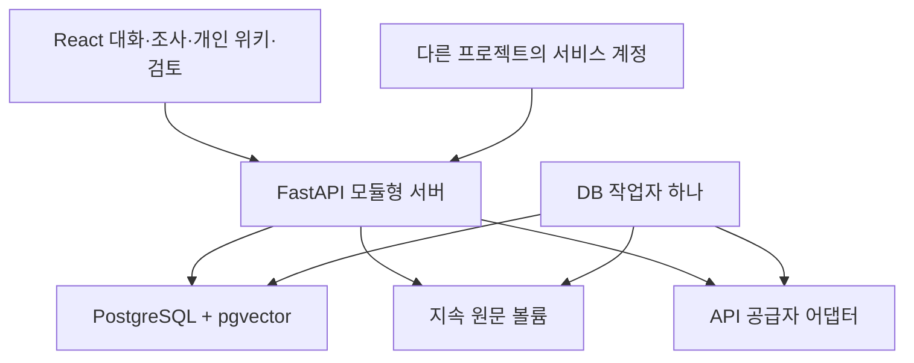

# 구현 구조와 책임

## 1. 사용자 작업에서 시작한 경계

주 작업은 대화입니다. 위키/분석은 동일 메시지 이력의 답변 형식이고 Extended는 내부 근거 탐색 깊이입니다. 새로운 대화는 위키·Extended 꺼짐으로 시작합니다. 모드, Extended, 초안, 선택 자료는 다음 요청의 상태이며 기존 답변을 재작성하지 않습니다.

관계 카드는 이미 전달한 조건·근거를 로컬에서 펼칩니다. 개념 설명, 추가 탐색, 다시 시도는 별도의 명시적 요청입니다. 원문 패널은 읽을 때마다 서버에서 현재 권한을 확인합니다. 외부 조사에서 돌아올 때 선택 자료와 질문 조건을 가져오며 자동으로 전송하지 않습니다.

외부 조사, 개인 위키, 문헌 검토는 대화와 목적이 다른 보조 공간입니다. 위키 형식 답변을 읽기 위해 독립 위키 화면으로 이동하지 않습니다. 공용 검토자는 문헌 판본의 사용을 판단하며, 개인 위키나 매 답변을 승인하지 않습니다.

## 2. 배치 구조

첫 버전에서 Redis, Celery, Kafka, 별도 그래프 DB, 다중 API 서버를 요구하지 않습니다. 정확 코사인 검색은 현재 검증 corpus의 크기에 맞으며, ANN 인덱스는 관측한 성능 병목과 품질 평가가 생긴 뒤 도입합니다. `.env`의 설정을 확인한 서버만 API 공급자에 연결합니다.

API 프로세스는 실행 중 응답 작업과 취소 이벤트를 메모리에 보유하고, 메시지·실행·이벤트 배치를 DB에 보존합니다. 재연결은 재생/복원을 수행합니다. 프로세스 중단을 새 생성 호출로 자동 복구하지 않습니다. DB 작업자는 세션 advisory lock으로 동시에 하나만 실행됩니다.

## 3. 프론트엔드 책임

| 계층 | 실제 위치 | 맡은 일 | 들어가면 안 되는 일 |
| --- | --- | --- | --- |
| View | `frontend/src/views/`, `views/components/` | 대화·5파트 위키·분석·관계/관점/출처 카드, 폼, 접근성·motion | 공급자 SDK, 서버 권한 판정, 임베딩 |
| Controller | `frontend/src/controllers/` | 로그인, 대화별 초안/다음 설정, submit/cancel/reconnect, 조사 왕복, 선택 상태, 패널 포커스 | 원문 진위 인증, 직접 DB 접근 |
| Service | `frontend/src/services/` | 제출·후속 질문 구성, 대화 reducer, 위키 파트 분리, 조사 자료 변환, 표시값 계산 | fetch·localStorage 직접 호출 |
| Repository | `frontend/src/repositories/` | HTTP/SSE 파싱, bearer 전송, 인증·초안 저장 I/O | 답변을 조립한 뒤 가짜 스트림으로 나누기 |
| DTO | `frontend/src/types/contracts.ts` | 요청·응답·메시지·이벤트 계약 | 실행 로직이나 불필요한 전달 메서드 |

`App.tsx`는 화면 조합과 Controller 연결을 맡습니다. `services/chatState.ts`는 runId/seq로 중복·늦은 이벤트를 방어합니다. `repositories/stream.ts`는 실제 스트림 연결과 재연결을 처리합니다. 서버 공급자 키를 저장하던 구형 localStorage/헤더 경로는 제거했습니다.

대화별 초안과 다음 설정은 사용자별 브라우저 저장소에 보관합니다. 같은 브라우저 복원에서는 이 설정을 우선하며, 해당 기록이 없는 장치는 서버의 마지막 제출 설정을 사용합니다. 새 대화 기본값은 항상 위키/Extended=false입니다.

## 4. 백엔드 책임

| 계층 | 위치/형태 | 맡은 일 |
| --- | --- | --- |
| Controller | 기능별 `router.py`, `main.py` health | 인증 의존성, DTO 입력, 상태 코드, Service 호출, SSE 전송 |
| Service | 기능별 `service.py`, RAG·답변 실행 모듈 | 사용 사례, 권한·상태 전이, 짧은 트랜잭션, provider 호출 조율, 최종 재검사 |
| Repository | 기능별 `repository.py` | 범위가 명시된 SQL 조회·저장, 원문 권한 조건, DB 작업 큐 |
| Entity | 기능별 `entities.py` | 테이블과 무결성·고유키·참조 모델 |
| DTO | 기능별 `dto.py`, `core/dto.py` | camelCase 요청/응답과 검증 |
| 외부 어댑터 | `integrations/` | OpenAI 실제 SSE/임베딩, 공개 URL 다운로드, 제한된 문서 해석 |

외부 어댑터는 Repository와 같은 외부 I/O 경계에서 Service에 주입합니다. 생성·임베딩 Protocol과 작은 factory만 두며, 모든 도메인을 감싸는 GenericRepository/BaseService를 만들지 않습니다. 간단한 순수 변환이나 상태 없는 GET 때문에 전달 메서드를 여러 개 쌓지 않습니다.

기능 패키지는 다음 역할로 나눕니다.

| 기능 | 주요 동작 |
| --- | --- |
| identity | 사람/서비스 계정, 비밀번호 검증, 서명 토큰, 계정 활성 상태·권한 재확인 |
| conversations | 대화/메시지 저장·목록·복원, 다음 설정, 개인 위키 제외 연결 |
| rag | 고정 검색 범위, 질문 임베딩, 공통 검색·문맥 예산·Extended·탐색 기록 |
| answers | 멱등 요청, 실행·재시도·취소, 공급자 delta, 원문 권한 재검사, 영속 이벤트·usage |
| documents | 불변 원문/판본/구간, 검토·귀속 메타데이터 정정, 즉시 접근 철회 |
| ontology | 안정적인 개념 ID, 타입/방향이 있는 관계, 출처별 설명, 현재 근거만 공개 |
| personal_wiki | 사적 LLM 정리, 조건별 병합, 판본·사용자 수정·제외 기록, 저장 직전 재검사 |
| research | 명시적 단일 문헌 검색, 실제 확보 범위, 본문 읽기, 선택 문헌의 대화 첨부 |
| jobs | 일일/즉시 색인, 파생 추출·개인 정리, 중복 방지, 상태·취소·재시도 |
| migration | 버전 고정 SQL, 평가 캐시 반입, 원래 legacy 기록과 ID mapping 보존 |

## 5. 저장하는 이유와 수명

| 저장 대상 | 실제 저장 위치 | 왜 필요한가 | 갱신 방식 |
| --- | --- | --- | --- |
| 원문 바이트 | `OW_STORAGE_PATH`의 해시 경로, 지속 볼륨 | 파싱 실패·정정·이전 때 원래 자료 복원 | 내용 해시별 불변 |
| 문헌·판본 | `documents`, `document_revisions` | 소유·공용 범위, 현재/활성 판본, 승인·색인 분리 | 새 본문은 새 판본; 활성 포인터만 전환 |
| 검색 구간 | `passages` | 원문 위치, 문맥 구성, 인용·주변 구간 | 원문 판본에 고정; 제외 사유 보존 |
| 벡터 | `embedding_records`, `passage_embeddings` | 같은 scope·프로필·실제 입력의 재계산 방지 | 입력 해시와 프로필이 같으면 재사용 |
| 검토/정정 이력 | `document_review_decisions`, `document_metadata_history` | 누가 어떤 문헌 사용을 판단했고 귀속을 바꿨는지 추적 | 이력 추가; 과거 요약은 현행에서 제외 |
| 대화·메시지 | `conversations`, `messages` | 사용자 작업 복원과 개인 정리의 원자료 | 본문은 실제 수신분을 배치 저장 |
| 실행·검색 기록 | `answer_runs`, `answer_event_batches`, `retrieval_runs` | 재연결·취소·실패 구분, 요청 설정·사용량·검색 누락 진단 | seq 이벤트 배치·terminal 상태 영속화 |
| 개념·관계 | `ontology_concepts`, `ontology_relations` | 다른 프로젝트의 안정적 참조, 관계 타입/방향/조건 | 근거 있는 추출·명시적 이전; 벡터 유사도로 생성하지 않음 |
| 출처별 설명 | `concept_source_views` | 발행자/필자/귀속 주체·측면·조건을 구분해 재사용 | 원문·메타데이터 버전에 연결, 정정 시 무효화/재추출 |
| 개인 위키 | `personal_wiki_pages`, `personal_wiki_revisions`, `personal_wiki_message_states` | 개인 재사용, 수정/되돌리기, 삭제한 정리의 재생성 방지 | 소유자·원메시지·예상 판본을 확인한 새 판본 |
| 외부 조사·첨부 | `research_items`, `document_attachments` | 읽은 범위와 대화로 가져온 자료의 연결 | 사용자 선택 시 첨부; 검색 결과 전체 수집 없음 |
| 작업 | `knowledge_jobs`, `scheduler_state` | 재시작에 남는 예약·진행·실패·취소와 일일 주기 | 고유 dedupe key, 명시적 재시도 |
| 과거 보존 | `legacy_imports`, `legacy_archive`, `legacy_mappings`, 원본 export 파일 | 실제 과거 수정/승인 이력을 잃지 않고 이전 대상을 구분 | 기본 dry-run, 원본·해시·ID 매핑; 공용 자동 편입 없음 |
| 실행 중 질문 벡터/후보 점수 | 요청 메모리 | 한 실행에서 비교·문맥 구성을 수행 | 요청 종료 후 폐기; 필요한 진단 결과만 DB 기록 |
| 실행 중 취소/구독·짧은 delta 버퍼 | API 프로세스 메모리 | 빠른 취소와 스트림 전달 | durable 메시지/이벤트 배치와 함께 사용, 메모리만으로 성공 판단 금지 |

벡터는 사람이 편집하는 지식이 아닙니다. 사용자는 원문·문헌 정보·판본·공용 사용 여부를 다루고, 시스템이 구간·벡터·파생 설명을 갱신합니다. 개인 위키를 공용 주장 DB로 승격하는 흐름은 없습니다.

원문 바이트 보존의 범위도 구분합니다. 평가 ZIP·legacy export·URL 다운로드는 확보한 원본 파일을 보존합니다. 일반 웹 파일 등록은 2MB 이하 Markdown·텍스트를 `File.text()`로 읽고 본문 JSON으로 전송하므로, 원래 인코딩·BOM까지 동일한 업로드 바이트를 보존하지는 않습니다. 이 경로는 서버가 수신한 본문을 불변 판본으로 보관합니다. 공개 URL PDF는 다운로드 5MB, 최대 30페이지·80,000자 추출 한도이며 OCR·표/그림 해석은 제공하지 않습니다.

## 6. 검색과 공개 범위

공용 기본 검색은 현재 허용된 **승인·활성 판본 집합**을 먼저 고정합니다. `sourceRevisionIds`는 이 집합을 좁힙니다. 그룹 안의 publisherId/sourceType 조건은 AND이며, 요청한 그룹마다 후보를 확보한 뒤 합칩니다. 큰 출처가 후보를 독점해 작은 요청 그룹이 사라지지 않도록 합니다.

검토 중 문헌은 `documentContextIds`, 대화 첨부는 `attachmentIds`로 분리합니다. 두 경로 모두 현재 소유자/검토자 권한을 검사하며 공유 인덱스의 승인 범위를 늘리지 않습니다. 선택 그룹은 이 요청 문맥에도 적용합니다.

그룹별 hit 수는 자료 확보 현황이며 참/거짓 확률이 아닙니다. 관계/출처별 설명도 같은 허용 판본과 현재 metadataVersion/hash를 따릅니다. 공용 추출 입력에는 승인 공용 원문, 그 메타데이터, canonical concept/aspect만 들어갑니다. 사용자의 질문 원문·사적 조건을 공용 추출에 넣지 않습니다.

새 원문을 모두 온톨로지화해야 검색이 시작되는 구조가 아닙니다. 기본 색인 활성화 뒤 제한된 후속 추출을 합니다. 현재 자동 추출은 앞쪽 최대 16구간을 다루며, 미처리 구간도 원문 RAG 검색에는 사용할 수 있습니다. 이 제한은 의미 품질 검증에서 확대 여부를 판단할 항목입니다.

## 7. 색인과 판본 전환

일일 작업의 초기 시간은 Asia/Seoul 03:00입니다. 최신 승인 판본을 모으고, 관리자가 명시적으로 요청하면 같은 경로로 즉시 실행합니다. 질문 임베딩은 요청 시 수행합니다. 문헌 갱신 주기와 질문 응답을 묶지 않습니다.

작업 시작 시 원문·프로필·메타데이터 버전을 고정합니다. 캐시 조회와 provider 호출 사이에는 DB 트랜잭션을 닫습니다. 벡터와 구간 연결은 단계별 저장할 수 있지만, **모든 구간을 준비하고 현재 승인·철회·판본·메타데이터를 다시 확인한 뒤** 활성 포인터를 원자적으로 바꿉니다. 늦은 결과는 superseded로 남습니다. 철회는 일일 주기를 기다리지 않습니다.

## 8. 프레젠테이션과 motion

화이트/블루 표면, 분명한 카드·표·출처, 데스크톱 사이드바와 모바일 내비게이션을 사용합니다. motion 참조는 [transitions.dev](https://transitions.dev/)의 Card resize/Accordion/Panel reveal/Modal 패턴입니다. 실제 구현은 작은 CSS 전환이며 reduced-motion과 키보드 포커스를 고려합니다. 실제 본문 delta에 가짜 타이핑 지연을 넣지 않습니다.
