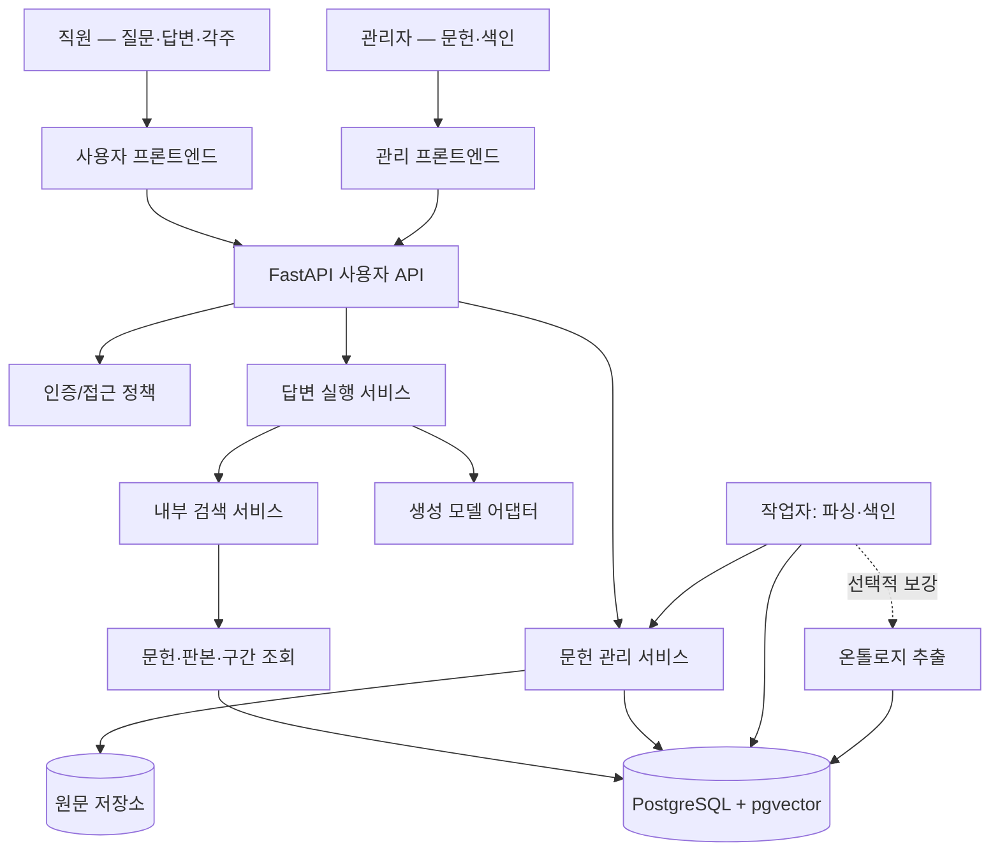

# 사내 지식 기반 AI 어시스턴트 — 목표 아키텍처

> **문서 유형:** 새 서비스의 목표 설계안(Target Architecture), **논의 초안 v0.2 · 과거 데이터 비호환 전환 반영**  
> **기준일:** 2026-10-28  
> **구현 현황 대조 기준:** `68ccd5f3bc98abd480d5a413947974aa02843a66` (문서 전처리 개선이 통합된 커밋)  
> **우선순위:** 이 문서의 **미래 목표 구조가 우선**한다. 기존 코드와의 차이는 10장의 이전·변경표에서만 설명한다. 이전 구현에 설계를 억지로 맞추지 않는다.  
> **주의:** 구현·테스트·DB 초기화·배포가 완료되었다는 뜻이 아니다. 세부 정책은 이후 대화를 통해 순차 확정한다.
>
> **2026-10-28 추가 결정:** 과거 위키/분석 답변, 개인 위키 페이지 및 이전 스키마의 호환·이관은 요구하지 않는다. 새 서비스는 새 데이터 모델과 초기 스키마를 독립적으로 설계할 수 있다. Git 기록은 코드 복원에만 사용하고, Git에 없는 실제 DB/원문 저장소는 별개로 취급한다. 기존 환경에서 파괴적 DB 명령을 실행한 것은 아니다.

## 1. 제품의 목적

### 1.1 한 문장 정의

**회사가 보유한 내부 문헌과 도메인 지식을 이용해 사용자의 업무 질문에 사내 맥락을 반영한 답변을 제공하는 AI 어시스턴트.**

직원은 온톨로지를 만들거나 문헌을 위키 페이지로 정리하려고 서비스에 들어오지 않는다. 회사에 이미 있는 문서를 바탕으로 **왜, 어떻게, 어떤 조건에서** 특정 판단이나 기술이 사용되는지 빠르게 이해하고 업무에 활용하기 위해 사용한다.

- 주요 사용 사례: 내부 기술자료·프로젝트 자료·업무 지침·검토 기록을 바탕으로 한 질의응답, 선택적 문헌 비교, 과거 결정과 적용 조건 확인.
- 부차적 사용 사례: 기술 개념 학습. **이를 별도의 위키 제품으로 개발하지 않는다.**
- 지금 검증할 제품 가설: 일반 AI 혹은 수동 문서 검색보다 **사내 맥락의 정확성과 업무 유용성**이 실제로 개선되는가?
- 전사 배포 여부는 현업 질문과 권한·자료 관리 조건을 검증한 뒤 판단한다.

### 1.2 하나의 대표 사용자 흐름

정상 답변의 성공 조건은 **정해진 목차를 모두 채우는 것**이 아니라, 사용자의 질문에 도움이 되는 설명과 검증 가능한 사내 근거를 제공하는 것이다. 비교표는 필요할 때, 다이어그램은 가능할 때만 나온다.

## 2. 확정된 범위와 비범위

| 기능 | 목표 상태 | 제품 관점의 의미 |
| --- | --- | --- |
| 질문·후속 대화·대화 이력 | **유지** | 핵심 사용자 기능 |
| 사내 자료 접근 정책·검색·문맥 구성 | **유지·개선** | RAG의 중심 |
| 문헌 파싱·전처리·검토·색인 | **유지·개선** | 관리 기능/지식 공급 경로 |
| 문장별 각주형 인용과 원문 확인 | **유지·간소화** | 사용자가 원할 때 검증 |
| 고정 다섯 섹션 답변 / 위키·분석 선택 | **제거** | 기존 위키/분석 답변 보존·복원·호환 불필요, 자유 형식 답변만 제공 |
| Extended 사용자 선택 및 별도 실행 경로 | **제거** | 하나의 내부 검색 정책만 운영 |
| 외부 문헌 검색·fetch·대화로 전송 | **제거** | 사용자의 실시간 웹 조사 도구는 MVP 밖 |
| 개인 위키·개인 위키 페이지·자동 정리 | **제거** | 신규 서비스에 불포함; 기존 페이지·자동 정리·데이터 이관 불필요 |
| 온톨로지 추출·관리 | **내부 운영/선택적 지식 보강으로 이전** | 기본 답변의 필수 선행 조건이 아님 |
| 관리자 기능 | **별도 관리 영역으로 이전·간소화** | 자료 등록·검토·활성화·진단 |
| 다이어그램 | **후순위·선택적 제공** | 이해 보조. 없어도 정상 답변 |

**명시적으로 하지 않는 일:** 별도 그래프 DB 도입, 질문마다 완전한 노드/엣지 구축, 개인 위키 자동 축적, 자동 외부 조사, 신규 다중 에이전트 플랫폼 구축, 모든 문서의 완전한 추출을 기본 답변 선행 조건으로 강제.

외부 조사 기능 제거는 과거에 수집·검토하여 내부 문헌으로 보관 중인 **자료 자체를 반드시 삭제한다는 뜻이 아니다.** 자료를 남길지는 새 지식 베이스의 실제 가치와 원본 보관 위치를 기준으로 별도 판단한다. 과거 대화·개인 위키·분석 결과를 복구하기 위해 스키마를 유지하지 않는다.

**문서 정책:** `docs/ARCHITECTURE.md`만 현재 목표 아키텍처의 정본으로 관리한다. 옛 설계 보고서와 실행 기록은 Git 역사에서 필요할 때만 조회한다. 새 구현이 완성되기 전, 보고서성 파일을 정본 문서처럼 다시 쌓지 않는다.

## 3. '엄격함' 대신 '튼튼함'의 기준

### 3.1 반드시 지켜야 하는 경계

1. **접근 권한:** 검색 단계, 모델에 보내는 문맥, 인용 열람, 과거 답변 표시 모두 현재 문헌 접근권한을 따른다. 접근 불가 자료는 추측·캐시·이전 기록을 통해 우회 노출하지 않는다.
2. **원문과 판본 무결성:** 출처가 가리키는 문헌·구간·판본을 임의로 바꾸지 않는다. 철회/교체된 자료를 현재 유효한 기준처럼 제시하지 않는다.
3. **사내 사실의 신뢰 범위:** 일반 지식을 사내 규정·사내 수치·사내 의사결정인 것처럼 표시하지 않는다. 동일한 문헌의 반복 추출을 독립 증거 여러 건으로 집계하지 않는다.
4. **외부 모델 데이터 사용:** 공급자에게 전달할 수 있는 내부 자료의 범위와 계약/정책을 확인한다. 전사 배포 전에 해결할 별도 운영 요건이다.
5. **실제 성공 상태:** 실패·중단·미확인·부분 성공을 성공으로 위장하지 않는다.

### 3.2 유연해야 하는 경계

- 일부 문서/구간이 처리에 실패해도 **유효한 다른 문헌/구간은 사용**한다.
- 모든 메타데이터, 온톨로지 관계, 수식, 다이어그램이 완성되어야 답변할 수 있는 것은 아니다.
- 내부 근거가 부분적으로만 있으면 **확인된 부분은 답하고, 부족한 부분은 표시**한다. 사내 정책·수치·결정 근거가 없는 질문에 가상의 답을 만들지 않는다.
- 범용 배경 설명이 적절한 질문이라면 일반 지식으로 설명할 수 있으나 **사내 문서 기반 내용과 구분**한다.
- 질문 종류에 맞춰 설명·표·목록을 선택하고, 고정 목차/필수 카드/필수 시각화는 강제하지 않는다.
- 추출 보류는 가급적 **문제 있는 구간 단위**로 관리하고 다른 정상 구간의 사용까지 무조건 막지 않는다. 단 원문 자체의 정합성을 확인할 수 없는 경우 해당 입력은 안전하게 보류한다.
- 불확실한 파싱·수식·표는 원문·보류 이유를 보존한다. 우회하여 모델에 넣는 것이 '유연함'은 아니다.

**운영 원칙:** 보안·기밀·무결성 오류는 안전하게 거부(fail closed). 독립된 부가기능·부분 데이터·표현의 실패는 나머지 정상 결과를 살린다(fail soft). 문제를 숨기는 '무조건 성공' 정책은 사용하지 않는다.

## 4. 목표 시스템의 경계

**기본 구성:** React/TypeScript, 모듈형 FastAPI, PostgreSQL/pgvector, 지속 원문 저장소, 백그라운드 작업자, 생성/임베딩 공급자 어댑터. 운영 규모의 병목이 관측되기 전에는 불필요한 서비스 분산·브로커·그래프 DB를 도입하지 않는다.

### 4.1 핵심 답변 파이프라인

1. **접수:** 요청 ID, 대화 소유권, 현재 사용자 권한, 중복/진행 중 요청 상태를 검사한다.
2. **검색:** 사용자가 접근 가능한 현재 유효 문헌 판본만 대상으로 검색한다. 필요한 근거를 찾아 문맥 예산에 맞게 구성한다. 구간/그룹이 일부 부족해도 확보한 근거를 무조건 버리지 않는다.
3. **생성:** 질문 목적에 맞는 형태로 답변한다. 사내 자료에서 확인한 주장과 일반 배경 설명을 구분하고, 확인 가능한 사내 주장에 실제 구간을 연결한다.
4. **출력:** 본문을 스트리밍하고 인용 번호·문헌/구간 정보·미확인 사항을 표시한다. 특정 다이어그램 포맷은 필수가 아니다.
5. **보관:** 요청/결과/부분 생성/사용량/실패를 적절히 저장하고, 재연결·명시적 취소·재시도를 지원한다. 원문 열람에는 최신 권한을 다시 적용한다.

**원칙:** 질문 처리 중에 새 온톨로지를 만들어야 한다거나, 외부 웹 검색을 해야 한다거나, 개인 위키를 갱신해야만 답변이 끝난다는 요구는 없다.

### 4.2 문헌 처리/운영 파이프라인

관리자가 자료를 등록/교체 → 원문과 판본을 보존 → 가능한 범위에서 구조를 파싱 → 검토가 필요한 표/수식/구간은 보류 상태와 사유로 표시 → 사용 가능한 구간을 색인 → 유효한 판본/검색 집합으로 반영한다.

- 파싱·추출의 성공 여부와 문헌의 열람/사용 승인 여부는 별개의 상태다.
- 일부 전처리 오류가 있어도 유효한 구간을 사용 가능한지는 분리 판단한다.
- 기존 정상 활성 판본은 신규 변환 실패 때문에 임의로 사라지지 않는다. 단 **철회된 자료는 옛 판본으로도 계속 노출하지 않는다.**
- 원문, 편집본, 변환본, 근거 구간, 검수 상태는 서로 다른 데이터 계보를 유지한다.
- 온톨로지 추출은 명시적인 관리자/운영 보조 작업으로 분리한다. 실패·지연이 문헌 검색을 막지 않는다.

## 5. 백엔드 목표 아키텍처 — 5계층

현재 코드 경로에 맞추어 설계를 제한하지 않는다. 다음은 **새 아키텍처가 가져야 할 책임**이다.

| 계층 | 목표 책임 | 하지 말아야 할 일 |
| --- | --- | --- |
| **Controller** | 사용자/관리자 API·인증 의존성·DTO 입력/출력·HTTP/SSE 상태 전달 | 검색 로직, LLM 프롬프트, 직접 DB 조작, 대규모 오케스트레이션 |
| **Service** | 답변 실행, 검색 문맥 구성, 문헌 운영·승인, 작업 정책 등의 사용 사례 조율 | 중복된 권한 규칙, 임의 SQL, 모든 기능을 하나의 거대 서비스로 집중 |
| **Repository** | DB 원자적 읽기/쓰기, 권한이 반영된 문헌/판본/구간 조회, 실행 이력·색인 상태 저장 | 모델 호출, 답변 작성, UI 형식 결정 |
| **Entity** | 문헌·판본·원문 계보·구간·임베딩·대화·실행·작업·보강 지식의 영속 구조 | UI 레이아웃, 프롬프트 문자열, 파생 답변 형식의 임의 혼합 |
| **DTO** | 사용자/관리자 요청·응답·SSE 이벤트, 신규/과거 읽기 호환 계약 | 영속 Entity 직접 노출, 비활성 기능을 신규 요청 필드로 유지 |

**기능별 모듈 내부에 위 5계층의 책임을 둔다.** 무조건 전역 Controller 폴더/Service 폴더로 모든 코드를 흩뿌리지 않는다. 공통 코드는 실제 중복과 공유되는 정책이 있을 때만 단일 책임 모듈로 추출한다.

### 5.1 백엔드 단일 책임 모듈

| 모듈(논리 이름) | 소유권 | 의존/제약 |
| --- | --- | --- |
| **Identity** | 계정·인증·권한 주체 | 사내 인증 연동은 후속 논의 |
| **Documents / Corpus** | 문헌 원본·판본·접근 정책·메타데이터·검토·철회 | 다른 서비스의 **유일한 문헌 접근 정책** 제공 |
| **Preprocessing** (Documents 하위) | 형식별 파싱·표/수식/블록 보존·출처 위치·구간 품질 표식 | 원문/구간 저장 구조와만 연결; 답변 생성 금지 |
| **Retrieval / RAG** | 문헌 후보 검색·선정·문맥 예산·검색 진단 | Documents 접근 정책을 사용; 답변 생성 금지 |
| **Answers** | 요청 멱등성·대화 응답·근거 인용 연결·스트림·취소·재연결 | Retrieval을 사용; 검색 SQL 자체 소유 금지 |
| **Conversations** | 대화·메시지 이력·사용자별 복원 | 공용 지식 원천으로 자동 승격 금지 |
| **Jobs / Indexing** | 색인/후처리 큐·상태·재시도·복구·부분 실패 기록 | API 요청 중 장시간 DB 트랜잭션 유지 금지 |
| **Ontology Enrichment** | 선택적 개념·관계·조건 추출/검토 | 주 RAG를 가로막는 필수 의존성 금지 |
| **Administration** | 운영자 사용 사례를 조합하는 얇은 경계 | Documents/Jobs/Ontology의 핵심 로직 복제 금지 |
| **Provider adapters** | 생성·임베딩 API, 호출 오류·사용량 어댑터 | 각 Agent/Service의 SDK 재구현 금지 |

### 5.2 데이터와 계약의 최소 형태

신규 질문의 의미상 필수 데이터는 **요청 식별자, 질문 문자열**, 기존 대화의 연속 질문이면 대화 ID이다. 별도 재시도를 지원할 경우 이전 실행 ID를 선택적으로 전달한다.

응답은 **답변 본문, 상태, 확인된 인용, 필요한 경고, 실행/메시지 식별자**로 충분하다. 사용자의 질문에 따라 표/목록이 생길 수 있지만 다섯 파트·출처별 관점 카드·관계 카드·다이어그램은 필수 계약이 아니다.

- 과거 저장 메시지의 `responseMode`/`extended`/관계 카드 및 위키/분석 결과는 **읽기 호환 대상이 아니다**. 새 DTO, 서비스, 화면을 과거 필드에 맞추지 않는다.
- 제거된 기능을 구 클라이언트가 실행하지 못하도록 서버에서 진입점을 제한한다. 이때 명확한 4xx 오류와 이전 안내를 주되 비활성 기능이 내부적으로 실행되지 않게 한다.
- 신규 DTO와 새 실행/이벤트 계약은 단순하게 다시 정의해도 된다. 단, **새 서비스 내부의** 멱등성·스트리밍·취소·재연결 일관성은 테스트로 검증한다.
- 새 시스템에서 등록하는 원문과 판본은 식별·추적 가능한 방식으로 관리한다. 단, **이전 시스템의 이력이나 참조 관계를 이관할 의무는 없다**.

### 5.3 인용 처리의 단일 책임

- 서버는 사용한 근거의 **실제 문헌 판본 ID + passage ID + 위치**를 보관한다.
- 생성 본문의 인용 표식은 실제 허용 근거 ID와 비교한다. 존재하지 않는 ID로 링크를 꾸며내지 않는다.
- 프론트에서는 공통 인용 매핑으로 화면 번호 **[1], [2]** 등을 부여한다. 본문·인용 목록·원문 패널의 번호가 다르면 안 된다.
- 모든 문장에 형식적으로 출처를 강요하지 않는다. **사내 사실·사내 적용 조건을 주장하는 핵심 부분**을 추적 가능하게 한다.
- 출처가 빠졌다는 이유만으로 근거 있는 다른 문장까지 무조건 폐기하지 않는다. 다만 근거 없는 사내 단정을 검증 완료로 표시하지 않는다.

### 5.4 새로운 데이터 모델과 초기화 원칙

기존 테이블에 맞추어 Entity를 설계하지 않는다. 새 요구에 필요한 최소 개념부터 정한다.

| 기본 Entity(논리명) | 목적 |
| --- | --- |
| User / Permission | 사용자 인증과 열람 가능 범위 |
| Document / DocumentRevision | 사내 원문, 현재 유효 판본과 검토 상태 |
| Passage / Embedding | 근거 구간, 문서 내 위치, 검색 표현 |
| Conversation / Message | **새 서비스에서 생성된** 질문과 답변 |
| AnswerRun / RetrievalRun | 실행 상태, 실패·취소·검색 진단과 복원 |
| Job | 색인·전처리/추출의 비동기 상태 |

인용은 실제 `DocumentRevision`과 `Passage`를 가리킨다. 독립 Citation 테이블이 정말 필요한지는 저장·성능 조건으로 결정한다. 온톨로지 Entity는 **관리 기능의 실제 요구가 있을 때** 최소 형태로 추가한다.

**초기 스키마에 포함하지 않을 것:** PersonalWikiPage/Revision, ResearchItem/Transfer, 구 위키 모드, Extended 설정, 과거 답변 이관용 LegacyArchive/LegacyMapping 등. 이미 필요하지 않다고 결정한 기능을 위해 빈 테이블을 만들어두지 않는다.

- 신규 개발 환경은 기존 개발 DB를 **별도 폐기·재생성하고 새 초기 migration으로 시작**할 수 있다. 과거 migration을 억지로 순차 실행하거나 과거 Entity FK를 유지할 필요는 없다.
- Git에서 삭제한 파일은 다시 받을 수 있지만 **실제 DB 행, 원본 PDF/XML, 인덱스 볼륨, 비밀키는 Git으로 복원되지 않는다.** DB 초기화 작업은 실제 대상 DB·파일 볼륨·계정 범위를 확인한 후 별도 실행한다.
- 이 문서 변경만으로 개발·공용·운영 DB 데이터를 지우지 않는다. 운영 DB 삭제나 실제 사내 자료 파기는 별개의 명시적 작업이다.
- **마이그레이션 규칙은 새 스키마에 적용한다.** 이미 운영 중인 새 스키마의 migration은 소급 수정하지 않지만, 버릴 기존 개발 스키마의 레거시 migration 보존을 위해 새 설계를 희생하지 않는다.

## 6. 프론트엔드 목표 아키텍처 — 5계층

일반 직원은 **하나의 대화 중심 화면**에서 질문과 출처 확인을 진행한다. 운영자는 같은 제품의 **별도 관리 영역**에서 자료를 운영한다. 둘을 별도 프론트 앱/배포로 분리할 필요는 아직 없다.

| 계층 | 목표 책임 | 하지 말아야 할 일 |
| --- | --- | --- |
| **View** | 질문·메시지·표/Markdown·각주·원문 패널·관리 UI 렌더링 | 모델 호출, 문헌 접근 허용 판정, DB/네트워크 직접 호출 |
| **Controller** | 대화 submit/cancel/reconnect, 입력·선택·라우트, 관리자 화면 사용자 동작 | 여러 개의 같은 네트워크 호출과 데이터 가공 복제 |
| **Service** | 요청 구성·대화 reducer·표현 정규화·공통 각주 번호 매핑 | fetch/localStorage 직접 호출, 서버 권한 정책 재구현 |
| **Repository** | 인증된 HTTP·SSE, 재연결·취소·브라우저 임시 상태 등 I/O | 별도 생성/근거 의미 판단, 화면 JSX 구성 |
| **DTO** | 단일 신규 질문 계약, 메시지/인용/이벤트/관리 상태 타입, 구 답변 조회 타입 | 구형 위키/Extended 요구를 신규 요청의 중심으로 유지 |

### 6.1 사용자 화면 구성

- 왼쪽: 대화 목록과 새 대화. 중앙: 질문 입력/자연어 답변. 필요한 경우: 인용 문헌/해당 구간을 여는 패널.
- **상시 노출하지 않을 것:** 외부조사, 개인 위키, 위키/분석 모드, Extended, 온톨로지 카드/그래프 편집, 모델 내부 진단값.
- 답변은 기본적으로 안전한 Markdown을 이용한다. 근거 번호는 **문장 옆**, 문헌 상세는 **클릭할 때** 로드한다.
- 검색 중/답변 중/중단/실패/자료 부족을 사용자에게 이해 가능한 메시지로 표시한다. 일부 자료 오류 때문에 전체 UI가 사라지는 일은 피한다.
- 과거 위키/분석 답변·개인 위키의 열람/복원을 지원하지 않는다. 신규 대화와 새 응답만 저장·표시한다. 구 브라우저 초안/URL은 안전하게 초기화한다.

### 6.2 관리자 화면 구성

- **문헌 목록/상세:** 원본·판본·메타데이터·사용 가능/보류 구간.
- **검색 반영 관리:** 검토·승인/철회, 색인 요청과 상태.
- **실행/문제 진단:** 실패 이유·부분 성공·중복/재시도·오래된 활성 판본 확인.
- **선택적 추출 관리:** 온톨로지 생성·진단을 고급 관리 기능으로 제공. 일반 대화 사용자는 알 필요가 없다.

관리자 화면도 5계층을 적용하되, **서비스의 핵심 비즈니스 규칙은 Documents/Jobs/Ontology가 소유**한다. Admin 화면 전용 중복 도메인 서비스를 만들지 않는다.

### 6.3 다이어그램은 플러그인 같은 보조 렌더러

초기 출시의 필수 기능이 아니다. 후속 추가한다면 제한된 형식(예: Mermaid flowchart)만 안전하게 지원하고, 파싱·렌더 실패 시 원래 설명 텍스트를 표시한다. 시각화 전용 LLM/그래프 저장소/관계 DB를 제품 MVP의 필수 요소로 만들지 않는다.

## 7. 장애/불확실성에 대한 사용자 경험

| 상황 | 기대 동작 |
| --- | --- |
| 관련 내부 근거가 충분함 | 자연어 답변 + 최소한의 클릭 가능한 각주 |
| 관련 문헌은 있으나 핵심 조건/수치 부족 | 확인 가능한 설명 제공, 부족한 부분 명시. 임의 수치 보충 금지 |
| 관련 사내 자료가 전혀 없음 | 내부 자료로는 확인 불가 안내; 일반 배경지식은 필요하면 분명히 구분 |
| 일부 표/수식/구간이 보류됨 | 해당 구간은 사용하지 않고 유효 구간으로 가능한 답변 제공. 보류 범위를 과장하지 않음 |
| 새 색인 실패 | 허용되는 기존 활성 판본 유지, 관리자에게 실패 사유. 권한 철회 자료는 계속 노출하지 않음 |
| 온톨로지 추출 실패 | 답변 검색·인용·대화는 정상. 관리자 진단만 남김 |
| 다이어그램 오류 | 설명 본문 유지, 텍스트로 안전하게 대체 |
| 모델 API 중단/실패 | 성공 답변을 꾸며내지 않고 상태·부분 결과·명시적 재시도 제공 |
| 인용이 실제 허용 구간에 연결되지 않음 | 잘못된 링크 생성 금지. 검증 가능한 다른 근거/부분 설명만 남김 |
| 문헌 접근 권한 변경 | 현재 권한을 재검사하여 비인가 원문/과거 인용을 차단 |

## 8. 코드 이전·정리의 방법

**새 아키텍처가 기준이다.** 아래 원칙으로 기존 자산을 취사선택한다.

1. 현재 정상 동작하고 목표 책임과 일치하는 것은 **유지**한다.
2. 목표 책임과 대체로 맞지만 다른 기능과 결합된 것은 **수정·분리**한다.
3. 신규 제품 범위 밖의 사용자/자동 실행 기능은 **제거·잠금**한다. 과거 위키/분석 답변과 개인 위키 이력을 보존하거나 이관하기 위해 코드를 남겨두지 않는다.
4. 현재 없는 핵심 기능은 **신규 추가**하되, 최소 모듈로 구현한다.
5. 먼저 동작하는 사용자 여정을 만들고, 실제 필요가 나타난 곳만 강화한다.
6. 다중 레이어에 동일한 정책/헬퍼를 복제하지 않는다. 하나의 소유자 모듈을 정해 호출한다.

**단순화의 핵심:** 옛 DB와 클라이언트의 호환성을 버릴 수 있으므로 코드를 얇게 만들 수 있다. 단, 현재 진행 중인 문헌 전처리 개선(원문·페이지·표·수식·보류 근거)은 사용자 가치를 위해 재사용 가능한 자산이며, '레거시'라는 이유만으로 통째로 버리지 않는다.

## 9. 단계별 이전 로드맵(순서는 제안)

| 단계 | 목표 | 검증/종료 기준 |
| --- | --- | --- |
| **A. 기능 경계 정리** | 외부조사·개인 위키·Extended·5파트 실행/경로 제거 | UI/API/큐의 비활성 기능이 동작하지 않음. 구 결과 호환 코드 없음 |
| **B. 핵심 대화 경로 완성** | 질문 → 내부 검색 → 자유 형식 생성 → 각주/원문 → 후속 대화 | 실제 승인 자료와 실사용 질문으로 끝까지 사용 가능 |
| **C. 관리자 공간 개편** | 문헌 등록·검토·전처리 보류·색인·실패 진단 | 관리자가 오류 상황에서 다음 행동을 결정할 수 있음 |
| **D. 공통 책임 정리** | 중복 로직 통합, 새 초기 DB·DTO 계약 정리 | 과거 데이터 호환 없이 새 기능에 필요한 Entity·계층만 존재 |
| **E. 현업 평가·품질 강화** | 검색 부족 vs 생성 오류 vs 전처리 오류 구분 | 고정 실업무 질문, 실제 근거, 실패/유용성 기준으로 비교 |
| **F. 선택 기능** | 다이어그램·온톨로지 보강 효과 평가 | 없어도 제품 정상, 효과 확인 시에만 확대 |

이 순서는 엄격한 워터폴 게이트가 아니다. 안정적인 핵심 흐름을 보호하면서 독립적인 개선은 병행할 수 있다.

## 10. 기존 코드와 목표 설계의 대응표 — **참고용 현황/작업 분류**

> **중요:** 이 절은 설계의 출발점이 아니다. `68ccd5f` 기준으로 **현재 갖고 있는 것과 목표에서 필요한 것의 차이**를 식별하는 변경표다. 상태는 **[유지] [수정] [제거·잠금] [신규 추가]** 중 하나이며, 실제 구현 완료를 뜻하지 않는다. 아래 경로는 현재 확인된 위치이며 리팩터링 후 반드시 이 경로를 유지해야 한다는 뜻은 아니다.

### 10.1 백엔드 5계층 대조

| 계층 | 현재 코드/기능 | 상태 | 목표에 맞게 무엇을 할 것인가 |
| --- | --- | --- | --- |
| Controller | `answers/router.py`, `conversations/router.py` | **유지** | 대화·실행·SSE API 경로 재사용, 신규 간소화 DTO 적용 |
| Controller | `main.py`에서 모든 라우터 등록 | **수정** | 직원 API와 관리자 API 구분, 비활성 기능 진입점 차단 |
| Controller | `research/router.py` | **제거·잠금** | 외부 조사 신규 API 실행 중지, 과거 자료는 별도 보존 |
| Controller | `personal_wiki/router.py` | **제거·잠금** | 개인 위키 API 삭제; 새 DB에서 데이터 이관하지 않음 |
| Controller | `documents/router.py`, `ontology/router.py`, `jobs/router.py` | **수정** | 운영/관리 기능으로 이전, 일반 인용 원문 읽기는 최소 경로 유지 |
| Controller | 관리자 전용 API 구성 | **신규 추가** | 문헌·검토·색인·추출·진단을 묶은 얇은 경계(기존 도메인 로직 재사용) |
| Service | `answers/service.py`, `answers/execution.py` | **수정** | 답변·스트림은 유지, 개인 위키 자동 enqueue·구 모드 의존 제거 |
| Service | `answers/prompt.py` | **수정** | 고정 5개 섹션/응답 모드 분기 대신 사내 맥락의 유연한 답변 정책 |
| Service | `rag/service.py`, `rag/grounding.py`, `rag/planning.py` | **수정** | 하나의 내부 검색 경로, Extended 분기 제거, 온톨로지 선택적 보강 분리 |
| Service | `documents/service.py`, `documents/preprocessing.py`, `documents/runtime_preprocessing.py` | **유지** | `68ccd5f` 전처리 보존/보류 자산 재사용. 실제 검색 품질 평가에 따라 보완 |
| Service | `jobs/indexing.py` | **수정** | 색인 후 `ontology_extract` 자동 enqueue는 필수 경로에서 분리 |
| Service | `jobs/worker.py` | **수정** | 개인 위키 작업의 신규 소비 중지, 기존 큐를 안전하게 보존·종료 |
| Service | `personal_wiki/service.py`, `research/service.py` | **제거·잠금** | 신규 서비스에서 완전 제외. 기존 코드/DB 호환 계층을 두지 않음 |
| Repository | `documents/repository.py` | **수정** | 현재 문헌 판본/접근 정책의 단일 소유자, 검색·원문 조회·재확인에 공유 |
| Repository | `answers/repository.py` 등 실행 이력 저장소 | **유지** | 멱등성, 저장/재생, 사용량 및 실패 상태 유지 |
| Repository | `ontology/repository.py` | **수정** | 운영자·선택적 보강 조회로 제한, 일반 검색의 필수 조건 제거 |
| Entity | `documents/entities.py`, `answers/entities.py`, `conversations/entities.py`, `jobs/entities.py` | **수정** | 기능 개념은 재사용하되 새 DB를 기준으로 최소 Entity/초기 migration을 다시 설계 |
| Entity | `personal_wiki/entities.py`, `research/entities.py` | **제거·잠금** | 새 초기 스키마에서 테이블 제외; 과거 이력 아카이브·참조 관계 호환 불필요 |
| Entity | 전사 접근범위/자료 보안 메타데이터 | **신규 추가** | 실제 배포 정책이 확정된 최소 범위만 설계·이전. 추상적 ACL 엔진부터 만들지 않음 |
| DTO | `rag/dto.py`, `answers/dto.py`, `conversations/dto.py` | **수정** | 단일 질문 계약으로 재설계, 과거 위키/분석·Extended 필드/값과 비호환 허용 |
| DTO | 관리/보류/부분 실패 상태의 읽기 계약 | **신규 추가** | 필요한 UI에만 최소 데이터 제공, 원문/영속 Entity 직접 노출 금지 |

### 10.2 프론트엔드 5계층 대조

| 계층 | 현재 코드/기능 | 상태 | 목표에 맞게 무엇을 할 것인가 |
| --- | --- | --- | --- |
| View | `App.tsx`, `ConversationView.tsx` | **수정** | 단일 직원 대화 중심 + 별도 관리자 공간. 조사·위키·모드·Extended UI 제거 |
| View | `MessageCard.tsx` | **수정** | 단일 Markdown 렌더링. 과거 위키/분석 답변 분기 삭제 |
| View | `SafeMarkdown.tsx`, `SourcePanel.tsx` | **유지** | 안전한 Markdown/인용·원문 패널 재사용, 각주 표현 간소화 |
| View | `ResearchView.tsx`, `PersonalWikiView.tsx` | **제거·잠금** | 신규 화면/라우트에서 제외. 소스 보존·삭제는 별도 판단 |
| View | `ReviewView.tsx` 및 문헌 업로드 UI | **수정** | 일반 대화에서 빼서 관리자 문헌 관리로 이전 |
| View | 관리자용 진단·보류 표시 화면 | **신규 추가** | 전처리 보류 구간/색인 결과/재시도 상태를 한곳에서 확인 |
| View | 선택형 다이어그램 렌더러 | **신규 추가** | **후순위**, 제한된 형식만; 실패하면 본문 텍스트 표시 |
| Controller | `useConversationController.ts` | **수정** | 대화·스트림·초안/인용 중심으로 축소, 개인 위키·조사·관계 후속 경로 제거 |
| Controller | `useSourceController.ts` | **수정** | 인용 원문 열람만 주력, 온톨로지 출처 카드 직접 관리 경로 분리 |
| Controller | `useResearchController.ts`, `useWikiController.ts` | **제거·잠금** | 일반 대화 앱에서 import/실행하지 않음 |
| Controller | `useReviewController.ts`, `useDocumentController.ts` | **수정** | 관리자 화면의 문헌 검토·등록·상태 관리로 이전 |
| Service | `conversationService.ts`, `chatState.ts` | **수정** | `splitWiki`, `WIKI_SECTIONS`, 위키/Extended 신규 입력 제거, 대화 reducer 보존 |
| Service | 공통 인용 ID↔번호 매핑 | **신규 추가** | 기존 단편 로직을 하나로 모아 본문·리스트·패널이 공유 |
| Service | `researchService.ts` | **제거·잠금** | 신규 사용자 흐름에서 제외 |
| Repository | `repositories/http.ts`, `stream.ts` | **유지** | 공통 인증된 HTTP, SSE 파싱/재연결 I/O 보존 |
| Repository | `repositories/api.ts` | **수정** | 대화/문헌/관리 API를 기능별로 분리, 비활성 연결 제거 |
| Repository | `workspaceStorage.ts` | **수정** | 구 브라우저 초안/라우트 복원·마이그레이션 제거, 신규 상태로 초기화 |
| DTO | `types/contracts.ts` | **수정** | 신규 질문·인용·이벤트·관리 계약만 남기고 구형 메시지 조회 타입 삭제 |
| DTO | 관리자 보류/진단 타입 | **신규 추가** | 백엔드 관리 응답에 해당하는 최소 타입 |

### 10.3 바로 다음에 재확인해야 할 사항

- `68ccd5f`의 **실제 최신 통합 상태**를 기준으로 다른 대화의 변경점을 다시 비교한다. 특히 표·수식/보류 구간/원문 위치의 변경은 구형 아키텍처 내용을 우선하지 않는다. 새 구조는 **기존 DB 참조 관계를 보존할 의무가 없다**.
- 코드 경로와 계층명보다 **사용자 흐름, 단일 책임, 실패 격리**가 목표에 부합하는지 먼저 논의한다.
- 원격에 올라간 전처리 테스트와 보고는 전처리 경계 검증이며 **전체 검색·RAG 답변 품질이 개선되었다는 검증과는 다르다.**
- 이 문서에 없는 세부 계약은 임의로 "이미 확정" 처리하지 않는다.

## 11. 후속 대화에서 하나씩 확정할 설계 질문

아래 질문은 한 번에 확정하거나 필요 이상의 엄격한 규칙을 만들기 위한 체크리스트가 아니다. 순서대로 실제 사용자 사례와 현재 구현을 대조해 결정한다.

1. **누가, 어떤 내부 자료로 질문하는가?** 초기 직원 집단, 문헌 범위, 조직 내부에서 공식 기준으로 취급할 자료의 차이.
2. **정답/부분 답변의 기준은?** 일반 배경 설명 허용 범위, 문헌 간 충돌, 자료가 아예 없을 때의 안내.
3. **근거 UX는 어느 정도인가?** 문장 옆 각주, 원문 구간 이동, 기존 답변의 오래된 인용 표시.
4. **문서 운영의 최소 절차는?** 누가 업로드·승인·보류 해제·색인 재시도를 할지, 일부 보류가 남은 문헌을 어떻게 표시할지.
5. **온톨로지는 무엇에 실질적으로 도움이 되는가?** 검색 재현율이나 답변 유용성 개선이 확인될 때만 보강 경로 확대.
6. **무엇을 측정할 것인가?** 실제 업무 질문 기반 검색 누락/전처리 오류/생성 오류를 분리한 작은 평가 집합.
7. **전사 배포 전 무엇이 필요한가?** 접근 제어, 데이터 전송 승인, 운영 로그·보관·지원 체계.

## 12. 완료 정의가 아니라 다음 설계 출발점

현재 확정한 것은 **제품 목적과 책임 경계**다. 구현 형식, 세부 API·메타데이터·전처리 보류 허용 기준·평가 수치·다이어그램 채택 여부는 다음 대화에서 현업 사례를 보며 조정할 수 있다.

**설계의 성공 기준은 모든 오류를 막도록 코드를 두껍게 만드는 것이 아니라, 정상적인 질문에는 잘 답하고 일부가 잘못돼도 가능한 부분을 유지하며, 실제로 위험한 오류만 적절하게 격리하는 것**이다.

레거시 DB·답변 보존과 이관은 목표에서 제외한다. 과거 구현이 아닌 신규 서비스의 실제 가치와 책임을 기준으로 이후 항목을 하나씩 구체화한다.
