# 반도체 공정·소자 인과 온톨로지 위키: 백엔드 아키텍처 및 지원 규격서

> **[문서 목적]**: 확정된 프론트엔드 화면 명세서(`docs/frontend_screens_specification.md`)의 모든 기능(적응형 Level 3 실무 카드, 2단계 비교분석 및 파라미터 튜닝 상담자, 2-Segment 검토 센터, 2단계 외부 문헌 조사 등)을 기술적으로 뒷받침하기 위한 백엔드 데이터 모델, AI 인과 추론 파이프라인, REST API 규격, 비기능 아키텍처를 정의하는 공식 기술 문서입니다.

---

## 목차

1. [백엔드 설계 원칙 및 시스템 개요](#1-백엔드-설계-원칙-및-시스템-개요)
2. [1단계: 온톨로지 코어 데이터 모델 & 엔티티 스키마](#2-1단계-온톨로지-코어-데이터-모델--엔티티-스키마)
   - 2.1 `Concept` (온톨로지 핵심 개념 엔티티)
   - 2.2 `PerspectiveCase` (적응형 Level 3 실무 사례 엔티티)
   - 2.3 `ComparisonSession` (기술 대안 비교 세션 엔티티)
   - 2.4 `ReviewTicket` (검토·승인 거버넌스 티켓 엔티티)
   - 2.5 `EvidenceSource` 및 `KnowledgeCandidate` (공인 출처 및 지식 후보 DTO)
   - 2.6 [아키텍처 당위성] 풍부한 도메인 모델(Aggregate)을 채택한 설계 이유
3. [2단계: AI 에이전트 & 인과 추론 파이프라인 아키텍처](#3-2단계-ai-에이전트--인과-추론-파이프라인-아키텍처)
   - 3.1 대화형 질문 구체화 파이프라인 (Clarifier Engine)
   - 3.2 다차원 기술 대안 비교 매트릭스 생성기 (Comparison Engine)
   - 3.3 AI 파라미터 튜닝 상담 파이프라인 (Advisor Engine)
   - 3.4 지식 무결성 검증 및 초안 재작성 파이프라인 (Directive Engine)
   - 3.5 공인 문헌 교차 분석 및 초안 합성기 (Deep Research Engine)
   - 3.6 인라인 문맥 맞춤 해설 파이프라인 (Contextual Explainer Pipeline)
4. [3단계: 화면별 REST API 엔드포인트 명세](#4-3단계-화면별-rest-api-엔드포인트-명세)
   - 4.1 시스템 공통 & 전역 서비스 API
   - 4.2 [Tab 1] 위키 본문 & 인과 온톨로지 브라우저 API
   - 4.3 [Tab 2] 기술 대안 비교분석 API (Comparison Studio)
   - 4.4 [Tab 3] 지식 거버넌스 및 검토·승인 센터 API (Review Center)
   - 4.5 [Tab 4] 외부 문헌·백서 조사 API (Deep Research)
   - 4.6 전역 플로팅 챗봇 API (Floating Engineering Chatbot)
5. [4단계: 실시간 동기화, 캐시 및 보안 아키텍처](#5-4단계-실시간-동기화-캐시-및-보안-아키텍처)
   - 5.1 다계층 캐싱 전략 및 0ms 서빙 아키텍처 (Multi-Tier Caching & Invalidation)
   - 5.2 실시간 이벤트 스트리밍 및 전역 동기화 아키텍처 (Real-Time Streaming & Event Sync)
   - 5.3 분산 동시성 제어 및 지식 불변 감사 추적 (Concurrency Control & Audit Trail)
   - 5.4 반도체 데이터 보안 및 권한 거버넌스 (Security & Access Governance: RBAC/ABAC)
   - 5.5 결함 감내 및 우아한 성능 저하 (Fault Tolerance & Graceful Degradation)

---

## 1. 백엔드 설계 원칙 및 시스템 개요

1. **무결성과 할루시네이션(환각) 제로**:
   - 일반 챗봇의 자유로운 환각 생성을 엄격히 배제하며, 모든 추론은 공인 출처(`EvidenceSource`)와 인과 온톨로지 그래프 관계를 선행 조건으로 삼는다.
2. **엔지니어링 실험 재현성 (Reproducibility)**:
   - 비교분석 및 파라미터 튜닝 결과는 스냅샷 불변 보존 원칙을 통해 1년 뒤에 조회해도 완전히 동일한 수치와 매트릭스로 복원된다.
3. **지식 거버넌스 감사 추적 (Audit Immutability)**:
   - 검토·승인 티켓은 승인 시점의 원문, AI 초안, 전문가 지시문, 무결성 점검 지표를 스냅샷으로 영구 보존하여 법적·기술적 감사 신뢰성을 확보한다.

---

## 2. 1단계: 온톨로지 코어 데이터 모델 & 엔티티 스키마

### 2.1 `Concept` (온톨로지 핵심 개념 엔티티)
- **역할**: [Tab 1] 위키 본문의 메인 지식이자 온톨로지 인과 그래프의 핵심 노드.

```typescript
interface Concept {
  id: string;                     // 불변 고유 식별자 (예: "concept-dry-etch-001")
  title: string;                  // 국문 공식 명칭 (예: "플라즈마 건식 식각")
  engName: string;                // 영문 학술 명칭 (예: "Plasma Dry Etching")
  aliases: string[];              // 현장 약어 및 별칭 (예: ["RIE", "건식 식각"])
  
  // 🏛️ 업무 분야 4축 & 📐 물리 규모 5단계 매핑
  domainFacet: "device" | "unit_process" | "operations" | "materials_infra";
  processCategory: string;        // 단위 카테고리 (예: "식각 공정", "첨단 패키징", "FDC 이상감지")
  scaleLevel: 1 | 2 | 3 | 4 | 5;  // 1(<1nm) ~ 5(팹 인프라 1km)
  scaleName?: string;             // 물리 규모 표기명 (예: "L3 단위 공정")
  
  // 버전 및 상태 거버넌스
  version: string;                // 현재 공식 판본 (예: "v1.2")
  status: "adopted" | "in_review" | "deprecated"; // 채택됨 / 검토중 / 폐기됨
  lastReviewedAt: string;         // 최종 승인 일자 (ISO-8601)
  lastReviewedBy: string;         // 최종 승인 전문가 식별자 (예: "Dr. 김수석 (수율분석팀)")
  
  // 5대 표준 섹션 콘텐츠
  summary: string;                // [L1] 백과사전식 기본 정의
  purpose: string;                // [L1] 공정/소자 도입 목적
  principles: Array<{             // [L2] 물리·화학적 메커니즘 단계별 리스트 (아코디언 및 수식 지원)
    step: number;
    title: string;
    content: string;
    formula?: string;             // LaTeX 수식 문자열
  }>;
  limitations: Array<{            // [L2] 미세화 물리 한계 및 트레이드오프 위험 리스트
    title: string;
    description: string;
    evidenceIds: string[];
  }>;
  
  // 온톨로지 관계 그래프 (Graph Edges)
  relations: {
    is_a: Array<{ id: string; name: string }>;       // 상위 개념 (예: 식각 공정)
    part_of: Array<{ id: string; name: string }>;    // 하위 장비/부품 (예: RF 제너레이터)
    next_step: Array<{ id: string; name: string }>;  // 후속 단위 공정 (예: PR 애싱)
    
    // 🌟 [추가 1: 3.1 Clarifier 지원] 경쟁 대안 기술 경로 (Competing / Alternative Technologies)
    alternative_to?: Array<{
      targetId: string;       // 경쟁 대안 개념 ID (예: "tc-ncf")
      targetName: string;     // 대안 명칭 (예: "마이크론 TC-NCF")
      commonGoal: string;     // 공통 공학 과제 (예: "고단 HBM 방열 및 휨 제어")
      tensionNote: string;    // 인과적 대립축 (예: "액상 일괄 몰딩 vs 박형 필름 열압착")
    }>;

    // 🌟 [추가 2: 3.3 Advisor 지원] 극성(Polarity) 기반 인과 엣지 (Causal Relations)
    causalEdges?: Array<{
      targetId: string;       // 대상 물리량/결함/지표 ID (예: "micro-void", "fab-tat", "etch-rate")
      targetName: string;     // 대상 명칭
      polarity: "+" | "-";    // '+' = 원인 증가 시 결과 증가(비례), '-' = 원인 증가 시 결과 감소(반비례)
      relationType: "causes" | "caused_by" | "trade_off";
      mechanism?: string;     // 지배 물리·화학 메커니즘 공식/설명
    }>;
  };
  
  evidenceIds: string[];          // 귀속된 공인 출처 ID 목록 (["E-01", "E-02"])
}
```

---

### 2.2 `PerspectiveCase` (적응형 Level 3 실무 사례 엔티티)
- **역할**: [Tab 1] 위키 본문의 3번 섹션. 챔버 레시피, Q-Time, 소자 신뢰성, 패키징 물성 등 반도체 전 영역의 실무 조건을 유연하게 담아내는 도메인 독립적 카드 데이터.

```typescript
interface PerspectiveCase {
  id: string;                     // 관점 식별자 (예: "company-a-hbm", "domain-memory")
  conceptId: string;              // 소속 개념 ID
  label: string;                  // 탭 표시명 (예: "A사 HBM3E P-Line")
  description: string;            // 관점 배경 설명 (스티키 바 하단 노출)
  
  // 🌟 도메인 독립적 적응형 실무 카드 (Adaptive Level 3 Block)
  appliedCase: {
    caseTitle: string;            // 실무 사례 표제 (예: "HBM TSV HARC 식각 중 바닥 보이드 대응")
    code?: string;                // 관리 코드 (예: "ET-HARC-04", "JESD92", "QTIME-01" - 없으면 null)
    narrative: string;            // 실무 적용 맥락 설명 (왜 이 규칙/조건이 필요한지 2~3줄)
    
    // 핵심 적용 사양/기준 (유연한 Key-Value & 인라인 출처 연동)
    specifications: Array<{
      label: string;              // 항목명 (예: "본딩 가압력", "RF 소스 파워", "보이드율")
      value: string;              // 수치/조건 (예: "250N", "800W", "0.05%")
      
      // 🌟 [추가 1: 3.3 Advisor 지원] 반도체 제어공학 표준 인과 역할
      role?: "control_knob"       // 🎛️ 조작 변수(Manipulated Variable): 엔지니어가 직접 조절하는 공정 인자 (압력, 온도, 가스 유량 등)
           | "kpi_target"         // 🎯 제어/목표 변수(Controlled Variable): 무너지면 안 되는 품질 지표 (보이드율, 식각선택비, TAT 등)
           | "ambient_limit";     // 🛑 외란/제약 변수(Disturbance/Limit): 장비/팹 환경 불변 한계 (최대 파워, 배기압 등)
      
      // 🌟 [추가 2: 3.2 Comparison 지원] 다차원 비교 축 카테고리 매핑
      category?: "thermal" | "defects" | "fab" | "custom"; // 비교 축 분류 코드
      categoryLabel?: string;                               // 표기용 라벨 (예: "🔬 열·물성")
      
      evidenceId?: string;        // 특정 항목별 근거 출처 연동 (예: "E-03")
    }>;
    
    caution: string;              // ⚠️ 현장 제약 및 트레이드오프 주의사항
    evidenceId?: string;          // 대표 공인 출처 ID
  } | null;                       // default(공통 기본 지식) 관점일 경우 null
}
```

---

### 2.3 `ComparisonSession` (기술 대안 비교 세션 엔티티)
- **역할**: [Tab 2] 기술 대안 비교분석의 2단계 독립 화면, 세션 폴더/즐겨찾기, 3-Step 스냅샷 및 AI 파라미터 튜닝 상담 이력 보존.

```typescript
interface ComparisonSession {
  id: string;                     // 세션 고유 ID (예: "sess-20261016-001")
  userId: string;                 // 세션 소유 엔지니어 ID
  title: string;                  // 세션 제목 (예: "HBM3E 방열 대안: SK하이닉스 vs 마이크론")
  isPinned: boolean;              // ⭐ 즐겨찾기 고정 여부
  folderId?: string;              // 📁 소속 프로젝트 폴더 ID (미분류 시 null)
  
  // 조사 요청 전제 파라미터 (화면 2-A)
  query: string;                  // 초기 고민 질의 (예: "HBM 열 문제")
  contextParams: {
    targetA: string;              // 기준 대상 A (예: "SK하이닉스 (MR-MUF)")
    targetB: string;              // 대조 대상 B (예: "마이크론 (TC-NCF)")
    domain: string;               // 평가 도메인 (예: "첨단 패키징")
    releaseVersion: string;       // 기준 온톨로지 판본 (예: "2026.10")
    
    // 🌟 [추가 1: 3.1 Clarifier 지원] 현장 엔지니어의 라인 제약 조건 (초기 감지 또는 설정)
    constraints?: Array<{
      param: string;              // 제약 파라미터명 (예: "본딩 가압력", "RF 파워")
      operator: "<=" | ">=" | "==";
      limitValue: string;         // 한계 수치 (예: "150N", "600W")
      source: "user_prompt" | "fab_profile"; // 자연어 질의에서 추출되었는지 팹 프로필 기본값인지
    }>;
  };
  
  // 3-Step 스냅샷 타임라인 데이터 (화면 2-B)
  snapshots: [
    { step: 1; title: "공학 질문 확정"; branchData: any },
    { 
      step: 2; 
      title: "양산 조건 매핑"; 
      conditions: Record<string, any>;
      
      // 🌟 [추가 2: 3.2 Comparison 지원] 기준 레시피와 현장 제약 간 괴리 자동 감지
      constraintGaps?: Array<{
        param: string;            // 괴리 파라미터명 (예: "본딩 가압력")
        standardValue: string;    // 기준 레시피 수치 (예: "250N")
        constraintValue: string;  // 현장 한계 수치 (예: "150N")
        riskNote: string;         // 위험 요약 (예: "접촉 면적 부족으로 보이드 증가 위험")
      }>;

      // 🌟 [추가 3: 3.3 Advisor 지원] 인과 보상 튜닝 상담 이력
      tuningHistory?: Array<{
        userPrompt: string;       // "장비 한계로 가압력을 150N 이상 못 줄 때 어떻게 하지?"
        advisorRecommendation: {
          compensationA: any;     // 추천안 A (초음파 시간 보상 + TAT 트레이드오프)
          compensationB: any;     // 추천안 B (온도 보상 + Warpage 트레이드오프)
        };
      }>;
    },
    { 
      step: 3; 
      title: "다차원 비교 분석 완료"; 
      
      // 🌟 [추가 4: 3.2 Comparison 지원] 축 카테고리, 공인 출처, 지식 갭 영구 보존 매트릭스
      matrix: Array<{
        axis: string;             // 축 명칭 (예: "16단 고단 적층 시 휨 및 보이드")
        axisCategory?: "thermal" | "defects" | "fab" | "custom";
        categoryLabel?: string;   // 표기 라벨 (예: "⚠️ 결함·신뢰성")
        valA: string;             // 기준 대상 A 실측치
        valB: string;             // 대조 대상 B 실측치
        evidenceA?: string;       // 복원용 공인 출처 ID (예: "E-11")
        evidenceB?: string;       // 복원용 공인 출처 ID (예: "E-12")
        isGap?: boolean;          // 🌟 갭 여부 영구 보존 (true 시 ⚠️ 공인 데이터 미등록 태그 렌더링)
      }>;
      
      aiCausalNote: string;       // AI 종합 인과 분석 코멘트
      
      // 🌟 [추가 5: 3.2 Comparison 지원] 꼬리질문 이력 영구 보존
      deepDiveHistory?: Array<{
        query: string;            // 사용자가 던진 꼬리물기 질문
        causalPath: string[];     // ["가압력 누적", "CTE 미스매치", "전단응력", "다이 휨"]
        explanation: string;      // 물리 메커니즘 심층 해설
        timestamp: string;
      }>;
    }
  ];
  
  exportedReviewId?: string;      // 3번 검토 센터로 이관된 티켓 ID (연동 시)
  updatedAt: string;
}
```

---

### 2.4 `ReviewTicket` (검토·승인 거버넌스 티켓 엔티티)
- **역할**: [Tab 3] 검토·승인 센터의 2-Segment 탭(`대기 중` ⟷ `승인 완료 이력`), 2-Pane Diff 및 에디터, AI 보완 지시 이력 및 감사 불변성 보장.

```typescript
interface ReviewTicket {
  id: string;                     // 티켓 ID (예: "rev-20261016-001")
  conceptId: string;              // 대상 개념 ID (예: "concept-tcb")
  conceptTitle: string;           // 대상 개념명 (예: "열압착 본딩 (TCB)")
  title: string;                  // 티켓 안건 제목 (예: "TCB 16단 적층 시 145N 가압 조건 및 시간 보상 파라미터 추가")
  reviewType: "신규 개념" | "관점 추가" | "파라미터 수정" | "외부 문헌 발굴";
  author: string;                 // 작성자 (엔지니어명 또는 "AI 비교 스튜디오", "조사 에이전트")
  department?: string;            // 소속 부서 (예: "수율분석팀")
  submittedAt: string;            // 티켓 상신 일시 (ISO-8601)
  status: "pending" | "approved" | "rejected"; // 🌟 pending ➔ 대기 중 탭, approved ➔ 승인 완료 이력 탭
  
  // 🌟 [추가 6: 거버넌스 역링크 지원] 출처 세션 및 유입 경로
  sourceSessionId?: string;       // 역링크용 원본 비교/조사 세션 ID (예: "sess-20261016-001", "res-20261016-001")
  originType?: "comparison_studio" | "literature_search" | "manual_expert"; // 유입 경로
  
  // 2-Pane Diff 대조 데이터
  currentVersion: string;         // 기준 위키 판본 (예: "v1.2")
  targetVersion?: string;         // 승인 시 배포될 예정 판본 (예: "v1.3")
  currentContent: string;         // 좌측 Pane: 현재 위키 본문
  aiMergedDraft: string;          // 우측 Pane: AI 통합 반영 초안
  humanEdits?: string | null;     // 전문가가 직접 편집기로 수정한 텍스트 (저장 시)
  // 🌟 [추가 7: 3.4 Directive 지원] 정형 사양 및 온톨로지 관계 패치 페이로드
  structuredPatches?: {
    specsPatch?: Array<{ label: string; oldValue: string; newValue: string; role?: string }>;
    relationsPatch?: {
      addedEdges?: Array<{ targetId: string; relationType: string; polarity?: "+" | "-" }>;
      removedEdges?: string[];
    };
  };

  // 실시간 자동 무결성 점검 리포트
  integrityReport: {
    evidenceMatchRate: number;    // 출처 일치도 (예: 1.0 = 100%)
    hasOntologyConflict: boolean; // 온톨로지 충돌 여부 (false)
    impactScopeCount: number;     // 영향받는 연관 개념 수 (예: 2)
    validationDetails: string;
    conflictDetails?: Array<{     // 충돌 감지 시 상세 원인과 해결 가이드
      conflictId: string;
      type: string;
      description: string;
      suggestedFix: string;
    }>;
  };
  
  // 에이전트 초안 보완 지시 이력
  directiveHistory: Array<{
    directiveId?: string;
    directiveText: string;        // 사용자의 지시문
    targetLayer?: "prose" | "specs" | "relations" | "hybrid"; // 🌟 지시 대상 계층
    previousDraft?: string;
    revisedDraft?: string;
    overrideReason?: string;      // 공인 출처 충돌 강제 반영 시 입력한 사유
    timestamp: string;
  }>;
  
  approvedAt?: string;            // 승인 완료 일시 (ISO-8601)
  approvedBy?: string;            // 최종 승인자 ID
  appliedConceptVersion?: string; // 발행된 신규 판본 (예: "v1.3")
}
```

---

### 2.5 `EvidenceSource` 및 `KnowledgeCandidate` (공인 출처 및 지식 후보 DTO)
- **역할**: `[D-01]` 근거 드로어, [Tab 4] 외부 문헌 조사에서 공인 출처 신뢰성을 보증하고, 화면 4-B에서 3번 검토 센터로 이관되기 전의 지식 후보 카드를 정형화.

```typescript
interface EvidenceSource {
  id: string;                     // 출처 ID (예: "E-01", "E-2026-TGV-01")
  sourceName: string;             // 출처 명칭 (예: "Lam Research 극저온 공정 백서")
  sourceType: "official_whitepaper" | "international_standard" | "academic_peer_reviewed" | "internal_approved";
  publisher: string;              // 발행 기관 (Samsung, SK hynix, ASML, Lam, Intel, SEMI, IEEE 등)
  publishedDate: string;          // 발행 연월 (예: "2026.01")
  quote: string;                  // 공인 규격/백서 원문 인용문 전문
  sectionContext?: string;        // 🌟 원문 상세 위치 (예: "Section 4.2 Experimental Results, p.14 Table 2")
  relevanceScore?: number;        // 🌟 질의 및 대상 개념과의 의미적 연관도 점수 (예: 0.98)
  externalUrl: string;            // DOI 또는 공식 웹페이지 URL
  urlLabel: string;               // 링크 버튼 라벨
  credibilityTier: "Tier 1 (공식 제조사)" | "Tier 2 (국제 표준)" | "Tier 3 (공인 학술)";
  referencedConcepts?: Array<{    // 본 출처를 인용 중인 온톨로지 개념 목록 (`[D-01]` 드로어 하단 표시)
    conceptId: string;
    name: string;
  }>;
}

// 🌟 [추가: 3.5 Deep Research 지원] 화면 4-B 지식 후보 카드 DTO
interface KnowledgeCandidate {
  candidateId: string;            // 후보 고유 식별자 (예: "cand-20261016-01")
  candidateType: "신규 개념" | "관점 추가" | "물리 한계 보완";
  title: string;                  // 후보 카드 표제 (예: "유리기판 관통전극 (TGV)")
  targetConceptId?: string | null;// 관점/한계 보완 시 소속 개념 ID (신규 개념일 경우 null)
  summary: string;                // 종합 기술 브리핑 요약
  draftPayload: {                 // 3번 검토 센터 ReviewTicket으로 자동 이관될 페이로드
    content: string;              // 합성된 Markdown 초안
    specifications?: Array<{      // 정형 사양 (Key-Value & Role)
      label: string;
      value: string;
      role?: "control_knob" | "kpi_target" | "ambient_limit";
    }>;
    relations?: {                 // 추천 온톨로지 관계 엣지
      is_a?: string;
      alternative_to?: string;
    };
  };
  evidenceIds: string[];          // 인라인 연동된 공인 출처 ID 목록 (["E-2026-TGV-01", "E-2026-TGV-02"])
}

// 🌟 [추가: 3.6 Contextual Explainer 지원] 인라인 등록 개념 팝오버 문맥 해설 DTO / 캐시 스키마
interface ContextualExplanationDTO {
  childConceptId: string;         // 호버된 하위 전문 용어 ID (예: "concept-imc")
  parentConceptId: string;        // 기준 부모 개념 ID (예: "concept-tcb")
  perspectiveId?: string;         // 적용 맥락 관점 ID (예: "yield")
  title: string;                  // 대상 개념 표제 (예: "금속간 화합물 (Intermetallic Compound, IMC)")
  aliases?: string[];             // 현장 별칭 (["IMC", "금속간 화합물"])
  definition: string;             // 백과사전식 기본 핵심 정의
  contextSentence: string;        // 부모 문서 맥락 맞춤 1~2문장 해설
  cached?: boolean;               // 캐시 적중 여부
  cachedAt?: string;              // 사전 컴파일 일시 (예: "2026-02-15")
  sourceEvidence?: {              // 인라인 근거 출처 요약
    evidenceId: string;
    sourceName: string;
    quote: string;
  };
  relatedOntologyNodes?: Array<{  // 팝오버 하단 [🔗 연관 온톨로지] 1-hop 칩
    conceptId: string;
    name: string;
    relation: "part_of" | "causes" | "caused_by" | "trade_off" | "is_a";
    relationLabel: string;
  }>;
  deepLink: string;               // "본문으로 이동 ➔" URL (/wiki/concept-imc)
}

// 🌟 [추가: 3.6 Contextual Explainer 지원] 위키 본문 조회 시 0ms 팝오버 프리페치 응답 DTO
interface ConceptDetailResponse extends Concept {
  perspectives: Array<any>;       // 도메인/직무별 적응형 실무 관점 카드 목록
  preloadedExplainers?: Record<string, Partial<ContextualExplanationDTO>>; // { [childConceptId]: ContextualExplanationDTO }
}
```

---

### 2.6 [아키텍처 당위성] 풍부한 도메인 모델(Aggregate)을 채택한 설계 이유

1. **RDB 3NF 대신 문서-그래프 모델을 택한 이유**:
   - 15~20개로 쪼개진 테이블의 복잡한 JOIN을 방지하여 LLM 프롬프트 조립 지연(Latency)을 0ms 수준으로 단축.
   - [정의 + 물리 메커니즘 + 한계 + 출처]가 하나의 일관된 덩어리(Cohesive Chunk)로 LLM에 공급되어 할루시네이션(환각)을 원천 차단.
2. **`PerspectiveCase`를 분리한 이유**:
   - 업계 공용 지식(`Concept`)과 프로젝트별 기밀/양산 조건(`PerspectiveCase`)의 수명 주기 및 보안 권한을 분리하여 불필요한 네트워크 트래픽 절감.
3. **`ComparisonSession`에 스냅샷 1~3을 통째로 보존하는 이유**:
   - 엔지니어링 분석의 **완벽한 재현성(Reproducibility)** 확보. AI의 비결정성(Non-deterministic)으로 인해 과거 분석 수치가 달라지는 치명적 문제 방지.
4. **`ReviewTicket`에 본문/초안/Diff를 불변 박제하는 이유**:
   - 반도체 지식 거버넌스의 **감사 추적(Audit Trail) 무결성** 보장. 향후 위키가 v1.4, v1.5로 판올림되더라도 과거 v1.2 승인 당시의 심사 배경과 Diff가 절대 깨지지 않음.

---

## 3. 2단계: AI 에이전트 & 인과 추론 파이프라인 아키텍처

### 3.1 대화형 질문 구체화 파이프라인 (Clarifier Engine)
- **해결 목적**: 현장 엔지니어의 모호하거나 광범위한 자연어 입력을 온톨로지 지식 그래프 및 의도 분류(Intent Routing)를 통해 정밀 분석하여, 각 화면의 목적에 부합하는 **동적 의사결정 분기, 문헌 검색 범위 필터, 또는 공인 출처 기반 즉각 답변**으로 구조화.
- **아키텍처 구조**: 공통 코어(Shared Core Engine)를 기반으로 화면 맥락에 맞춘 3가지 특화 동작 모드(Mode A, B, C)로 분기.

#### 1) 공통 코어 메커니즘 (Shared Core Logic)
- **온톨로지 엔티티 매핑**: `text-embedding-005`와 반도체 공학 사전(Fab, Packaging, Material, Defect)을 통해 입력 질의에서 핵심 온톨로지 노드(`Concept.id`) 식별.
- **현장 제약 조건 파싱**: 질의에 포함된 장비/공정 한계(예: "600W 이하", "150N 제한")를 감지하여 `ComparisonSession.contextParams.constraints`에 구조화 바인딩.
- **모호성 및 의도 평가 (Intent & Ambiguity Routing)**: 질의의 구체성, 연결된 온톨로지 인과 엣지 수, 사용자 의도를 평가하여 즉답(Direct Answer) / 구체화 역질문(Clarification) / 화면 전환 액션(Action Trigger) 여부를 1차 판별.

#### 2) 화면별 특화 동작 모드 (Screen-Specific Modes)

##### [모드 A: `comparison_clarifier`] [Tab 2] 기술 대안 비교 전용
- **호출 화면**: [Tab 2] 화면 2-A (기술 대안 비교분석 - 조사·분석 요청실)
- **입력 (Input)**:
  ```typescript
  interface ComparisonClarifierInput {
    query: string;               // 예: "HBM3E 16단 적층에서 TCB랑 LAB 어떻게 달라?"
    baseConceptId?: string;      // 기준 대상 개념 ID (옵션)
    customAxes?: string[];       // 엔지니어가 직접 지정한 초기 관심 축 (옵션)
  }
  ```
- **특화 처리 로직 (동적 적응형 축 연동)**:
  - `Concept.relations.alternative_to` 엣지를 조회하여 두 기술의 공통 목적(예: 16단 마이크로범프 접합)과 상충하는 공학적 긴장점(CTE 열팽창 미스매치 vs 택트타임)을 탐색.
  - **정적 3개 고정을 탈피한 동적 축 확장 체계**:
    1. **1차 추천 3대 대표 분기 카드 (Quick-start Presets)**: 가장 격차가 큰 3대 대표 축(예: 열·기계 한계 vs 결함·신뢰성 vs 설비 개조비용)을 프리셋 카드로 즉시 제안.
    2. **동적 후보 축 태그 풀 (Dynamic Axis Pool)**: 온톨로지 스펙 카테고리(`thermal`, `defects`, `fab`)에서 도출된 추가 후보 축(예: `[+ 휨 변형률]`, `[+ 보이드 발생률]`, `[+ N2 퍼지 유량]`)을 태그 칩으로 노출하여 엔지니어가 자유롭게 토글 선택 가능.
    3. **사용자 정의 커스텀 축(Custom Axis) 주입**: 엔지니어가 입력창에 직접 작성한 관심 지표(예: "단위 소모 전력")를 `customAxes` 파라미터로 즉시 흡수.
- **출력 (Output)**:
  - `recognizedIntent`: 인식된 비교 의도 요약
  - `branches[3]`: 3대 대표 분기 카드 (`branchId`, `title`, `description`, `targetA`, `targetB`, `domain`)
  - `dynamicAxesPool`: 카테고리별 추가 추천 축 태그 목록 (`axisId`, `label`, `category`)
  - `clarificationQuestions[3]`: 양산 타깃 조건, 우선순위 지표, 팹 환경 제약 선택 칩
- **다운스트림 연동**: 분기 카드 또는 사용자 설정 확정 시 `ComparisonSession`을 생성하고, 선택된 축 목록(`selectedAxes` + `customAxes`)을 [3.2 Comparison Engine]으로 직결 전달.

##### [모드 B: `research_clarifier`] [Tab 4] 공인 백서 조사 전용
- **호출 화면**: [Tab 4] 화면 4-A (외부 문헌·백서 조사실 - Search Clarifier 대화창)
- **입력 (Input)**:
  ```typescript
  interface ResearchClarifierInput {
    searchTopic: string;         // 예: "하이브리드 본딩 표면 플라즈마 활성화 보이드 방지"
    preferredTier?: string[];    // 선호 신뢰도 티어 (Tier 1, Tier 2, Tier 3)
  }
  ```
- **특화 처리 로직**:
  - 입력된 기술의 산업 계층(Packaging level, Wafer fab, Material vendor)을 온톨로지에서 분류.
  - 비공인 웹 문서나 마케팅 블로그 유입을 원천 차단하기 위해, **조사 대상 소자 세대(HBM4 vs 3D Logic), 공정 온도 범위, 선호 공인 기관(IEEE, SEMI, Samsung, TSMC 등)을 한정하는 구체화 질문** 생성.
- **출력 (Output)**:
  - `scopeFilters`: 추천 검색 범위 필터 (소자 세대, 공정 임계치, 발행 연도 프리셋)
  - `targetInstitutions`: 타깃팅할 공인 학회/기업 태그 목록 (`["IEEE", "SEMI", "ECTC", "Samsung Tech Day"]`)
  - `negativeKeywords`: 마케팅/루머 배제용 제외 키워드 세트 (`["news", "stock", "rumor", "blog"]`)
- **다운스트림 연동**: 엔지니어가 필터를 확정하면 [3.5 Deep Research Engine] Step 1의 타깃 웹 검색 파라미터(`searchParams`)로 주입.

##### [모드 C: `global_chatbot_router`] 상단 글로벌 검색 바 & 지능형 챗봇 전용
- **호출 화면**: 상단 글로벌 헤더 검색창 및 우측 플로팅 지능형 엔지니어링 챗봇
- **입력 (Input)**:
  ```typescript
  interface GlobalChatbotInput {
    utterance: string;           // 엔지니어의 자연어 입력
    currentUrlContext?: string;  // 현재 사용자가 머물고 있는 화면/탭 컨텍스트
  }
  ```
- **특화 처리 로직 (`Intent Router` 기반 3단 분기)**:
  - **경로 1: 사실/스펙 단답형 질의 (Direct Factoid Q&A)**:
    - *트리거*: "TCB 최대 가압력 스펙이 얼마야?", "HBM3E 높이 규격은?" 등 정형 사실 질의.
    - *동작*: 역질문 없이 온톨로지 정형 스펙(`specifications`) 및 요약 텍스트를 즉시 매칭하여 **"TCB의 최대 가압력은 150N (공정 마진 120~180N)입니다. [출처: Samsung Tech Whitepaper E-01]"** 처럼 **정확한 수치 단답 + 공인 출처 배지**를 즉각 반환.
  - **경로 2: 모호한 트러블슈팅/인과 질의 (Ambiguous Causal Clarifier)**:
    - *트리거*: "식각 챔버에서 아킹이 자꾸 튀어요", "패키징 수율이 급락했습니다" 등 단답이 불가능한 현상 질의.
    - *동작*: 온톨로지 인과 엣지(`causes`, `caused_by`)를 역추적하여 **1~2문장의 정중한 공학 역질문(`clarificationPrompt`) + 온톨로지 추천 노드 링크 2~3개**를 반환하여 문제 범위를 좁힘.
  - **경로 3: 화면 액션 트리거 (Action Trigger)**:
    - *트리거*: "TCB랑 LAB 장단점 비교해줘", "하이브리드 본딩 최신 백서 찾아줘" 등 작업 실행 의도.
    - *동작*: 챗봇 내에서 긴 답변 대신 **[Tab 2 비교 분석 바로가기]** 또는 **[Tab 4 백서 조사 바로가기]** 원클릭 딥링크 카드를 띄워 세션 생성 및 화면 전환 유도.

#### 3) 예외 처리 및 가드레일 (Fallback)
- **온톨로지 범위 이탈 질의 (유사도 < 0.65)**: 비반도체/범용 질의 유입 시 도메인 특화 안내 메시지 반환.
- **신공정 편측 결손 감지**: 비교 대상 중 한쪽이 온톨로지에 부재한 신기술인 경우, [Tab 4] Deep Research Engine과 연계하여 외부 공인 백서에서 대조군 후보를 발굴하도록 유도.

### 3.2 다차원 기술 대안 비교 매트릭스 생성기 (Comparison Engine)
- **동작 화면**: [Tab 2] 기술 대안 비교분석의 [화면 2-B: 비교 결과 리포트]
- **해결 목적**: 대상 A와 B의 공통점과 차이점을 편향이나 추정치 없이 온톨로지 인과 그래프와 공인 출처에 기반해 대조하며, 고정된 축 대신 도메인/스케일에 맞는 **동적 적응형 비교 축(Dynamic Adaptive Axes)**을 제공하고, 출처 없는 데이터는 **환각 없이 지식 갭(Gap)으로 정직하게 격리**하며, 엔지니어의 **꼬리질문**을 지원.
- **상세 처리 단계 (End-to-End)**:
  1. **서브그래프 정렬 및 동적 비교 축(Dynamic Adaptive Axes) 도출**:
     - 대상 A와 B의 `domainFacet`(소자, 공정, 운영, 소재) 및 `scaleLevel`(1~5)을 분석.
     - `PerspectiveCase.appliedCase.specifications`의 `category` 및 `role` 속성을 분석하여 해당 기술의 차별성을 가장 극명하게 가르는 3~5대 핵심 축을 동적으로 선택.
     - 엔지니어가 현장에서 주입한 사용자 정의 축(Custom Axis) 동적 추가 지원.
  2. **현장 제약 괴리(Constraint Gap) 자동 감지**:
     - 스냅샷 2(양산 조건 매핑) 로드 시, 기준 레시피와 세션 제약(`contextParams.constraints`)을 자동 대조하여 차이 발생 시 `ComparisonSession.snapshots[1].constraintGaps`에 기록하고 UI에 괴리 경고 배너 출력.
  3. **무환각 지식 갭 격리 및 스냅샷 불변 보존 (Zero-Hallucination Gap Isolation)**:
     - 매트릭스 셀 매핑 시 공인 출처(`evidenceId`)가 매핑되지 않은 항목은 **절대 임의의 숫자를 지어내지 않고(Zero-Fabrication) `isGap: true` 태그를 부착하여 공백 처리**.
     - 누락 항목 발생 시 상단에 **지식 갭 경고 배너**를 생성하고, [Tab 4] Deep Research Engine과 연동되는 탐색 쿼리(`query: "대상B + 누락항목"`)를 자동 생성하여 공인 백서 수집을 유도.
     - 최종 결과는 `ComparisonSession.snapshots[2].matrix`에 `evidenceA`, `evidenceB`, `isGap`, `axisCategory`를 포함하여 영구 보존.
  4. **AI 종합 인과 분석 코멘트 합성 (Causal Synthesis Note)**:
     - 온톨로지 상충 엣지(`trade_off`, `causes`)를 기반으로 한쪽 기술을 택했을 때의 이점과 물리적 한계 비용(트레이드오프 방정식)을 정밀 요약.
  5. **꼬리질문 (Tail Question)**:
     - 엔지니어가 결과 코멘트를 보고 "왜 16단에서 휨(Warpage)이 급증하나?" 같은 꼬리질문 입력 시,
     - 온톨로지 인과 그래프의 3-hop 역방향/정방향 인과 경로(`가압력 누적 ➔ 열팽창계수 미스매치 ➔ 계면 전단응력 집중 ➔ 다이 휨 & 보이드`)를 그래프 순회로 추적.
     - 구조화된 `causalPath: string[]` 다이어그램 노드와 물리 화학적 메커니즘 해설을 즉시 스트리밍 반환하며, 이 질의 이력은 `ComparisonSession.snapshots[2].deepDiveHistory`에 자동 영구 보존.
  6. **거버넌스 연동 역링크 보장**:
     - 3번 검토 센터로 지식 제안 이관 시, 생성되는 `ReviewTicket`에 현재 `sourceSessionId: session.id`와 `originType: "comparison_studio"`를 주입하여 심사관의 원천 비교 맥락 역추적을 보장.

### 3.3 🌟 AI 파라미터 튜닝 상담 파이프라인 (Advisor Engine: 범용 인과 제약 보상 엔진)
- **동작 화면**: [Tab 2] 기술 대안 비교분석의 [스냅샷 2: 양산 조건 매핑] 및 `[M-04]` 파라미터 수정 모달
- **해결 목적**: 특정 공정에 국한되지 않고, 반도체 전 영역(단위공정, 설비, 팹 인프라, FDC 운영 등)에서 엔지니어가 겪는 장비·라인·환경의 물리적 제약($X \downarrow$)이 발생했을 때, 온톨로지 인과 엣지를 역방향으로 순회하여 **위험 노드($Y$)를 자동 감지하고, 이를 방어할 수 있는 보상 파라미터($Z$, Compensating Parameters)와 반작용(Trade-off)을 수식·인과 기반으로 역제안**.
- **인과 그래프 연산 메커니즘 (Causal Math & Traversal)**:
  $$\text{현장 제약 변수}(X \downarrow) \implies \text{위험 노드 감지}(Y \text{ 악화}) \implies \text{보상 파라미터 탐색}(\{Z_1, Z_2\} \text{ 보상}) \implies \text{트레이드오프 도출}(W_1, W_2)$$
  1. **현장 제약 변수($X$) 및 목표 지표($Y$) 파싱**:
     - 엔지니어의 자연어 질의 또는 1단계(Clarifier)에서 인계된 제약 컨텍스트(`sessionConstraints`)로부터 조작 불가 한계 변수($X \le \text{Limit}$)와 반드시 지켜야 할 품질 목표($Y_{\text{kpi}}$) 분리.
  2. **위험 노드 자동 감지 (Risk Node Detection)**:
     - 제약 변수 $X$에서 뻗어나가는 인과 엣지(`causalEdges`) 중 극성(Polarity)이 반비례(`'-'`)인 노드 자동 추적.
     - *예: 가압력($P \downarrow$) ➔ 보이드($\text{Void} \uparrow$), RF파워($W \downarrow$) ➔ 식각률($\text{ER} \downarrow$), 샘플링속도($f \downarrow$) ➔ 아킹미감지($\text{Miss} \uparrow$).*
  3. **보상 파라미터 탐색 (Compensating Parameters Finding)**:
     - 위험 노드 $Y$로 유입되는 다른 인과 엣지($Z \rightarrow Y$) 중 엔지니어가 조작 가능한 변수(`role: "control_knob"`) 역방향 탐색.
     - *예: 보이드를 낮추는 보상 파라미터 ➔ 초음파 시간($Z_1$), 스테이지 온도($Z_2$); 식각률을 올리는 보상 파라미터 ➔ $O_2$ 가스비율($Z_1$), 공정시간($Z_2$).*
  4. **트레이드오프(부작용) 도출 및 2~3대 레시피 세트 생성**:
     - 보상 파라미터($Z$)에서 뻗어나가는 2차 엣지($Z \xrightarrow{+} W$)를 추적하여 감수해야 할 공학적 비용 명시.
     - **[추천안 A]**: 제1 보상 파라미터 조정 + *TAT 또는 원가 트레이드오프 명시*.
     - **[추천안 B]**: 제2 보상 파라미터 조정 + *물리적 스트레스(Warpage, 로딩 등) 트레이드오프 명시*.
  5. **원클릭 자동 주입 및 스냅샷 3 매트릭스 재계산**:
     - 추천안 클릭 시 전제 수치 폼 자동 기입 및 0.8초 이내 비교 매트릭스 재추론 완료.
- **예외 처리 및 안전 가드레일 (Safety Margin & Physics Limits)**:
  - **공정 안전 마진(Process Window) 이탈 차단**: 온톨로지의 `ambient_limit` 및 `limitations` 임계치를 대조하여, 파괴선(예: 300℃ 초과 솔더 재용융, 플라즈마 아킹 한계 전압)을 벗어나는 보상값은 거절하고 `⚠️ 공정 안전 마진 위반` 경고와 함께 안전 범위 내로 바운딩(Bounding).

### 3.4 지식 무결성 검증 및 초안 재작성 파이프라인 (Directive Engine: 다중 계층 거버넌스 엔진)
- **동작 화면**: [Tab 3] 검토·승인 센터의 2-Pane Diff 화면 및 하단 보완 지시 바
- **해결 목적**: 전문가의 자연어 보완 지시(Directive)를 충실히 반영하되, 기존 공인 출처 원문 인용구와 온톨로지 무결성 가드레일을 100% 보존하고, 단순 비정형 텍스트뿐만 아니라 **정형 사양(Key-Value Specs)** 및 **온톨로지 관계망(Graph Relations)**까지 다중 계층(Multi-Target)으로 정밀 패치하며 실시간 3대 무결성 지표를 산출.
- **상세 처리 단계 (End-to-End)**:
  1. **지시 의도 분류 및 타깃 라우팅 (Directive Intent Classification)**:
     - 전문가 지시문을 분석하여 처리 계층을 4가지로 자동 라우팅:
       - `prose`: 본문 설명, 원리, 한계 등 Markdown 줄글 수정
       - `specs`: `PerspectiveCase.specifications`의 특정 파라미터 수치, 단위, 역할(`role`) 수정
       - `relations`: `Concept.relations`의 상하위(`is_a`), 경쟁 대안(`alternative_to`), 인과 엣지(`causalEdges`) 수정
       - `hybrid`: 본문과 정형 사양을 동시에 수정하는 복합 지시
  2. **불변 제약 앵커링 (Immutability Anchoring & Masking)**:
     - 현재 초안에 귀속된 공인 출처(`EvidenceSource.quote`)와 온톨로지 핵심 엣지를 '불변 블록'으로 마스킹(Lock).
     - 시스템 가드레일 프롬프트를 통해 출처 원문의 임의 왜곡·누락(Knowledge Drift)을 원천 차단.
  3. **다중 계층 제약 패치 생성 (Multi-Target Constrained Patching)**:
     - 줄글 수정 시에는 2-Pane 우측 초안(`aiMergedDraft`)을 정밀 패치.
     - 정형 데이터 수정 시에는 `ReviewTicket.structuredPatches` (`specsPatch`, `relationsPatch`)를 함께 생성하여 테이블과 그래프의 정합성을 동시 갱신.
  4. **3대 실시간 무결성 감사 지표 산출 (3-Pillar Integrity Audit)**:
     - **출처 일치도 (Evidence Match Rate)**: 신규 문장의 기술적 주장(Assertion)과 `EvidenceSource.quote` 간 NLI(함의/모순 검사) 수행 (100% 달성 목표).
     - **온톨로지 충돌 여부 (Ontology Conflict)**: 상하위 위계 및 인과 극성(`causalEdges`)과의 물리 법칙 모순 발생 여부 검사 (`충돌 없음`).
     - **영향 범위 (Impact Scope)**: 본 수정으로 인해 영향을 받는 downstream 온톨로지 개념 개수 산출 (`연관 개념 N건`).
  5. **2-Pane Git Diff 재계산 및 감사 이력 보존**:
     - 좌측(현재 위키 v1.2) vs 우측(AI 재작성 초안) 간 단어 단위 Git Diff 산출 및 시각적 하이라이트.
     - 지시문, 수정 전/후 초안, 타깃 계층을 `ReviewTicket.directiveHistory`에 영구 보존하여 완벽한 감사 추적(Audit Trail) 보장.
- **예외 처리 및 충돌 가드레일 (Conflict Guardrail)**:
  - **공인 출처 정면 충돌 감지**: 지시 내용이 공인 백서 실측치와 충돌할 경우, 출처 일치도를 강등하고 `⚠️ 경고: 입력하신 지시 내용이 공인 백서의 실측치와 정면 충돌합니다. 강제 반영하시려면 사유를 입력해야 합니다.` 확인 모달을 띄워 사유(`overrideReason`)를 반드시 남기도록 강제.

### 3.5 공인 문헌 교차 분석 및 초안 합성기 (Deep Research Engine: 공인 지식 발굴기)
- **동작 화면**: [Tab 4] 외부 문헌·백서 조사의 2단계 분리 화면 전체
  - [화면 4-A]: 발굴된 공인 문헌 및 핵심 근거 피드 (Evidence Feed)
  - [화면 4-B]: 문헌 종합 분석 리포트 & 지식 후보 카드 열람 (Synthesis Report & Candidates)
- **해결 목적**: 온톨로지에 없는 신규 공정·소자 기술을 다룰 때, 비공인 블로그나 커뮤니티 루머를 배제하고 **도메인 평판 타깃팅 웹 검색(Domain-Reputation Search)**을 통해 공인된 1차 출처(Tier 1~3)를 교차 분석하여, 위키 데이터 모델 스키마에 100% 부합하는 **정형 지식 후보 카드(KnowledgeCandidate)** 2~3건을 합성하여 검토 센터로 안전하게 이관.
- **상세 처리 단계 (End-to-End)**:
  1. **도메인 평판 타깃팅 정밀 웹 검색 (Domain-Reputation Targeted Web Search)**:
     - 일반 검색을 차단하는 것이 아니라, 검색 쿼리에 학술 포털(`ieeexplore.ieee.org`, `nature.com`, `spie.org`), 국제 표준(`semi.org`, `jedec.org`), 글로벌 톱티어 제조사(`samsung.com`, `skhynix.com`, `asml.com`, `lamresearch.com`, `intel.com`) 화이트리스트 도메인을 강제 결합하여 비공인 찌라시 유입 차단.
  2. **핵심 실측 인용구 추출 및 티어링 (Assertion & Metric Extraction Engine)**:
     - 수백 페이지 PDF/HTML 원문에서 서론, 면책 조항, 마케팅 문구를 배제하고 `Results`, `Discussion`, `Data Table` 섹션만 구조적 청킹(1,000토큰).
     - 반도체 물리 단위(온도 ℃, 압력 MPa, 점도 Pa·s, 열팽창 ppm/K, 수율 %) 패턴 매칭(NER/RegEx).
     - [전제 조건 ➔ 조작 수치 ➔ 결과 현상]이 완결된 핵심 문단을 추출하여 `EvidenceSource` 엔티티(인용구 `quote`, 상세 위치 `sectionContext`, 연관도 `relevanceScore`, `credibilityTier`) 생성 ➔ [화면 4-A]에 실시간 카드 피드 렌더링.
  3. **다중 출처 교차 대조 및 종합 기술 브리핑 합성 (Cross-Source Synthesis)**:
     - 2개 이상의 독립된 출처를 대조하여 2축 매트릭스로 분석:
       - **공통 합의점 (Consensus)**: 다수 출처가 일치하게 보고한 물리적 물성 및 효과 ➔ `공인 팩트`로 확정.
       - **상충점 및 미해결 과제 (Tension / Gap)**: 공정 조건에 따른 결함 모드나 측정치 차이 ➔ `온톨로지 한계점 보완 과제`로 도출.
     - 출처 인라인 인용(`[E-01]`, `[E-02]`)이 포함된 마크다운 종합 기술 브리핑 생성 ➔ [화면 4-B] 상단 렌더링.
  4. **온톨로지 정형 지식 후보 2~3건 합성 (KnowledgeCandidate Generation)**:
     - 온톨로지 위키 스키마와 1:1로 호환되는 정형 `KnowledgeCandidate` 객체 3종 자동 생성:
       - **후보 1: [신규 개념 제안]** 개념 정의, 원리, 한계점, 추천 관계망(`is_a`, `alternative_to`)
       - **후보 2: [적응형 실무 사례 제안]** 특정 팹/장비 가공 사양 (`specifications`에 `role` 메타데이터 바인딩)
       - **후보 3: [물리 한계 보완 제안]** 가공 취성 결함 등 한계점 패치
     - ➔ [화면 4-B] 하단에 2~3대 카드로 렌더링.
  5. **원클릭 거버넌스 이관 (Escalation to Review Center)**:
     - 엔지니어가 후보 카드에서 `[✍️ 이 후보를 검토 센터로 전송]` 클릭 시, `ReviewTicket`으로 즉시 1:1 변환(`originType: "literature_search"`, `evidenceIds`)되어 3번 [Tab 3] 검토 센터의 '대기 중' 큐로 즉각 등록.
- **환각 차단 및 신뢰성 가드레일 (Anti-Hallucination Guardrail)**:
  - **출처 미보증 텍스트 합성 금지**: 생성되는 모든 지식 후보 카드의 문장은 반드시 Step 2에서 수집된 `EvidenceSource.quote`에 앵커링되어야 하며, 출처가 없거나 신뢰 티어(Tier 1~3)를 통과하지 못한 텍스트는 지식 후보에서 제외.

### 3.6 🌟 인라인 문맥 맞춤 해설 파이프라인 (Contextual Explainer Pipeline)
- **동작 화면**: [Tab 1] 위키 본문 등록 개념 팝오버 (`#concept-popover`: `💡 문맥 맞춤 해설`)
- **해결 목적**: 단순 백과사전식 기본 정의만 출력하는 것이 아니라, **현재 엔지니어가 읽고 있는 부모 문서의 맥락(Parent Concept & Perspective)과 마우스 올린 자식 용어의 인과적 관계**를 1~2줄로 맞춤 해설.
- **아키텍처 구조 (3단계 하이브리드 서빙)**:
  1. **[오프라인] Tab 3 지식 승인·배포 시점 사전 컴파일 (Pre-computed Edge Caching)**:
     - 승인된 기술 문서 내에 포함된 모든 등록 개념 링크(`.concept-link`)를 정규식으로 전수 파싱 (문서당 평균 10~25개).
     - 온톨로지 인과 엣지(`is_a`, `part_of`, `caused_by`, `causes`, `causalEdges`)를 1-hop 순회하여 배경 그래프 조립.
     - 컨텍스트 브릿징(Context-bridging) LLM 배치를 가동하여 1~2문장의 정밀 해설을 일괄 생성한 뒤 **Redis 캐시에 영구 보존**.
     - `Redis Key`: `explainer:{parentConceptId}:{perspectiveId}:{targetConceptId}`
     - `Redis Value`: `ContextualExplanationDTO` JSON.
  2. **[온라인] Tab 1 본문 로드 시 0ms 프리페칭 (Document-level Prefetch)**:
     - 위키 본문 조회 API(`GET /api/v1/concepts/{id}`) 호출 시, 해당 본문 내 모든 자식 개념의 `ContextualExplanationDTO`를 `preloadedExplainers` 맵으로 일괄 패킹하여 전달.
     - 엔지니어가 본문을 읽다가 마우스를 올리면 **네트워크 왕복(HTTP Latency) 없이 클라이언트 로컬 메모리에서 0ms로 즉각 팝오버 렌더링**.
  3. **[온라인 폴백] 미캐시 동적 조합 온디맨드 스트리밍 (On-demand Fallback)**:
     - 신규 초안 열람 등으로 캐시 미스(Cache Miss) 발생 시, 150ms hover-intent 디바운스를 거쳐 `GET /api/v1/concepts/{childId}/contextual-explain` 호출.
     - 초경량 모델(Gemini Flash-Lite 등)을 온디맨드로 호출하여 스켈레톤 로더와 함께 스트리밍 서빙하고, 생성된 결과는 Redis에 즉시 자동 캐싱.
- **프롬프트 가드레일 (Context-bridging Prompt)**:
  - 장황한 사전적 정의 서술을 엄격히 금지.
  - 반드시 `"현재 공정 맥락({parentName}):"`으로 시작하여, 부모 공정에서 해당 자식 개념이 물리·화학적으로 어떤 역할을 수행하는지 1~2문장으로 압축 서술 강제.

---

## 4. 3단계: 화면별 REST API 엔드포인트 명세

> **[설계 및 검수 원칙]**:
> 모든 API는 다음 4단계 체크리스트를 100% 만족하도록 설계되었습니다:
> 1. **화면 맥락**: 이 화면에서 사용자가 무엇을 누르고 무엇을 보는가?
> 2. **사용자 입력 (Request)**: 사용자가 고른 조건(검색어, 필터, ID 등)이 정확히 실려 가는가?
> 3. **화면 렌더링용 데이터 (Response)**: 화면에 표시될 텍스트, 배지, 본문, 링크가 누락 없이 담겨 있는가? (확정 데이터 모델 네이밍 100% 일치)
> 4. **예외 처리 (Error)**: 0건일 때의 안내 및 에러 코드/메시지가 정의되어 있는가?

### 4.1 시스템 공통 & 전역 서비스 API

#### 1. `GET /api/v1/system/health`
- **화면 맥락**: [프론트 §1.1] 탑바 우측 `⚙️ 설정` 버튼 옆 상태 인디케이터 닷(Dot) 연동 및 헬스체크.
- **사용자 입력 (Request)**:
  - 파라미터 없음 (공개 엔드포인트, 클라이언트 30초 주기 폴링 또는 초기 1회 로드)
- **화면 렌더링용 데이터 (Response 200 OK)**:
  ```json
  {
    "status": "healthy",
    "timestamp": "2026-10-16T12:00:00Z",
    "services": {
      "database": "connected",
      "redisCache": "connected",
      "llmGateway": "ready"
    },
    "message": "모든 온톨로지 엔진이 정상 가동 중입니다."
  }
  ```
- **예외 처리 (Error)**:
  - `503 Service Unavailable`: 서버 장애 발생 시 `{ "status": "unhealthy", "message": "데이터베이스 연결이 일시 중단되었습니다." }` 반환 ➔ 프론트엔드가 설정 아이콘 옆 닷을 **검은색 인디케이터(⚫ 계획된 점검 및 안전 정지 상태)**로 전환하고 차분한 점검 안내 토스트 출력.

#### 2. `GET /api/v1/system/version`
- **화면 맥락**: [프론트 §1.2] 시스템 설정 팝업창 (`#settings-modal`) 상단 신규 온톨로지 배포 알림 배너, 메타데이터 표기, 사내 표준 고정 정책(0.35) 확인.
- **사용자 입력 (Request)**:
  - Query Params:
    - `clientVersion` (선택, string): 클라이언트 로컬 캐시 판본 (예: `"v1.2"`)
- **화면 렌더링용 데이터 (Response 200 OK)**:
  ```json
  {
    "activeVersion": "v1.2",
    "latestVersion": "v1.3",
    "isUpdateAvailable": true,
    "publishedAt": "2026-10-15T18:00:00Z",
    "totalConcepts": 148,
    "totalEvidences": 312,
    "schemaHash": "sha256:7f83b1657ff1fc53b92dc18148a1d65dfc2d4b1fa3d677284addd200126d9069",
    "systemConfig": {
      "gapThreshold": 0.35,
      "policyLabel": "사내 표준 고정 정책",
      "defaultDepth": "L1",
      "supportedEnvironments": [
        { "label": "로컬 개발 (localhost:8000)", "url": "http://localhost:8000" },
        { "label": "사내 스테이징", "url": "https://staging-fab.corp/api" },
        { "label": "팹 라인 운영망 (Production)", "url": "https://prod-fab.corp/api" }
      ]
    }
  }
  ```
- **예외 처리 (Error)**:
  - `500 Internal Server Error`: 메타 정보 조회 실패 시 프론트엔드가 안전 기본값(`activeVersion: "v1.2"`, `isUpdateAvailable: false`)으로 폴백하여 설정 팝업 정상 작동 유지.

#### 3. `GET /api/v1/search/spotlight`
- **화면 맥락**: [프론트 §4.3 `[M-01]`] 전역 스포트라이트 검색 모달 (`Cmd+K`). 상단 카운터, 제목, 약어 배지, 공정 분류, 본문 요약, 키보드 선택 지원.
- **사용자 입력 (Request)**:
  - Query Params:
    - `q` (선택, string): 사용자 입력 검색어 (예: `"tcb"`, 빈 문자열 시 추천 8선 반환)
    - `limit` (선택, integer): 최대 결과 수 (기본값: 10)
- **화면 렌더링용 데이터 (Response 200 OK)**:
  ```json
  {
    "query": "tcb",
    "tookMs": 11,
    "totalIndexedConcepts": 148,
    "results": [
      {
        "conceptId": "concept-tcb",
        "title": "열압착 본딩",
        "engName": "Thermo-Compression Bonding",
        "aliases": ["TCB", "열압착"],
        "processCategory": "첨단 패키징",
        "domainFacet": "unit_process",
        "scaleLevel": 3,
        "summary": "마이크로범프에 열과 물리적 압력을 가해 칩을 수직 적층하는 전통적 인터커넥트 접합 기술.",
        "matchHighlight": "<strong>TCB</strong> (열압착 본딩)",
        "docLink": "/wiki/concept-tcb"
      }
    ],
    "suggestions": ["EUV", "ALE", "ZAZ", "KGD", "TDDB", "Cryo 식각"]
  }
  ```
- **예외 처리 (Error)**:
  - **검색 결과 0건 시**: `200 OK` 응답에 `results: []` 빈 배열 반환 및 `suggestions` 추천 약어 칩 제공 ➔ 프론트엔드가 "일치하는 개념을 찾지 못했습니다" 안내와 추천 검색어 칩을 렌더링.

#### 4. `GET /api/v1/evidences/{id}`
- **화면 맥락**: [프론트 §4.1 `[D-01]`] 근거(Evidence) 원문 리더 슬라이드 드로어 (`#evidence-drawer`). 본문/매트릭스 내 `[E-01]` 칩 클릭 시 우측 슬라이드인 열람.
- **사용자 입력 (Request)**:
  - Path Param:
    - `id` (필수, string): 공인 출처 ID (예: `"E-01"`)
- **화면 렌더링용 데이터 (Response 200 OK - `EvidenceSource` 엔티티)**:
  ```json
  {
    "id": "E-01",
    "sourceName": "Samsung Electronics HBM3E 패키징 신뢰성 보고서",
    "sourceType": "official_whitepaper",
    "publisher": "Samsung Electronics",
    "publishedDate": "2026.01",
    "quote": "In 16-stack HBM3E architectures, conventional TCB exhibits a 42% increase in interfacial warpage and micro-void formation when the mechanical bonding load exceeds 180N under high thermal stress.",
    "sectionContext": "Section 4.2 Experimental Results, p.14 Table 2",
    "relevanceScore": 0.98,
    "externalUrl": "https://semiconductor.samsung.com/whitepaper/hbm3e-packaging",
    "urlLabel": "Samsung 공식 기술 백서 열람 (PDF)",
    "credibilityTier": "Tier 1 (공식 제조사)",
    "referencedConcepts": [
      { "conceptId": "concept-tcb", "name": "열압착 본딩 (TCB)" },
      { "conceptId": "concept-mrmuf", "name": "MR-MUF 공정" }
    ]
  }
  ```
- **예외 처리 (Error)**:
  - `404 Not Found`: 존재하지 않는 ID 요청 시 `{ "code": "EVIDENCE_NOT_FOUND", "message": "출처 'E-99' 상세 정보를 불러올 수 없습니다." }` ➔ 프론트엔드 경고 토스트 출력.

---

### 4.2 [Tab 1] 위키 본문 & 인과 온톨로지 브라우저 API

#### 1. `GET /api/v1/concepts/tree`
- **화면 맥락**: [프론트 §1.2] 좌측 사이드바 4축 업무 분류 및 계층형 온톨로지 네비게이션 트리.
  - 사용자는 4대 탭(소자 설계 / 단위 공정 / 수율·품질·설비 / 소재·원천기술)을 전환하고, 아코디언 노드를 클릭하여 하위 개념 계층을 펼치거나 특정 개념을 클릭해 본문을 로드합니다.
- **사용자 입력 (Request)**:
  - Query Params:
    - `facet` (선택, enum: `device` | `unit_process` | `operations` | `materials_infra`): 4대 업무 분류 필터
    - `expandedId` (선택, string): 기본 활성화할 개념 ID
- **화면 렌더링용 데이터 (Response 200 OK)**:
  ```json
  {
    "currentFacet": "unit_process",
    "totalNodes": 148,
    "tree": [
      {
        "id": "cat-packaging",
        "title": "첨단 패키징 (Advanced Packaging)",
        "type": "category",
        "children": [
          {
            "id": "concept-tcb",
            "title": "열압착 본딩",
            "engName": "Thermo-Compression Bonding",
            "aliases": ["TCB"],
            "type": "concept",
            "scaleLevel": 3,
            "badge": "L3 공정",
            "status": "adopted",
            "hasPerspectives": true,
            "children": [
              {
                "id": "concept-ncf",
                "title": "비도전성 필름 접합",
                "engName": "Non-Conductive Film",
                "type": "concept",
                "scaleLevel": 4,
                "badge": "L4 소재",
                "status": "adopted"
              }
            ]
          },
          {
            "id": "concept-mrmuf",
            "title": "매스 리플로우 몰디드 언더필",
            "engName": "Mass Reflow Molded Underfill",
            "aliases": ["MR-MUF"],
            "type": "concept",
            "scaleLevel": 3,
            "badge": "L3 공정",
            "status": "adopted",
            "hasPerspectives": true
          }
        ]
      }
    ]
  }
  ```
- **예외 처리 (Error)**:
  - 잘못된 `facet` 값 입력 시 `400 Bad Request` `{ "code": "INVALID_FACET", "message": "지원하지 않는 도메인 패싯입니다." }` ➔ 프론트엔드가 기본 패싯(`unit_process`)으로 자동 폴백 렌더링.

#### 2. `GET /api/v1/concepts/{id}`
- **화면 맥락**: [프론트 §1.1, §1.3] 상단 4단 헤더, 본문 1~3번 섹션(개념 정의, 원리/수식, 한계/트레이드오프), 0ms 인라인 팝오버 프리페치(`preloadedExplainers`), 5번 섹션(적응형 Level 3 실무 카드).
  - 사용자는 위키 본문을 읽으며 수식, 트레이드오프, 공인 출처(`[E-01]`) 칩, 본문 하단 3개 관점 실무 탭을 전환하여 조회합니다.
- **사용자 입력 (Request)**:
  - Path Param:
    - `id` (필수, string): 개념 고유 ID (예: `"concept-tcb"`)
  - Query Param:
    - `perspective` (선택, enum: `yield` | `circuit` | `process`): 5번 섹션에서 초기에 활성화할 실무 관점 (기본값: `yield`)
- **화면 렌더링용 데이터 (Response 200 OK - `ConceptDetailResponse`)**:
  ```json
  {
    "id": "concept-tcb",
    "title": "열압착 본딩",
    "engName": "Thermo-Compression Bonding",
    "aliases": ["TCB", "열압착 접합"],
    "domainFacet": "unit_process",
    "processCategory": "첨단 패키징",
    "scaleLevel": 3,
    "scaleName": "L3 단위 공정",
    "status": "adopted",
    "lastReviewedBy": "Dr. 김수석 (수율분석팀)",
    "lastReviewedAt": "2026.02.15",
    "purpose": "HBM 및 3D IC 적층 시 마이크로범프에 열(Thermal)과 기계적 하중(Pressure)을 동시에 인가하여 Cu-Sn 금속간 화합물(IMC)을 형성하고 전기적·물리적 접합을 구현하는 단위 조립 공정.",
    "principles": [
      {
        "step": 1,
        "title": "정밀 다이 정렬 및 픽앤플레이스",
        "content": "비전 얼라인 시스템을 통해 상하부 다이의 마이크로범프 패드를 서브마이크론(±1.0μm) 오차 이내로 정합."
      },
      {
        "step": 2,
        "title": "열압착 및 IMC 접합",
        "content": "가열된 본딩 툴(Bonding Head)을 강하하여 250~300°C 온도와 120~180N 하중을 인가, 솔더를 용융시키고 Cu6Sn5 금속간 화합물을 형성.",
        "formula": "F_{\\text{bonding}} = P_{\\text{tool}} \\times A_{\\text{die}} \\pm \\delta_{\\text{compliance}}"
      }
    ],
    "limitations": [
      {
        "title": "16단 이상 고다단 적층 시 누적 열변형(Thermal Warpage)",
        "description": "다단 칩을 반복 가열/냉각하는 과정에서 열팽창계수(CTE) 불일치로 인한 휨(Warpage) 및 크랙 발생 위험.",
        "evidenceIds": ["E-01"]
      },
      {
        "title": "택트 타임(Tact-time) 증가에 따른 생산성 저하",
        "description": "칩 1매당 개별 열압착 및 냉각 사이클(수 초 소요)이 필수적이어서 칩 수가 증가할수록 생산 단가 상승.",
        "evidenceIds": ["E-02"]
      }
    ],
    "perspectives": [
      {
        "id": "case-tcb-yield-01",
        "facet": "yield",
        "tabLabel": "수율/품질 관점",
        "challenge": "12단 HBM3E 적층 공정 중 에지 범프 간 마이크로 브릿지(단락) 발생 및 패키지 휨",
        "causalPathSummary": "과도한 본딩 하중 인가(180N 초과) ➔ NCF 필름 용융 수지 측방 과유출 ➔ 범프 간 마이크로 브릿지 형성 ➔ 패키지 휨 14μm 초과 및 수율 11.4%p 하락",
        "compensatingParams": [
          { "param": "본딩 헤드 인가 하중", "from": "185N", "to": "145N", "effect": "NCF 수지 유출량 35% 억제" },
          { "param": "본딩 램프업 속도", "from": "50°C/s", "to": "30°C/s", "effect": "열충격 완화" }
        ],
        "metrics": [
          { "label": "패키지 휨(Warpage)", "before": "18.2μm", "after": "9.4μm", "delta": "-48.3%" },
          { "label": "범프 접합 결함률", "before": "4.2%", "after": "0.3%", "delta": "-92.8%" }
        ],
        "author": "Dr. 김수석 (수율분석팀)",
        "evidenceIds": ["E-01"]
      },
      {
        "id": "case-tcb-circuit-01",
        "facet": "circuit",
        "tabLabel": "소자/회로 관점",
        "challenge": "고주파 I/O 전송 라인에서 마이크로범프 저항 산포 및 기생 용량 증가",
        "causalPathSummary": "IMC 불균일 계면 성장 ➔ 고주파 인터커넥트 삽입 손실 증가",
        "compensatingParams": [
          { "param": "피크 본딩 온도", "from": "280°C", "to": "260°C", "effect": "Cu6Sn5 계면 두께 균일도 확보" }
        ],
        "metrics": [
          { "label": "I/O 신호 감쇠(Insertion Loss)", "before": "-1.8dB", "after": "-0.9dB", "delta": "+50.0%" }
        ],
        "author": "박책임 (소자설계팀)",
        "evidenceIds": ["E-03"]
      },
      {
        "id": "case-tcb-process-01",
        "facet": "process",
        "tabLabel": "단위공정 관점",
        "challenge": "본딩 툴 열팽창 편차로 인한 4개 코너 범프 접합 불균일",
        "causalPathSummary": "히터 블록 온도 편차 ➔ 코너 범프 미접합 오픈 불량",
        "compensatingParams": [
          { "param": "멀티존 히터 개별 PID 제어", "from": "단일 히팅", "to": "4분할 개별 제어", "effect": "면내 온도 산포 ±1.5°C 이내" }
        ],
        "metrics": [
          { "label": "코너 범프 미접합률", "before": "3.1%", "after": "0.05%", "delta": "-98.4%" }
        ],
        "author": "최책임 (패키징공정팀)",
        "evidenceIds": ["E-02"]
      }
    ],
    "preloadedExplainers": {
      "concept-ncf": {
        "title": "비도전성 필름 (NCF)",
        "definition": "마이크로범프 사이를 절연하고 칩을 접착하기 위해 본딩 전 도포하는 접착 필름 소재.",
        "contextSentence": "본 문서(열압착 본딩)에서는 본딩 헤드가 가압될 때 마이크로범프 간극을 채우며 절연성을 유지하는 핵심 소재로 기능합니다.",
        "cachedAt": "2026.02.15"
      },
      "concept-imc": {
        "title": "금속간 화합물 (IMC)",
        "definition": "서로 다른 금속(Cu와 Sn 등)이 고온에서 확산 반응하여 계면에 형성되는 합금층.",
        "contextSentence": "본 문서에서는 Cu 범프와 Sn 솔더 캡이 열압착될 때 Cu6Sn5를 형성하여 기계적·전기적 신뢰성을 결정하는 접합 계면입니다.",
        "cachedAt": "2026.02.15"
      }
    }
  }
  ```
- **예외 처리 (Error)**:
  - `404 Not Found`: 존재하지 않는 개념 ID 요청 시 `{ "code": "CONCEPT_NOT_FOUND", "message": "개념 'concept-xyz'를 찾을 수 없습니다." }` ➔ 프론트엔드가 404 전용 빈 상태 카드 노출.

#### 3. `GET /api/v1/concepts/{childId}/contextual-explain`
- **화면 맥락**: [프론트 §1.1, §4.2 `[P-01]`] 본문 파란색 점선 용어 호버 시 0.2초 내 뜨는 문맥 맞춤 해설 팝오버 (`#concept-popover`).
  - 사용자가 본문 읽기 중 파란색 점선으로 표시된 전문 용어 위에 마우스를 올렸을 때 호출됩니다.
  - 본문 조회 시 `preloadedExplainers`에 이미 포함된 용어는 네트워크 호출 없이 즉시(0ms) 표시되며, 프리페치되지 않은 용어 호버 시 본 API를 온디맨드 호출합니다.
- **사용자 입력 (Request)**:
  - Path Param:
    - `childId` (필수, string): 호버된 하위 전문 용어 ID (예: `"concept-imc"`)
  - Query Param:
    - `parentConceptId` (필수, string): 현재 읽고 있는 위키 본문의 부모 개념 ID (예: `"concept-tcb"`)
- **화면 렌더링용 데이터 (Response 200 OK - `ContextualExplanationDTO`)**:
  ```json
  {
    "childConceptId": "concept-imc",
    "parentConceptId": "concept-tcb",
    "title": "금속간 화합물 (Intermetallic Compound, IMC)",
    "definition": "서로 다른 금속(Cu와 Sn) 원자가 고온 확산 반응을 일으켜 계면에 형성되는 단단하고 부서지기 쉬운(brittle) 화학량론적 금속 화합물층.",
    "contextSentence": "본 문서(열압착 본딩) 맥락에서 IMC는 Cu 범프와 솔더 볼 계면에서 과도 성장할 경우 취성 파괴를 유발하므로 본딩 피크 온도와 시간 제어가 필수적입니다.",
    "cached": true,
    "sourceEvidence": {
      "evidenceId": "E-01",
      "sourceName": "Samsung Electronics HBM3E 신뢰성 보고서",
      "quote": "Cu6Sn5 IMC thickness must be maintained under 1.8μm to prevent micro-cracking."
    },
    "deepLink": "/wiki/concept-imc"
  }
  ```
- **예외 처리 (Error)**:
  - `404 Not Found`: 존재하지 않는 자식 용어 ID이거나 문맥 해설 생성 실패 시:
    ```json
    {
      "code": "CONTEXT_EXPLAIN_UNAVAILABLE",
      "message": "해당 용어의 맞춤 문맥 해설이 아직 인덱싱되지 않았습니다.",
      "fallbackDefinition": "금속간 화합물(IMC): 서로 다른 금속 간의 확산 반응으로 형성되는 중간상 화합물.",
      "chatbotShortcut": {
        "buttonLabel": "💬 AI 챗봇에게 실시간 질문하기 ➔",
        "prompt": "'열압착 본딩(TCB)' 문맥에서 '금속간 화합물(IMC)'의 역할과 주의점에 대해 설명해줘.",
        "targetConceptId": "concept-imc",
        "parentConceptId": "concept-tcb"
      }
    }
    ```
    ➔ **UI 연동 대책**: 팝오버 창 내부에 기본 사전적 정의(`fallbackDefinition`)와 함께 `[💬 AI 챗봇에게 실시간 질문하기 ➔]` 버튼을 렌더링합니다. 사용자가 이 버튼을 클릭하면 우측 하단 `#floating-chat-widget`이 열리면서 해당 맞춤 질문이 자동 입력·전송되어 백엔드 인과 추론 챗봇이 즉시 실시간 해설을 생성합니다.

#### 4. `GET /api/v1/concepts/{id}/causal-subgraph`
- **화면 맥락**: [프론트 §1.1, 4번 섹션] 개념 본문 내 D3/Cytoscape 기반 인과 관계망 인터랙티브 캔버스 (`#causal-subgraph-canvas`).
  - 사용자는 캔버스 상에서 직접 원인/결과 노드를 드래그·줌·팬하고, 관계선(Edge)을 클릭하여 인과 메커니즘 툴팁을 확인하거나 연결된 다른 개념으로 페이지를 전환합니다.
- **사용자 입력 (Request)**:
  - Path Param:
    - `id` (필수, string): 중심 개념 ID (예: `"concept-tcb"`)
  - Query Params:
    - `depth` (선택, integer): 인과 체인 탐색 홉(Hop) 수 (기본값: 1, 최대: 2)
    - `edgeType` (선택, enum: `all` | `positive` | `negative` | `tradeoff`): 인과 관계 유형 필터
- **화면 렌더링용 데이터 (Response 200 OK)**:
  ```json
  {
    "centralConceptId": "concept-tcb",
    "graph": {
      "nodes": [
        {
          "id": "concept-tcb",
          "label": "열압착 본딩 (TCB)",
          "category": "unit_process",
          "scaleLevel": 3,
          "isCenter": true
        },
        {
          "id": "param-bonding-pressure",
          "label": "본딩 인가 압력/하중 (N)",
          "category": "process_parameter",
          "scaleLevel": 3,
          "isCenter": false
        },
        {
          "id": "defect-micro-bridging",
          "label": "마이크로 범프 단락 (Short)",
          "category": "defect",
          "scaleLevel": 4,
          "isCenter": false
        },
        {
          "id": "concept-mrmuf",
          "label": "MR-MUF 공정",
          "category": "alternative_process",
          "scaleLevel": 3,
          "isCenter": false
        }
      ],
      "edges": [
        {
          "id": "edge-01",
          "source": "param-bonding-pressure",
          "target": "defect-micro-bridging",
          "relationType": "causes_defect",
          "polarity": "+",
          "weight": 0.92,
          "mechanismLabel": "180N 초과 가압 시 NCF 수지 측방 유출 유발",
          "evidenceId": "E-01"
        },
        {
          "id": "edge-02",
          "source": "concept-tcb",
          "target": "concept-mrmuf",
          "relationType": "technological_alternative",
          "polarity": "tradeoff",
          "weight": 0.88,
          "mechanismLabel": "16단 고적층 생산성 한계로 인한 공정 대체 관계",
          "evidenceId": "E-02"
        }
      ]
    }
  }
  ```
- **예외 처리 (Error)**:
  - 인과 관계 데이터가 없는 고립 노드일 경우 `200 OK` 응답에 `nodes: [{ ...중심노드단독 }]`, `edges: []`를 반환하고, 프론트엔드는 "현재 연결된 인과 관계 노드가 없습니다." 안내 뱃지를 캔버스 중앙에 렌더링.

#### 5. `POST /api/v1/review-tickets` (위키 본문 간이 제안 모달)
- **화면 맥락**: [프론트 §1.1 본문 하단, §4.3 `[M-05]`] "이 문서의 오류 수정 또는 보완 제안하기" 버튼 클릭 시 열리는 간이 제안 모달.
  - 사용자는 위키 본문 내용을 확인한 후, 오류 지적이나 수치 보완 의견을 텍스트로 적고 공인 출처 URL/도서명과 함께 제출하여 거버넌스 티켓을 신규 발행합니다.
- **사용자 입력 (Request Body - `ReviewTicket` 생성)**:
  ```json
  {
    "conceptId": "concept-tcb",
    "author": "Dr. 김수석",
    "department": "수율분석팀",
    "reviewType": "파라미터 수정",
    "originType": "manual_expert",
    "targetSection": "limitations",
    "title": "TCB 16단 적층 시 NCF 필름 유출 한계 하중 수치 보완 제안",
    "userNote": "최신 2026.01 공인 백서에 따르면 과도 하중 임계치가 180N이 아닌 165N으로 정정되어야 합니다.",
    "evidencePayload": {
      "sourceName": "Samsung Electronics HBM3E 패키징 신뢰성 보고서 개정판",
      "sourceType": "official_whitepaper",
      "externalUrl": "https://semiconductor.samsung.com/whitepaper/hbm3e-packaging-v2",
      "quote": "Under high thermal stress in 16-stack configurations, void formation threshold is revised from 180N to 165N."
    }
  }
  ```
- **화면 렌더링용 데이터 (Response 201 Created)**:
  ```json
  {
    "ticketId": "rev-20261016-004",
    "status": "pending",
    "conceptId": "concept-tcb",
    "reviewType": "파라미터 수정",
    "originType": "manual_expert",
    "title": "TCB 16단 적층 시 NCF 필름 유출 한계 하중 수치 보완 제안",
    "submittedAt": "2026-10-16T14:20:00Z",
    "message": "수정 제안이 검토 센터(Review Center)에 성공적으로 접수되었습니다. AI 지식 검증 에이전트가 2차 검증을 시작합니다.",
    "viewUrl": "/review-center/rev-20261016-004"
  }
  ```
- **예외 처리 (Error)**:
  - 필수 필드(`userNote`, `conceptId`) 누락 시 `400 Bad Request` `{ "code": "REQUIRED_FIELDS_MISSING", "message": "제안 내용과 대상 개념 ID는 필수입니다." }` ➔ 모달 내 에러 메시지 빨간색 텍스트 표시.
  - 존재하지 않는 개념에 대한 제안 시 `404 Not Found` `{ "code": "CONCEPT_NOT_FOUND", "message": "대상 개념이 존재하지 않습니다." }` ➔ 토스트 알림 표시 후 모달 닫기 방지.

---

### 4.3 [Tab 2] 기술 대안 비교분석 API (Comparison Studio)

#### 1. `GET /api/v1/comparison-sessions`
- **화면 맥락**: [프론트 §2.2 좌측 사이드바] 엔지니어가 좌측 사이드바를 열었을 때, 상단 `⭐ 즐겨찾기(Pinned) 세션` 목록과 하단 `🕒 최근 비교 분석 히스토리` 목록을 폴더별로 구분하여 렌더링.
- **사용자 입력 (Request)**:
  - Query Params:
    - `isPinned` (선택, boolean): 즐겨찾기 고정 세션만 필터링
    - `limit` (선택, integer): 최대 조회 개수 (기본값: 20)
- **화면 렌더링용 데이터 (Response 200 OK)**:
  ```json
  {
    "totalSessions": 12,
    "pinnedSessions": [
      {
        "id": "sess-20261016-001",
        "title": "HBM3E 방열 대안: SK하이닉스 MR-MUF vs 마이크론 TC-NCF",
        "targetA": "SK하이닉스 (MR-MUF)",
        "targetB": "마이크론 (TC-NCF)",
        "isPinned": true,
        "folderId": "folder-hbm3e",
        "folderName": "HBM3E 양산성 검토",
        "updatedAt": "2026-10-16T14:05:00Z"
      }
    ],
    "recentSessions": [
      {
        "id": "sess-20261015-004",
        "title": "Cryo 저온 식각 vs 고온 플라즈마 HARC 프로파일 비교",
        "targetA": "Cryo 식각 (-60°C)",
        "targetB": "고온 플라즈마 식각 (60°C)",
        "isPinned": false,
        "folderId": null,
        "folderName": null,
        "updatedAt": "2026-10-15T18:20:00Z"
      }
    ]
  }
  ```
- **예외 처리 (Error)**:
  - 세션 이력이 전혀 없는 경우: `200 OK` 응답에 `pinnedSessions: []`, `recentSessions: []` 반환 ➔ 사이드바에 "비교 분석 이력이 없습니다. 새로운 분석을 시작해보세요." 빈 상태 안내 렌더링.

#### 2. `POST /api/v1/comparison/clarify`
- **화면 맥락**: [프론트 §2.1 화면 2-A: 조사·분석 요청실] 엔지니어가 질문 입력창에 모호한 고민(예: `"HBM3E 16단 적층에서 TCB랑 LAB 어떻게 달라?"`)을 입력하고 `💬 대화로 질문 구체화` 버튼을 클릭. 화면에는 백엔드가 온톨로지 인과 그래프를 조회하여 도출한 3대 공학 분기 카드, 카테고리별 동적 후보 축 태그 풀(`dynamicAxesPool`), 추천 질문 칩 3종이 즉시 렌더링.
- **사용자 입력 (Request)**:
  - Request Body:
    ```json
    {
      "query": "HBM3E 16단 적층에서 TCB랑 LAB 어떻게 달라?",
      "baseConceptId": "concept-tcb",
      "customAxes": ["단위 소모 전력"]
    }
    ```
- **화면 렌더링용 데이터 (Response 200 OK)**:
  ```json
  {
    "recognizedIntent": "HBM3E 16단 고적층 인터커넥트 공정에서 열압착 본딩(TCB)과 레이저 어시스트 본딩(LAB)의 공학적 상충 비교",
    "branches": [
      {
        "branchId": "branch-thermal-stress",
        "title": "열 피로 및 다이 휨(Warpage) 한계 비교",
        "description": "국소 순간 가열(LAB) vs 전체 열압착(TCB) 간 누적 열응력 및 휨 특성 중심 비교",
        "targetA": "열압착 본딩 (TCB)",
        "targetB": "레이저 어시스트 본딩 (LAB)",
        "domain": "첨단 패키징"
      },
      {
        "branchId": "branch-void-reliability",
        "title": "마이크로 보이드 및 접합 신뢰성 비교",
        "description": "NCF 수지 유출 및 솔더 계면 금속간 화합물(IMC) 두께 균일도 중심 비교",
        "targetA": "열압착 본딩 (TCB)",
        "targetB": "레이저 어시스트 본딩 (LAB)",
        "domain": "수율/품질"
      },
      {
        "branchId": "branch-tact-time-capex",
        "title": "양산 택트타임(TAT) 및 설비 개조비용 비교",
        "description": "다이당 접합 시간(초 단위) 단축 효과 vs 신규 레이저 헤드 도입 CAPEX 비교",
        "targetA": "열압착 본딩 (TCB)",
        "targetB": "레이저 어시스트 본딩 (LAB)",
        "domain": "팹 양산성"
      }
    ],
    "dynamicAxesPool": [
      { "axisId": "axis-thermal", "label": "다이 중앙부 휨(Warpage) 변형량", "category": "thermal", "categoryLabel": "🔬 열·물성" },
      { "axisId": "axis-defect", "label": "마이크로 보이드 발생률 (%)", "category": "defects", "categoryLabel": "⚠️ 결함·신뢰성" },
      { "axisId": "axis-tat", "label": "다이 1매당 접합 소요 시간 (초)", "category": "fab", "categoryLabel": "🏭 팹 양산성" },
      { "axisId": "axis-custom-power", "label": "단위 소모 전력 (W/die)", "category": "custom", "categoryLabel": "📐 사용자 정의" }
    ],
    "clarificationQuestions": [
      "16단 적층 시 허용 가능한 최대 다이 휨(Warpage) 한계 기준이 있으신가요?",
      "기존 TCB 본더의 챔버 개조(Retrofit)를 고려 중이신가요, 전용 라인 신설인가요?",
      "적층 시 적용되는 절연 소재가 NCF인가요, Non-NCF(플럭스리스)인가요?"
    ]
  }
  ```
- **예외 처리 (Error)**:
  - `400 Bad Request`: `query` 누락 시 `{ "code": "QUERY_EMPTY", "message": "비교 질문을 2자 이상 입력해주세요." }`.
  - **도메인 범위 이탈 시 (유사도 < 0.65)**: `{ "code": "OUT_OF_DOMAIN_QUERY", "message": "입력하신 내용은 반도체 소자·공정 온톨로지 범위를 벗어납니다.", "suggestedKeywords": ["HBM 방열 대안", "Cryo 식각 vs 고온 식각", "TCB vs MR-MUF"] }` ➔ 질문창 하단에 추천 검색어 칩을 띄워 엔지니어의 재입력 유도.

#### 3. `POST /api/v1/comparison-sessions`
- **화면 맥락**: [프론트 §2.1 화면 2-A ➔ §2.2 화면 2-B 전환] 사용자가 분기 카드를 선택하거나 `⚡ 비교 분석 실행 (결과 보기 ➔)` 버튼 클릭 시 새 세션을 생성하고 화면 2-B로 전환(Transitions.dev). 상단 서브 네비게이션 바, 3-Step 스냅샷 타임라인, 다차원 비교 매트릭스 테이블, 지식 갭 카드, AI 종합 인과 코멘트, 꼬리질문 추천 칩 3종 렌더링.
- **사용자 입력 (Request)**:
  - Request Body:
    ```json
    {
      "userId": "eng-kim-01",
      "title": "HBM3E 방열 대안: SK하이닉스 MR-MUF vs 마이크론 TC-NCF",
      "query": "HBM3E 16단 적층에서 TCB랑 LAB 어떻게 달라?",
      "contextParams": {
        "targetA": "SK하이닉스 (MR-MUF)",
        "targetB": "마이크론 (TC-NCF)",
        "domain": "첨단 패키징",
        "releaseVersion": "2026.10",
        "constraints": [
          { "param": "본딩 가압력", "operator": "<=", "limitValue": "150N", "source": "user_prompt" }
        ]
      },
      "selectedAxes": ["axis-thermal", "axis-defect", "axis-tat"]
    }
    ```
- **화면 렌더링용 데이터 (Response 201 Created - `ComparisonSession` 엔티티)**:
  ```json
  {
    "id": "sess-20261016-001",
    "userId": "eng-kim-01",
    "title": "HBM3E 방열 대안: SK하이닉스 MR-MUF vs 마이크론 TC-NCF",
    "isPinned": false,
    "folderId": null,
    "contextParams": {
      "targetA": "SK하이닉스 (MR-MUF)",
      "targetB": "마이크론 (TC-NCF)",
      "domain": "첨단 패키징",
      "releaseVersion": "2026.10",
      "constraints": [
        { "param": "본딩 가압력", "operator": "<=", "limitValue": "150N", "source": "user_prompt" }
      ]
    },
    "snapshots": [
      {
        "step": 1,
        "title": "공학 질문 확정",
        "branchData": { "branchId": "branch-thermal-stress", "title": "열 피로 및 다이 휨 한계 비교" }
      },
      {
        "step": 2,
        "title": "양산 조건 매핑",
        "conditions": { "targetStack": "16-stack", "maxLoad": "150N", "epoxyViscosity": "12Pa·s" },
        "constraintGaps": [
          {
            "param": "본딩 가압력",
            "standardValue": "180N",
            "constraintValue": "150N",
            "riskNote": "가압력 150N 이하 제한 시 범프 접촉 면적 부족으로 보이드 발생 위험 2.8배 증가"
          }
        ]
      },
      {
        "step": 3,
        "title": "다차원 비교 분석 완료",
        "matrix": [
          {
            "axis": "열전도도 및 방열 계수",
            "axisCategory": "thermal",
            "categoryLabel": "🔬 열·물성",
            "valA": "2.5 W/m·K (에폭시 몰딩 언더필 일체화)",
            "valB": "0.8 W/m·K (NCF 필름 개별 도포)",
            "evidenceA": "E-01",
            "evidenceB": "E-02",
            "isGap": false
          },
          {
            "axis": "16단 고적층 시 다이 중앙부 휨(Warpage) 및 마이크로 보이드",
            "axisCategory": "defects",
            "categoryLabel": "⚠️ 결함·신뢰성",
            "valA": "8.2μm / 보이드율 0.05% 이하",
            "valB": "공인 실측 데이터 미등록 (사내 DB 결손)",
            "evidenceA": "E-01",
            "evidenceB": null,
            "isGap": true
          },
          {
            "axis": "칩 1매당 양산 본딩 택트타임(TAT)",
            "axisCategory": "fab",
            "categoryLabel": "🏭 팹 양산성",
            "valA": "0.3초 (매스 리플로우 일괄 처리)",
            "valB": "2.5초 (칩당 개별 열압착 가열/냉각)",
            "evidenceA": "E-02",
            "evidenceB": "E-03",
            "isGap": false
          }
        ],
        "knowledgeGapCard": {
          "hasGap": true,
          "missingTopic": "마이크론 16단 TC-NCF 휨/보이드 실측치",
          "gapNotice": "사내 온톨로지 DB에 공인 출처가 등록되지 않은 항목입니다. AI 환각 수치를 제공하지 않고 안전 격리되었습니다.",
          "researchButtonLabel": "📑 [외부 문헌 조사]에서 공인 백서 발굴하기 ➔",
          "researchQuery": "Micron 16-stack TC-NCF warpage micro-void measurement reliability whitepaper"
        },
        "aiCausalNote": "MR-MUF는 액상 에폭시 주입을 통해 열전도도를 3배 이상 개선하고 16단 일괄 경화로 TAT를 88% 단축하나, 언더필 점도 제어 실패 시 미충전 보이드 위험이 상존합니다. 반면 TC-NCF는 칩별 정밀 제어가 가능하나 누적 열응력으로 인한 휨(Warpage) 제어가 핵심 병목입니다.",
        "tailQuestionSuggestions": [
          "💡 16단 적층 시 TC-NCF 휨(Warpage) 급증 인과 체인",
          "💡 MR-MUF 에폭시 점도 초과 시 마이크로 보이드 메커니즘",
          "💡 본딩 가압력 완화 시 접합 신뢰성 트레이드오프"
        ]
      }
    ],
    "updatedAt": "2026-10-16T14:00:00Z"
  }
  ```
- **예외 처리 (Error)**:
  - `400 Bad Request`: 필수 비교 대상(`targetA`, `targetB`) 누락 시 `{ "code": "TARGET_REQUIRED", "message": "비교 대상 A와 B가 모두 지정되어야 합니다." }`.

#### 4. `GET /api/v1/comparison-sessions/{id}`
- **화면 맥락**: [프론트 §2.2 화면 2-B] 엔지니어가 좌측 사이드바 히스토리/즐겨찾기 목록에서 특정 세션을 클릭했을 때 호출. 1년 전에 실행했더라도 당시의 질문, 양산 전제 수치, 다차원 매트릭스, 꼬리질문 이력이 100% 동일한 스냅샷 불변 데이터로 화면에 복원 렌더링.
- **사용자 입력 (Request)**:
  - Path Param:
    - `id` (필수, string): 세션 ID (예: `"sess-20261016-001"`)
- **화면 렌더링용 데이터 (Response 200 OK - `ComparisonSession`)**:
  - `POST /api/v1/comparison-sessions` 응답과 동일한 `ComparisonSession` 엔티티 전체 반환.
- **예외 처리 (Error)**:
  - `404 Not Found`: 존재하지 않는 세션 ID 요청 시 `{ "code": "SESSION_NOT_FOUND", "message": "비교 세션을 찾을 수 없습니다." }` ➔ 세션 목록 화면으로 자동 리다이렉트 및 토스트 알림.

#### 5. `PATCH /api/v1/comparison-sessions/{id}`
- **화면 맥락**: [프론트 §2.2 화면 2-B 상단 서브 네비게이션 바] 엔지니어가 상단 바의 즐겨찾기(⭐) 버튼을 클릭하여 좌측 사이드바에 세션을 고정하거나, 세션 제목 수정 또는 폴더 이동 시 호출.
- **사용자 입력 (Request)**:
  - Path Param: `id` (필수, string)
  - Request Body:
    ```json
    {
      "isPinned": true,
      "title": "HBM3E 16단 방열 대안 분석 (최종 확정본)",
      "folderId": "folder-hbm3e"
    }
    ```
- **화면 렌더링용 데이터 (Response 200 OK)**:
  ```json
  {
    "id": "sess-20261016-001",
    "title": "HBM3E 16단 방열 대안 분석 (최종 확정본)",
    "isPinned": true,
    "folderId": "folder-hbm3e",
    "updatedAt": "2026-10-16T14:05:00Z"
  }
  ```
- **예외 처리 (Error)**:
  - `404 Not Found`: 유효하지 않은 세션 ID 시 `{ "code": "SESSION_NOT_FOUND", "message": "수정할 세션이 존재하지 않습니다." }`.

#### 6. `POST /api/v1/comparison-sessions/{id}/matrix`
- **화면 맥락**: [프론트 §2.2 화면 2-B 매트릭스 툴바] 엔지니어가 매트릭스 상단 필터 칩(`전체`, `🔬 열·물성`, `⚠️ 결함·신뢰성`, `🏭 팹 양산성`)을 누르거나, `+ 비교 축 직접 추가` 버튼을 눌러 새 축(예: `"CAPEX 설비 개조비"`)을 추가했을 때 매트릭스 테이블 즉시 재구성.
- **사용자 입력 (Request)**:
  - Path Param: `id` (필수, string)
  - Request Body:
    ```json
    {
      "selectedCategories": ["thermal", "defects"],
      "addedCustomAxis": {
        "name": "CAPEX 설비 개조비",
        "description": "기존 TCB 본더 활용 가능 여부 및 라인 전환 비용"
      }
    }
    ```
- **화면 렌더링용 데이터 (Response 200 OK)**:
  ```json
  {
    "sessionId": "sess-20261016-001",
    "matrix": [
      {
        "axis": "열전도도 및 방열 계수",
        "axisCategory": "thermal",
        "categoryLabel": "🔬 열·물성",
        "valA": "2.5 W/m·K (에폭시 몰딩 언더필 일체화)",
        "valB": "0.8 W/m·K (NCF 필름 개별 도포)",
        "evidenceA": "E-01",
        "evidenceB": "E-02",
        "isGap": false
      },
      {
        "axis": "16단 고적층 시 다이 중앙부 휨(Warpage) 및 마이크로 보이드",
        "axisCategory": "defects",
        "categoryLabel": "⚠️ 결함·신뢰성",
        "valA": "8.2μm / 보이드율 0.05% 이하",
        "valB": "공인 실측 데이터 미등록 (사내 DB 결손)",
        "evidenceA": "E-01",
        "evidenceB": null,
        "isGap": true
      },
      {
        "axis": "CAPEX 설비 개조비",
        "axisCategory": "custom",
        "categoryLabel": "📐 사용자 정의",
        "valA": "기존 리플로우 퍼니스 인프라 활용 가능 (개조비 낮음)",
        "valB": "초정밀 툴 헤드 및 진공 챔버 전용 설비 신규 도입 필수 (CAPEX 높음)",
        "evidenceA": "E-02",
        "evidenceB": "E-03",
        "isGap": false
      }
    ],
    "aiCausalNote": "열·물성 및 결함 관점에서 MR-MUF는 방열 특성이 월등하나, 설비 개조 측면에서는 기존 리플로우 설비를 재활용할 수 있어 CAPEX 방어에 유리합니다."
  }
  ```
- **예외 처리 (Error)**:
  - `400 Bad Request`: 추가하려는 커스텀 축 이름이 공백인 경우 에러 반환.

#### 7. `POST /api/v1/comparison-sessions/{id}/tune-advisor`
- **화면 맥락**: [프론트 §2.2 스냅샷 2 타임라인 바 ➔ §4.6 `[M-04]` 파라미터 수정 및 AI 튜닝 상담 모달] 엔지니어가 스냅샷 2에서 `[✏️ 전제 수치 수정]`을 클릭하면 모달이 열림. 자연어로 설비 제약을 질문하거나 접이식 인풋 필드에서 숫자를 직접 수정. AI 상담관이 온톨로지 물리 인과 모델 기반 위험 노드 감지 및 보상 파라미터(추천안 A, B) 역제안. `[👉 이 수치 세트로 자동 반영 & 재실행]` 클릭 시 세션 전제 조건이 업데이트되고 스냅샷 3 매트릭스가 즉시 재계산되어 테이블에 반영.
- **사용자 입력 (Request)**:
  - Path Param: `id` (필수, string)
  - Request Body:
    ```json
    {
      "userPrompt": "우리 라인 장비 한계로 본딩 가압력을 150N 이상 못 주는데 어떻게 조정하지?",
      "applyCompensation": "A",
      "manualConditions": null
    }
    ```
    *(엔지니어가 수동으로 수치를 조정한 경우 `applyCompensation: null`, `manualConditions: { "maxLoad": "140N", "ultrasonicTime": "2.5s" }` 전달)*
- **화면 렌더링용 데이터 (Response 200 OK)**:
  ```json
  {
    "userPrompt": "우리 라인 장비 한계로 본딩 가압력을 150N 이상 못 주는데 어떻게 조정하지?",
    "riskDetected": "본딩 가압력 150N 제한 시 마이크로범프 접촉 면적 부족으로 계면 보이드율이 4.2%까지 급증 위험 감지 (허용치: 0.1% 이하)",
    "advisorRecommendation": {
      "compensationA": {
        "title": "초음파 진동 인가 시간 보상안",
        "description": "기계적 압력 부족분을 초음파 캐비테이션 마찰 에너지로 치환하여 접합 면적을 확보합니다.",
        "compensatingParams": [
          { "param": "초음파 인가 시간 (Ultrasonic Duration)", "from": "1.0s", "to": "2.2s" },
          { "param": "본딩 가압력", "from": "180N", "to": "145N (장비 한계 충족)" }
        ],
        "tradeOff": "다이 1매당 택트타임(TAT) 1.2초 증가로 시간당 생산량(UPH) 약 18% 감소",
        "processWindowNotice": "공정 안전 마진(Normal Window) 이내 충족"
      },
      "compensationB": {
        "title": "본딩 헤드 피크 온도 상향 보상안",
        "description": "솔더 용융 점도를 낮추어 낮은 압력에서도 젖음성(Wetting)을 극대화합니다.",
        "compensatingParams": [
          { "param": "본딩 툴 피크 온도", "from": "270°C", "to": "295°C" },
          { "param": "본딩 가압력", "from": "180N", "to": "150N (장비 한계 충족)" }
        ],
        "tradeOff": "열팽창계수(CTE) 미스매치로 인한 다이 휨(Warpage)이 1.5μm 추가 증가할 위험",
        "processWindowNotice": "주의 마진(Marginal Window) - 300°C 초과 시 솔더 재용융 파괴 위험"
      }
    },
    "appliedResult": {
      "appliedPlan": "compensationA",
      "updatedConditions": {
        "maxLoad": "145N",
        "ultrasonicTime": "2.2s",
        "peakTemp": "270°C"
      },
      "updatedMatrix": [
        {
          "axis": "칩 1매당 양산 본딩 택트타임(TAT)",
          "axisCategory": "fab",
          "categoryLabel": "🏭 팹 양산성",
          "valA": "0.3초 (매스 리플로우 일괄 처리)",
          "valB": "3.7초 (초음파 인가 시간 2.2초 반영)",
          "evidenceA": "E-02",
          "evidenceB": "E-03",
          "isGap": false
        }
      ]
    }
  }
  ```
- **예외 처리 (Error)**:
  - `422 Unprocessable Entity` (물리 안전 한계선 파괴 시):
    ```json
    {
      "code": "PROCESS_WINDOW_VIOLATION",
      "message": "요청하신 온도 상향(325°C)은 솔더 재용융 한계선(300°C)을 초과하여 인접 범프 쇼트 파괴를 유발합니다.",
      "boundedSafeValue": "최대 허용 상한선 295°C로 제한하여 역제안을 산출합니다."
    }
    ```
    ➔ **UI 연동**: 모달 내 경고 배너를 띄우고 위험 수치 입력을 차단하며, 안전 상한치(`boundedSafeValue`)로 자동 보정하여 보여줍니다.

#### 8. `POST /api/v1/comparison-sessions/{id}/tail-question`
- **화면 맥락**: [프론트 §2.2 화면 2-B 하단: 꼬리질문 대화형 블록] 엔지니어가 추천 질문 칩(예: `💡 16단 적층 시 TC-NCF 휨(Warpage) 급증 인과 체인`)을 누르거나 질의 입력창에 꼬리질문 입력 후 `인과 분석 ➔` 버튼 클릭 시 온톨로지 인과 그래프 3-hop 역추적 경로 다이어그램(`causalPath`)과 물리 화학적 메커니즘 심층 해설이 펼쳐지며 렌더링되고 세션에 영구 보존.
- **사용자 입력 (Request)**:
  - Path Param: `id` (필수, string)
  - Request Body:
    ```json
    {
      "query": "16단 적층 시 TC-NCF 휨(Warpage) 급증 인과 체인"
    }
    ```
- **화면 렌더링용 데이터 (Response 200 OK)**:
  ```json
  {
    "query": "16단 적층 시 TC-NCF 휨(Warpage) 급증 인과 체인",
    "causalPath": [
      "16단 고적층 가압력 및 반복 열이력 누적",
      "실리콘 다이(3ppm/K)와 NCF 수지(30ppm/K) 간 열팽창계수(CTE) 미스매치",
      "다이 외곽 및 범프 접합 계면에 열응력(Thermal Shear Stress) 집중",
      "다이 중앙부 휨(Warpage 14μm 초과) 및 미세 크랙/보이드 형성"
    ],
    "explanation": "16단 적층 구조에서는 칩을 한 층씩 쌓을 때마다 하부 칩들이 반복적인 가열·냉각 사이클을 겪습니다. 실리콘 웨이퍼 다이와 NCF 절연 필름 간의 10배에 달하는 열팽창계수 차이로 인해 냉각 시 수축 응력이 중심부로 집중되며, 180N 이상의 과도 하중이 가해질 경우 NCF 수지가 측방으로 과유출되면서 가장자리 지지력이 약화되어 패키지 전반의 휨 변형이 기하급수적으로 증가합니다.",
    "governingEquation": "\\sigma_{\\text{shear}} = \\frac{G \\cdot \\Delta \\alpha \\cdot \\Delta T \\cdot L}{2t_{\\text{NCF}}}",
    "sourceEvidences": [
      {
        "evidenceId": "E-01",
        "sourceName": "Samsung Electronics HBM3E 패키징 신뢰성 보고서",
        "quote": "In 16-stack architectures, cumulative CTE mismatch induces warpage exceedance above 180N bonding load."
      }
    ],
    "timestamp": "2026-10-16T14:10:00Z"
  }
  ```
- **예외 처리 (Error)**:
  - `404 Not Found`: 인과 관계망 상에서 연결 경로를 찾을 수 없는 경우 `{ "code": "CAUSAL_PATH_NOT_FOUND", "message": "해당 질문에 대한 공인 인과 체인이 온톨로지에 등록되어 있지 않습니다.", "suggestedDeepResearchQuery": "16-stack TC-NCF warpage mechanism CTE mismatch whitepaper" }` ➔ 온톨로지 인과 경로 미등록 안내와 함께 [Tab 4 외부 문헌 조사에서 공인 백서 발굴하기] 버튼 칩 노출.

#### 9. `POST /api/v1/comparison-sessions/{id}/export-ticket`
- **화면 맥락**: [프론트 §2.2 화면 2-B 최하단: 거버넌스 연동 배너] 비교 분석 중 사내 온톨로지에 누락된 신규 규격이나 결함 데이터가 발견되었을 때, 엔지니어가 배너의 `✍️ 이 분석 결과를 검토 센터로 전송하여 온톨로지에 반영하기 ➔` 버튼 클릭 시 [Tab 3] 검토·승인 센터의 [대기 중] 큐에 `ReviewTicket`이 생성되고 해당 티켓 화면으로 즉시 전환.
- **사용자 입력 (Request)**:
  - Path Param: `id` (필수, string)
  - Request Body:
    ```json
    {
      "conceptId": "concept-tcb",
      "targetSection": "limitations",
      "userNote": "비교분석 결과: 16단 적층 시 가압력 150N 제한 조건 하에서 초음파 인가 시간 2.2초 보상 파라미터 규격을 위키 한계 섹션에 반영 제안."
    }
    ```
- **화면 렌더링용 데이터 (Response 201 Created)**:
  ```json
  {
    "id": "rev-20261016-002",
    "sourceSessionId": "sess-20261016-001",
    "conceptId": "concept-tcb",
    "conceptTitle": "열압착 본딩 (TCB)",
    "reviewType": "파라미터 수정",
    "originType": "comparison_studio",
    "status": "pending",
    "title": "비교분석 도출: TCB 16단 적층 초음파 보상 파라미터 규격 보완",
    "message": "검토 센터(Review Center) 큐에 성공적으로 등록되었습니다.",
    "redirectUrl": "/review-center/rev-20261016-002"
  }
  ```
- **예외 처리 (Error)**:
  - `400 Bad Request`: 필수 전달 필드 누락 시 에러 반환.
  - `404 Not Found`: 대상 세션이나 대상 개념이 없는 경우 에러 토스트 출력.

---

### 4.4 [Tab 3] 지식 거버넌스 및 검토·승인 센터 API (Review Center)

#### 1. `GET /api/v1/review-tickets`
- **화면 맥락**: [프론트 §3.3 좌측 사이드바 2-Segment 큐] 엔지니어가 좌측 사이드바 상단의 `[대기 중 (Pending)]` 또는 `[승인 완료 이력 (Approved)]` 세그먼트 탭을 전환하여 티켓 목록을 열람. 각 티켓 카드에는 개념명, 제안 유형(파라미터 수정, 신규 개념 등), 작성자, 제출일시, 요약문, 출처 일치도 배지가 표시됨.
- **사용자 입력 (Request)**:
  - Query Params:
    - `status` (선택, enum: `pending` | `approved` | `rejected`, 기본값: `pending`): 2-Segment 탭 상태
    - `category` (선택, string): 공정 분류 필터
    - `limit` (선택, integer): 페이지당 조회 수 (기본값: 15)
- **화면 렌더링용 데이터 (Response 200 OK)**:
  ```json
  {
    "currentSegment": "pending",
    "counts": {
      "pendingCount": 3,
      "approvedCount": 42
    },
    "tickets": [
      {
        "id": "rev-20261016-001",
        "conceptId": "concept-tcb",
        "conceptTitle": "열압착 본딩 (TCB)",
        "reviewType": "파라미터 수정",
        "title": "TCB 16단 적층 시 NCF 필름 유출 한계 하중 수치 보완 제안",
        "author": "Dr. 김수석",
        "department": "수율분석팀",
        "submittedAt": "2026-10-16T14:20:00Z",
        "status": "pending",
        "originType": "comparison_studio",
        "sourceSessionId": "sess-20261016-001",
        "summary": "16단 고적층 가압력 한계 수치를 180N에서 165N으로 하향 보완하고 초음파 보상 파라미터 규격을 추가 반영 요청.",
        "integrityBadge": {
          "evidenceMatchRate": 1.0,
          "hasOntologyConflict": false,
          "label": "출처 부합율 100% (검증 완료)"
        }
      },
      {
        "id": "rev-20261016-002",
        "conceptId": "concept-glass-tgv",
        "conceptTitle": "유리기판 관통전극 (TGV)",
        "reviewType": "신규 개념",
        "title": "차세대 패키징 유리기판 TGV 공정 및 물성 표준 규격 신규 등록",
        "author": "조사 에이전트 (AI Deep Research)",
        "department": "선행패키징연구소",
        "submittedAt": "2026-10-16T11:00:00Z",
        "status": "pending",
        "originType": "literature_search",
        "sourceSessionId": "res-20261016-01",
        "summary": "글로벌 선도사 기술 백서 및 IEEE 논문 교차 검증을 통해 추출된 유리기판 TGV 핵심 사양 신규 등재 요청.",
        "integrityBadge": {
          "evidenceMatchRate": 0.95,
          "hasOntologyConflict": false,
          "label": "출처 부합율 95% (검증 완료)"
        }
      }
    ]
  }
  ```
- **예외 처리 (Error)**:
  - 해당 세그먼트에 티켓이 0건인 경우 `tickets: []` 빈 배열 반환 ➔ 사이드바에 "대기 중인 검토 티켓이 없습니다." 빈 상태 일러스트 노출.

#### 2. `GET /api/v1/review-tickets/{id}`
- **화면 맥락**: [프론트 §3.3 메인 검토 화면 (2-Pane Diff & 컨트롤 헤더)] 사이드바에서 특정 티켓을 클릭했을 때 메인 화면 전체를 로드. 상단 헤더의 메타데이터 및 4대 액션 버튼(`✏️ 직접 편집 모드`, `👁️ 반영될 위키 페이지 미리보기`, `📖 반영된 위키 문서 바로가기`, `승인 및 공용 위키에 즉시 게시`), 3대 실시간 무결성 점검 바(출처 일치도, 온톨로지 충돌 여부, 영향 범위), 2-Pane Diff(좌측: 현재 위키 v1.2 vs 우측: AI 통합 반영 초안 + 하이라이트), 하단 초안 보완 지시 바와 추천 지시 칩 4종 렌더링.
- **사용자 입력 (Request)**:
  - Path Param:
    - `id` (필수, string): 티켓 ID (예: `"rev-20261016-001"`)
- **화면 렌더링용 데이터 (Response 200 OK - `ReviewTicket` 엔티티)**:
  ```json
  {
    "id": "rev-20261016-001",
    "conceptId": "concept-tcb",
    "conceptTitle": "열압착 본딩 (TCB)",
    "reviewType": "파라미터 수정",
    "title": "TCB 16단 적층 시 NCF 필름 유출 한계 하중 수치 보완 제안",
    "author": "Dr. 김수석",
    "department": "수율분석팀",
    "submittedAt": "2026-10-16T14:20:00Z",
    "status": "pending",
    "sourceSessionId": "sess-20261016-001",
    "originType": "comparison_studio",
    "currentVersion": "v1.2",
    "targetVersion": "v1.3",
    "currentContent": "### 3. 한계 및 트레이드오프\n- **16단 이상 고다단 적층 시 누적 열변형(Thermal Warpage)**:\n  다단 칩을 반복 가열/냉각하는 과정에서 NCF 필름에 과도한 하중(180N 초과)이 인가되면 수지 유출 및 단락이 발생함. [E-01]",
    "aiMergedDraft": "### 3. 한계 및 트레이드오프\n- **16단 이상 고다단 적층 시 누적 열변형(Thermal Warpage)**:\n  다단 칩을 반복 가열/냉각하는 과정에서 NCF 필름에 과도한 하중(<mark class=\"diff-modified\">165N 초과</mark>)이 인가되면 수지 유출 및 단락이 발생함. [E-01]\n  <mark class=\"diff-added\">장비 가압력 한계(150N 이하) 환경에서는 초음파 인가 시간(2.2s) 보상 파라미터를 적용하여 마진을 확보함.</mark> [E-02]",
    "humanEdits": null,
    "structuredPatches": {
      "specsPatch": [
        { "label": "NCF 유출 임계 하중", "oldValue": "180N", "newValue": "165N", "role": "ambient_limit" }
      ],
      "relationsPatch": {
        "addedEdges": [
          { "targetId": "concept-tsv", "relationType": "coupled_with", "polarity": "+" }
        ],
        "removedEdges": []
      }
    },
    "integrityReport": {
      "evidenceMatchRate": 1.0,
      "hasOntologyConflict": false,
      "impactScopeCount": 1,
      "validationDetails": "인용 출처(Samsung Tech Whitepaper E-01 개정판)와 실측치(165N)가 100% 일치하며 상하위 온톨로지 충돌이 없습니다. 영향받는 연관 개념: 1건(concept-ncf)."
    },
    "directiveHistory": [],
    "quickDirectiveChips": [
      "극저온 배기 한계 추가",
      "출처 표기 공식화",
      "초심자 비유 보강",
      "Scale 2 실리콘 관통전극(TSV) 계면 연계 추가"
    ],
    "approvedBy": null,
    "approvedAt": null,
    "appliedConceptVersion": null
  }
  ```
- **예외 처리 (Error)**:
  - `404 Not Found`: 존재하지 않는 티켓 ID 요청 시 `{ "code": "TICKET_NOT_FOUND", "message": "해당 검토 티켓을 찾을 수 없습니다." }` ➔ 사이드바 목록으로 이동 및 토스트 출력.

#### 3. `POST /api/v1/review-tickets/{id}/directive`
- **화면 맥락**: [프론트 §3.3 하단 초안 보완 지시 바 (Directive Box)] 전문가가 자연어 지시 입력창에 지시문(예: `"Scale 2 실리콘 관통전극(TSV) 계면 응력 연계를 추가해줘"`)을 입력하거나 빠른 요청 칩을 클릭한 후 `🚀 수정 지시 전송` 버튼을 누름. 백엔드의 [3.4 Directive Engine]이 공인 출처 불변 제약을 보존하면서 초안(`aiMergedDraft`)과 정형 사양/관계망을 재작성하고, 우측 Pane의 텍스트와 3대 무결성 점검 지표가 즉시 갱신(Transitions.dev).
- **사용자 입력 (Request)**:
  - Path Param: `id` (필수, string)
  - Request Body:
    ```json
    {
      "directiveText": "Scale 2 실리콘 관통전극(TSV) 계면 응력 연계를 한계 섹션에 추가해줘.",
      "overrideReason": null
    }
    ```
    *(공인 출처 충돌 경고 발생 시 강제 반영 사유 문자열을 함께 전송 가능)*
- **화면 렌더링용 데이터 (Response 200 OK)**:
  ```json
  {
    "ticketId": "rev-20261016-001",
    "directiveText": "Scale 2 실리콘 관통전극(TSV) 계면 응력 연계를 한계 섹션에 추가해줘.",
    "targetLayer": "hybrid",
    "revisedDraft": "### 3. 한계 및 트레이드오프\n- **16단 이상 고다단 적층 시 누적 열변형(Thermal Warpage)**:\n  다단 칩을 반복 가열/냉각하는 과정에서 NCF 필름에 과도한 하중(165N 초과)이 인가되면 수지 유출 및 단락이 발생함. [E-01]\n  장비 가압력 한계(150N 이하) 환경에서는 초음파 인가 시간(2.2s) 보상 파라미터를 적용하여 마진을 확보함. [E-02]\n  <mark class=\"diff-added\">- **Scale 2 TSV 계면 응력 집중**: 16단 적층 시 상하 TSV 구리 필러와 실리콘 다이 간 열팽창계수 불일치로 마이크로 크랙 전파 위험이 병행 발생함. [E-03]</mark>",
    "structuredPatches": {
      "specsPatch": [
        { "label": "NCF 유출 임계 하중", "oldValue": "180N", "newValue": "165N", "role": "ambient_limit" }
      ],
      "relationsPatch": {
        "addedEdges": [
          { "targetId": "concept-tsv", "relationType": "causes_stress_on", "polarity": "+" }
        ],
        "removedEdges": []
      }
    },
    "integrityReport": {
      "evidenceMatchRate": 1.0,
      "hasOntologyConflict": false,
      "impactScopeCount": 2,
      "validationDetails": "공인 출처(E-01, E-02, E-03)와 100% 부합하며 온톨로지 충돌 없음. 영향받는 연관 개념: 2건(concept-ncf, concept-tsv)."
    },
    "addedDirective": {
      "directiveText": "Scale 2 실리콘 관통전극(TSV) 계면 응력 연계를 한계 섹션에 추가해줘.",
      "targetLayer": "hybrid",
      "timestamp": "2026-10-16T14:25:00Z"
    }
  }
  ```
- **예외 처리 (Error)**:
  - `400 Bad Request`: `directiveText` 누락 시 에러 반환.
  - `422 Unprocessable Entity` (공인 백서 실측치와 정면 충돌 시):
    ```json
    {
      "code": "EVIDENCE_CONFLICT_WARNING",
      "message": "입력하신 수치(140N)는 공인 백서 E-01의 실측치(165N)와 정면 충돌합니다. 강제 반영하시려면 사유를 입력해야 합니다.",
      "requiresOverride": true
    }
    ```
    ➔ **UI 연동**: 경고 모달을 띄워 엔지니어가 사유를 작성하고 재전송하도록 유도.

#### 4. `PUT /api/v1/review-tickets/{id}/human-edits`
- **화면 맥락**: [프론트 §3.3 우측 Pane 전문가 직접 편집기 (In-Place Editor)] 전문가가 상단 `✏️ 직접 편집 모드` 토글을 켜면 우측 초안 Pane이 `Textarea` 에디터로 전환됨. 문구를 직접 수정한 후 `💾 수정 내용 초안에 반영` 버튼을 클릭하면 수정한 텍스트가 저장되고 3대 무결성 점검 지표가 실시간 재산출.
- **사용자 입력 (Request)**:
  - Path Param: `id` (필수, string)
  - Headers: `If-Match` (선택/권장, string): 동시 수정 충돌 방지용 판본 해시 (예: `"v1.2-rev04"`, [5.3.1절](#531-이중-동시성-방어-아키텍처-pessimistic-presence--optimistic-versioning) 참조)
  - Request Body:
    ```json
    {
      "ticketVersion": 4,
      "editedContent": "### 3. 한계 및 트레이드오프\n- **16단 이상 고다단 적층 시 누적 열변형(Thermal Warpage)**:\n  다단 칩을 반복 가열/냉각하는 과정에서 NCF 필름에 과도한 하중(165N 초과)이 인가되면 수지 유출 및 단락이 발생함. [E-01]\n  (전문가 직접 수정 문구 반영)"
    }
    ```
- **화면 렌더링용 데이터 (Response 200 OK)**:
  ```json
  {
    "ticketId": "rev-20261016-001",
    "ticketVersion": 5,
    "humanEdits": "### 3. 한계 및 트레이드오프\n- **16단 이상 고다단 적층 시 누적 열변형(Thermal Warpage)**:\n  다단 칩을 반복 가열/냉각하는 과정에서 NCF 필름에 과도한 하중(165N 초과)이 인가되면 수지 유출 및 단락이 발생함. [E-01]\n  (전문가 직접 수정 문구 반영)",
    "integrityReport": {
      "evidenceMatchRate": 1.0,
      "hasOntologyConflict": false,
      "impactScopeCount": 1,
      "validationDetails": "전문가 수동 편집본 기준 출처 정합성 유지 확인 완료."
    },
    "updatedAt": "2026-10-16T14:27:00Z"
  }
  ```
- **예외 처리 (Error)**:
  - 본문이 공백인 경우 `400 Bad Request` 에러 반환.
  - `409 Conflict` (`VERSION_CONFLICT`): 타 전문가가 먼저 수정을 반영하여 `ticketVersion`(`If-Match`)이 어긋난 경우 `{ "code": "VERSION_CONFLICT", "latestVersion": 5, "currentContent": "..." }` 반환 ➔ [수정 충돌 해결 2-Pane Diff 모달](#531-이중-동시성-방어-아키텍처-pessimistic-presence--optimistic-versioning) 노출.

#### 5. `GET /api/v1/review-tickets/{id}/wiki-preview`
- **화면 맥락**: [프론트 §3.3 상단 버튼 ➔ §4.4 `[M-02]` 위키 페이지 승인 반영 실시간 미리보기 모달] 전문가가 상단의 `👁️ 반영될 위키 페이지 미리보기` 버튼을 누르면 대형 모달이 열림. 최종 승인 시 1번 [Tab 1] 공용 위키 페이지가 어떻게 변경되는지를 ✨ 변경 항목 하이라이트 토글(추가분 초록, 수정분 노랑)과 함께 완벽한 형태의 위키 본문(정의, 수식, 한계, 실무 사례 카드)으로 미리 확인.
- **사용자 입력 (Request)**:
  - Path Param: `id` (필수, string)
  - Query Param:
    - `highlightChanges` (선택, boolean, 기본값: `true`)
- **화면 렌더링용 데이터 (Response 200 OK)**:
  ```json
  {
    "ticketId": "rev-20261016-001",
    "conceptId": "concept-tcb",
    "targetVersion": "v1.3",
    "previewConcept": {
      "id": "concept-tcb",
      "title": "열압착 본딩",
      "engName": "Thermo-Compression Bonding",
      "aliases": ["TCB", "열압착 접합"],
      "domainFacet": "unit_process",
      "processCategory": "첨단 패키징",
      "scaleLevel": 3,
      "scaleName": "L3 단위 공정",
      "status": "preview",
      "lastReviewedBy": "Dr. 김수석 (수율분석팀)",
      "lastReviewedAt": "2026.10.16 (승인 대기 중)",
      "purpose": "HBM 및 3D IC 적층 시 마이크로범프에 열과 압력을 인가하여 Cu-Sn 금속간 화합물을 형성하는 접합 공정.",
      "limitations": [
        {
          "title": "16단 이상 고다단 적층 시 누적 열변형(Thermal Warpage)",
          "description": "다단 칩을 반복 가열/냉각하는 과정에서 NCF 필름에 과도한 하중(<mark class=\"diff-modified\">165N 초과</mark>)이 인가되면 수지 유출 및 단락이 발생함.",
          "evidenceIds": ["E-01"]
        },
        {
          "title": "장비 가압력 한계(150N 이하) 환경에서의 보상 파라미터 규격",
          "description": "<mark class=\"diff-added\">초음파 인가 시간(2.2s) 보상 파라미터를 적용하여 접합 마진을 확보함.</mark>",
          "evidenceIds": ["E-02"]
        }
      ]
    },
    "diffSummary": {
      "addedCount": 1,
      "modifiedCount": 1,
      "deletedCount": 0
    }
  }
  ```
- **예외 처리 (Error)**:
  - `404 Not Found`: 동료가 이미 승인 또는 삭제하여 해당 티켓이 데이터베이스에 존재하지 않을 때 ➔ 빈 깡통 모달이 열리지 않도록 차단하고, 화면 우측 하단에 `"이미 승인되었거나 삭제된 티켓입니다."` 경고 토스트 알림을 띄운 뒤 사이드바 목록 새로고침.

#### 6. `POST /api/v1/review-tickets/{id}/approve`
- **화면 맥락**: [프론트 §3.3 상단 버튼 ➔ §4.5 `[M-03]` 승인 성공 확인 모달] 전문가가 최종 검토를 마치고 `승인 및 공용 위키에 즉시 게시` 버튼을 클릭. 백엔드가 공식 위키에 `v1.3`으로 즉시 배포하고 티켓을 `approved`로 확정. 화면에는 체크 애니메이션과 함께 `[M-03] 승인 성공 확인 모달`이 열리며 사이드바의 [대기 중] 큐에서 티켓이 제거되고 [승인 완료 이력]으로 자동 이동. 헤더의 `📖 반영된 위키 문서 바로가기` 버튼 활성화.
- **사용자 입력 (Request)**:
  - Path Param: `id` (필수, string)
  - Headers: `If-Match` (선택/권장, string): 동시 승인 및 버전 충돌 방지용 판본 해시 ([5.3.1절](#531-이중-동시성-방어-아키텍처-pessimistic-presence--optimistic-versioning) 참조)
  - Request Body:
    ```json
    {
      "ticketVersion": 5,
      "approvedBy": "Dr. 김수석",
      "department": "수율분석팀",
      "approvalComment": "최신 2026.01 공인 백서 실측치 부합 확인 및 16단 양산 한계 반영 정식 승인.",
      "overrideReason": null
    }
    ```
- **화면 렌더링용 데이터 (Response 200 OK)**:
  ```json
  {
    "ticketId": "rev-20261016-001",
    "status": "approved",
    "conceptId": "concept-tcb",
    "conceptTitle": "열압착 본딩 (TCB)",
    "appliedConceptVersion": "v1.3",
    "approvedBy": "Dr. 김수석",
    "approvedAt": "2026-10-16T14:30:00Z",
    "publishedUrl": "/wiki/concept-tcb",
    "successMessage": "위키 문서가 'v1.3' 정식 버전으로 공용 위키에 즉시 배포되었습니다.",
    "modalData": {
      "title": "승인 및 배포 완료",
      "versionNotice": "버전 v1.3 배포 완료",
      "auditId": "audit-20261016-tcb-v13",
      "wikiLink": "/wiki/concept-tcb",
      "wikiLinkLabel": "📖 반영된 위키 문서 바로가기 ➔"
    }
  }
  ```
- **예외 처리 (Error)**:
  - `409 Conflict` (`INTEGRITY_CONFLICT_UNRESOLVED` - 미해결 온톨로지 충돌 존재 시):
    ```json
    {
      "code": "INTEGRITY_CONFLICT_UNRESOLVED",
      "message": "본딩 온도(295°C)가 하위 연결 소재인 'NCF 필름'의 열분해 한계(260°C)를 초과합니다.",
      "conflictDetails": {
        "conflictingConceptId": "concept-ncf",
        "conflictingParam": "열분해 한계 온도",
        "limitValue": "260°C",
        "proposedValue": "295°C"
      },
      "suggestedFix": "온도를 260°C 이하로 낮추거나 초음파 인가 시간(2.2s) 보상 파라미터를 적용하세요."
    }
    ```
    ➔ **UI 연동**: 승인 버튼을 비활성화하고, 모달 창에 충돌 원인과 해결 추천 팁(`suggestedFix`)을 띄워 AI 지시문이나 직접 편집으로 해결하도록 안내.
  - `409 Conflict` (`VERSION_CONFLICT` - 동시 편집/승인 버전 불일치 시): 타 전문가가 먼저 티켓을 수정했거나 이미 승인한 경우 `{ "code": "VERSION_CONFLICT", "latestVersion": 6 }` 반환 ➔ 최신 상태 동기화 및 Diff 확인 안내.

#### 7. `POST /api/v1/review-tickets/{id}/reject`
- **화면 맥락**: [프론트 §3.3 메인 검토 화면 (보조 액션)] 전문가가 제안된 초안이 사내 공정 기준에 부합하지 않거나 오류가 심각하여 기각하기 위해 `반려 (Reject)` 버튼을 클릭하고 사유를 입력. 티켓 상태가 `rejected`로 변경되어 큐에서 종결되며 제안자에게 반려 사유 전달.
- **사용자 입력 (Request)**:
  - Path Param: `id` (필수, string)
  - Request Body:
    ```json
    {
      "rejectedBy": "Dr. 김수석",
      "department": "수율분석팀",
      "rejectReason": "해당 제안의 가압력 조건은 당사 HBM3E 신뢰성 기준에 미달하여 반영 불가합니다."
    }
    ```
- **화면 렌더링용 데이터 (Response 200 OK)**:
  ```json
  {
    "ticketId": "rev-20261016-001",
    "status": "rejected",
    "rejectedBy": "Dr. 김수석",
    "rejectedAt": "2026-10-16T14:32:00Z",
    "rejectReason": "해당 제안의 가압력 조건은 당사 HBM3E 신뢰성 기준에 미달하여 반영 불가합니다.",
    "message": "해당 검토 티켓이 공식 반려 처리되었습니다."
  }
  ```
- **예외 처리 (Error)**:
  - `400 Bad Request`: `rejectReason` 누락 시 `{ "code": "REJECT_REASON_REQUIRED", "message": "반려 사유는 필수 입력 사항입니다." }`.

---

### 4.5 [Tab 4] 외부 문헌·백서 조사 API (Deep Research)

#### 1. `GET /api/v1/research/sessions`
- **화면 맥락**: [프론트 §3.4 좌측 사이드바 과거 조사 로그 목록] 엔지니어가 좌측 사이드바에서 과거 외부 문헌 조사 히스토리를 확인하고 특정 세션을 클릭하여 복원할 때 사용. 조사 주제, 발굴된 공인 문헌 수, 생성된 지식 후보 수, 조사 일시가 카드 목록으로 표시됨.
- **사용자 입력 (Request)**:
  - Query Params:
    - `limit` (선택, integer): 최대 조회 개수 (기본값: 15)
- **화면 렌더링용 데이터 (Response 200 OK)**:
  ```json
  {
    "totalSessions": 8,
    "sessions": [
      {
        "id": "res-20261016-01",
        "searchTopic": "차세대 유리기판 TGV 공정 및 물성 표준 규격",
        "evidenceCount": 4,
        "candidateCount": 2,
        "createdAt": "2026-10-16T11:00:00Z"
      },
      {
        "id": "res-20261015-02",
        "searchTopic": "High-NA EUV용 탄소나노튜브(CNT) 펠리클 열적 내구성",
        "evidenceCount": 3,
        "candidateCount": 1,
        "createdAt": "2026-10-15T15:30:00Z"
      }
    ]
  }
  ```
- **예외 처리 (Error)**:
  - 조사 이력이 없을 때 `200 OK` 응답에 `sessions: []` 빈 배열 반환 ➔ 사이드바에 "과거 조사 이력이 없습니다." 빈 상태 안내 렌더링.

#### 2. `POST /api/v1/research/clarify`
- **화면 맥락**: [프론트 §3.4 화면 4-A: 문헌 발굴 및 근거 피드 상단] 엔지니어가 기술 주제 입력창에 키워드(예: `"유리기판 TGV"`)를 입력하거나 빠른 추천 검색어 칩 3종(`차세대 유리기판 TGV`, `High-NA CNT 펠리클`, `극저온 저탄소 대체 가스`) 중 하나를 클릭했을 때 호출. 비공인 마케팅 블로그 유입을 차단하기 위한 신뢰 출처 풀 안내 배너(삼성, SK하이닉스, ASML, Lam, Intel, SEMI, IEEE 등 5대 기관), 추천 소자 세대 필터, 타깃팅 기관 칩, 마케팅 루머 배제용 제외 키워드 목록 렌더링.
- **사용자 입력 (Request)**:
  - Request Body:
    ```json
    {
      "searchTopic": "차세대 유리기판 TGV 공정 및 물성 표준 규격",
      "preferredTier": ["Tier 1 (공식 제조사)", "Tier 2 (국제 표준)"]
    }
    ```
- **화면 렌더링용 데이터 (Response 200 OK)**:
  ```json
  {
    "searchTopic": "차세대 유리기판 TGV 공정 및 물성 표준 규격",
    "trustPoolNotice": "인터넷의 비공인 웹 문서를 배제하고, 삼성/SK하이닉스 기술자료, ASML 백서, Lam/AMAT 핸드북, SEMI 국제 표준, IEEE 학술 논문 등 검증된 5대 기관 출처 풀만을 대상으로 조사합니다.",
    "scopeFilters": [
      { "filterId": "gen-ai-package", "label": "AI 가속기 2.5D/3D 패키징", "selected": true },
      { "filterId": "thickness-100um", "label": "유리 기판 두께 100μm 이하", "selected": true }
    ],
    "targetInstitutions": ["Intel Foundry", "IEEE ECTC", "SEMI 3D Packaging", "Samsung Tech Day"],
    "negativeKeywords": ["stock", "rumor", "news", "investment", "blog"],
    "suggestedChips": [
      "차세대 유리기판 TGV",
      "High-NA CNT 펠리클",
      "극저온 저탄소 대체 가스"
    ]
  }
  ```
- **예외 처리 (Error)**:
  - `400 Bad Request`: `searchTopic`이 공백이거나 2자 미만인 경우 에러 메시지 반환.

#### 3. `POST /api/v1/research/discover`
- **화면 맥락**: [프론트 §3.4 화면 4-A: 발굴된 공인 문헌 카드 피드] 엔지니어가 조사 조건을 확인하고 `🔍 문헌 발굴` 버튼을 클릭. 백엔드의 [3.5 Deep Research Engine]이 신뢰 도메인 화이트리스트 웹 검색 및 실측 인용구 추출을 수행하고, 화면에 3~4건의 핵심 공인 문헌 카드 피드(Evidence Feed) 렌더링. 문서명, 발행일, 출처 유형 배지(`공식 제조사 백서`, `Tier 2 국제 표준`, `Tier 3 공인 학술`), 핵심 인용구(Quote), 외부 DOI/공식 웹사이트 직행 링크 표시.
- **사용자 입력 (Request)**:
  - Request Body:
    ```json
    {
      "searchTopic": "차세대 유리기판 TGV 공정 및 물성 표준 규격",
      "targetInstitutions": ["Intel Foundry", "IEEE ECTC", "SEMI 3D Packaging"],
      "preferredTier": ["Tier 1 (공식 제조사)", "Tier 2 (국제 표준)"]
    }
    ```
- **화면 렌더링용 데이터 (Response 200 OK - `EvidenceSource` 배열)**:
  ```json
  {
    "sessionId": "res-20261016-01",
    "searchTopic": "차세대 유리기판 TGV 공정 및 물성 표준 규격",
    "totalEvidencesFound": 3,
    "evidenceFeed": [
      {
        "id": "E-21",
        "sourceName": "Intel Glass Substrate Technology Architecture Whitepaper",
        "sourceType": "official_whitepaper",
        "publisher": "Intel Corporation",
        "publishedDate": "2025.12",
        "quote": "Glass core substrates achieve a 50% reduction in pattern distortion and support an interconnect pitch down to 10μm, though micro-crack initiation during laser-assisted TGV etching remains a critical yield boundary when aspect ratios exceed 10:1.",
        "sectionContext": "Section 3.1 Material Properties & Aspect Ratio Limits, p.8",
        "relevanceScore": 0.98,
        "externalUrl": "https://download.intel.com/newsroom/2025/glass-substrate-whitepaper.pdf",
        "urlLabel": "Intel 공식 백서 열람 (PDF)",
        "credibilityTier": "Tier 1 (공식 제조사)"
      },
      {
        "id": "E-22",
        "sourceName": "IEEE Transactions on Advanced Packaging - Glass Core Interconnects",
        "sourceType": "academic_peer_reviewed",
        "publisher": "IEEE",
        "publishedDate": "2026.01",
        "quote": "Thermal expansion coefficient of glass (3.2 ppm/K) closely matches silicon die (2.8 ppm/K), completely eliminating the interfacial shear stress observed in traditional organic flip-chip packages under 1000 thermal cycles.",
        "sectionContext": "Section 4 Thermal Stress Cycle Analysis, p.112 Table 3",
        "relevanceScore": 0.95,
        "externalUrl": "https://doi.org/10.1109/TADVP.2026.0112",
        "urlLabel": "IEEE 논문 DOI 직행",
        "credibilityTier": "Tier 3 (공인 학술)"
      },
      {
        "id": "E-23",
        "sourceName": "SEMI Standard 3D-0925: Specification for Through Glass Via (TGV) Metrology",
        "sourceType": "international_standard",
        "publisher": "SEMI",
        "publishedDate": "2025.10",
        "quote": "TGV taper angle must be maintained at 88.5° ± 0.5° with a sidewall roughness Ra < 25nm to prevent void entrapment during subsequent copper electroplating.",
        "sectionContext": "Clause 5.2 Geometric Tolerances, p.14",
        "relevanceScore": 0.96,
        "externalUrl": "https://www.semi.org/standards/3d-0925",
        "urlLabel": "SEMI 표준 문서 열람",
        "credibilityTier": "Tier 2 (국제 표준)"
      }
    ],
    "synthesisReady": true,
    "ctaButtonLabel": "📊 이 문헌들로 종합 분석 리포트 생성 (리포트 보기 ➔)"
  }
  ```
- **예외 처리 (Error)**:
  - 신뢰 출처 풀에서 공인 문헌이 검색되지 않은 경우: HTTP 에러 대신 `200 OK` 응답에 `evidenceFeed: []`, `suggestedKeywords` 반환 ➔ 프론트엔드가 에러 창을 터뜨리지 않고 "공인 5대 기관 출처 풀에서 문헌을 찾지 못했습니다" 안내와 함께 추천 검색어 칩을 안전하게 렌더링.

#### 4. `POST /api/v1/research/sessions/{id}/synthesize`
- **화면 맥락**: [프론트 §3.4 화면 4-A ➔ 화면 4-B 전환] 엔지니어가 화면 4-A의 `📊 이 문헌들로 종합 분석 리포트 생성 (리포트 보기 ➔)` 버튼을 누름. 백엔드가 수집된 공인 출처들을 교차 대조하여 종합 기술 브리핑을 작성하고, 위키 스키마에 부합하는 신규 지식 후보 카드 2~3건(`KnowledgeCandidate`)을 자동 정형화. 화면 4-A가 닫히고 화면 4-B로 이동하여 상단 서브 네비게이션 바, Full-width 종합 분석 리포트, 하단 지식 후보 카드가 펼쳐짐.
- **사용자 입력 (Request)**:
  - Path Param: `id` (필수, string): 세션 ID (예: `"res-20261016-01"`)
  - Request Body:
    ```json
    {
      "selectedEvidenceIds": ["E-21", "E-22", "E-23"]
    }
    ```
- **화면 렌더링용 데이터 (Response 200 OK)**:
  ```json
  {
    "sessionId": "res-20261016-01",
    "searchTopic": "차세대 유리기판 TGV 공정 및 물성 표준 규격",
    "synthesisReport": {
      "title": "차세대 유리기판 TGV 공정 및 인프라 표준 종합 분석",
      "narrativeMarkdown": "### 1. 기술 도입 배경 및 물성적 이점\n유리기판은 기존 유기(Organic) 기판 대비 열팽창계수(CTE 3.2 ppm/K)가 실리콘 다이와 유사하여 1000 사이클 이상의 열충격 시험에서도 계면 전단응력으로 인한 휨(Warpage)이 거의 발생하지 않습니다. [E-22]\n\n### 2. 양산 수율 한계 및 공정 병목\n레이저 유도 식각(Laser-Assisted Etching)을 이용한 TGV 홀 형성 시 종횡비(Aspect Ratio)가 10:1을 초과하면 미세 크랙이 발생하기 쉬우며 [E-21], 구리 도금 시 보이드 방지를 위해 비아 테이퍼 각도를 88.5° ± 0.5°로 정밀 제어해야 합니다. [E-23]",
      "consensusFacts": [
        "실리콘과의 CTE 미스매치 해소로 고다단 적층 시 휨 방어 탁월 (공통 합의)",
        "10μm 이하의 초미세 인터커넥트 범프 피치 구현 가능"
      ],
      "tensionGaps": [
        "유리의 고유 취성(Brittleness)으로 인한 기계적 드릴링 시 미세 크랙 및 치핑 결함 위험"
      ]
    },
    "candidates": [
      {
        "candidateId": "cand-20261016-01",
        "candidateType": "신규 개념",
        "title": "유리기판 관통전극 (Through Glass Via, TGV)",
        "summary": "AI 가속기용 2.5D/3D 패키징에서 유기 코어 기판을 대체하여 실리콘 수준의 열팽창계수 정합과 초미세 배선을 제공하는 유리 관통 전극 기술.",
        "draftPayload": {
          "content": "### 1. 기술 정의\n유리기판 내부에 레이저 및 화학 식각으로 미세 비아홀을 뚫고 구리를 전기도금하여 상하 칩 간 전기 신호를 연결하는 단위 인터커넥트 기술.",
          "specifications": [
            { "label": "유리 열팽창계수 (CTE)", "value": "3.2 ppm/K", "role": "ambient_limit" },
            { "label": "TGV 비아 테이퍼 각도", "value": "88.5° ± 0.5°", "role": "kpi_target" },
            { "label": "최대 종횡비 (Aspect Ratio)", "value": "10:1 이하", "role": "ambient_limit" }
          ],
          "relations": {
            "is_a": "concept-interconnect",
            "alternative_to": "concept-tsv"
          }
        },
        "evidenceIds": ["E-21", "E-22", "E-23"]
      },
      {
        "candidateId": "cand-20261016-02",
        "candidateType": "물리 한계 보완",
        "title": "유리기판 TGV 레이저 식각 시 취성 크랙 전파 한계 규격",
        "summary": "종횡비 10:1 초과 및 레이저 에너지 밀도 과다 시 발생하는 측벽 치핑 방지 가이드라인.",
        "draftPayload": {
          "content": "### 3. 물리적 한계\n레이저 변질층 제거 공정에서 불산(HF) 계열 식각액 농도가 과도할 경우 측벽 조도(Ra)가 25nm를 초과하여 구리 도금 시 보이드 트랩이 형성됨. [E-23]",
          "specifications": [
            { "label": "측벽 표면 조도 (Ra)", "value": "< 25nm", "role": "kpi_target" }
          ]
        },
        "evidenceIds": ["E-21", "E-23"]
      }
    ]
  }
  ```
- **예외 처리 (Error)**:
  - `400 Bad Request` (선택된 문헌 0건 시): `{ "code": "NO_EVIDENCES_SELECTED", "message": "종합 분석을 생성할 공인 문헌을 1건 이상 선택해주세요." }` ➔ 화면 내 안내 뱃지 출력.
  - `404 Not Found`: 존재하지 않는 조사 세션 ID 시 에러 토스트 출력.

#### 5. `GET /api/v1/research/sessions/{id}`
- **화면 맥락**: [프론트 §3.4 화면 4-B] 엔지니어가 좌측 사이드바 히스토리에서 과거 조사 로그(예: `res-20261016-01`)를 클릭했을 때 호출. 종합 분석 리포트 내용과 도출된 지식 후보 카드들이 불변 보존된 스냅샷으로 화면 4-B에 즉시 복원 렌더링.
- **사용자 입력 (Request)**:
  - Path Param:
    - `id` (필수, string): 세션 ID
- **화면 렌더링용 데이터 (Response 200 OK)**:
  - `POST /api/v1/research/sessions/{id}/synthesize` 응답과 동일한 전체 리포트 및 지식 후보 데이터 반환.
- **예외 처리 (Error)**:
  - `404 Not Found`: 세션이 삭제되었거나 존재하지 않는 경우 `{ "code": "RESEARCH_SESSION_NOT_FOUND", "message": "해당 조사 세션을 찾을 수 없습니다." }` ➔ 사이드바 목록으로 이동.

#### 6. `POST /api/v1/research/candidates/{candidateId}/export-ticket`
- **화면 맥락**: [프론트 §3.4 화면 4-B 하단: 지식 후보 카드 액션] 엔지니어가 지식 후보 카드(예: `cand-20261016-01`) 하단의 `[ ✍️ 검토 센터 큐에 등록 ]` 버튼을 누름. 백엔드가 해당 지식 후보를 3번 [Tab 3] 검토 센터의 `ReviewTicket`으로 즉시 1:1 변환 등록(`originType: "literature_search"`, `status: "pending"`)하고 등록 완료 토스트 알림을 제공. 등록 후 카드 하단 버튼은 `[ 📖 등록된 검토 티켓 열람 ➔ ]` 상태로 변경되어 중복 생성을 방지.
- **사용자 입력 (Request)**:
  - Path Param:
    - `candidateId` (필수, string): 후보 식별자 (예: `"cand-20261016-01"`)
  - Request Body:
    ```json
    {
      "sessionId": "res-20261016-01",
      "author": "Dr. 김수석",
      "department": "선행패키징연구소",
      "userNote": "Intel/SEMI 공인 백서 교차 검증을 통해 합성된 유리기판 TGV 신규 개념 검토 요청."
    }
    ```
- **화면 렌더링용 데이터 (Response 201 Created)**:
  ```json
  {
    "id": "rev-20261016-003",
    "conceptId": "concept-glass-tgv",
    "conceptTitle": "유리기판 관통전극 (TGV)",
    "reviewType": "신규 개념",
    "originType": "literature_search",
    "sourceSessionId": "res-20261016-01",
    "status": "pending",
    "submittedAt": "2026-10-16T14:40:00Z",
    "message": "검토 센터(Review Center)의 [대기 중] 큐에 성공적으로 등록되었습니다.",
    "viewUrl": "/review-center/rev-20261016-003"
  }
  ```
- **예외 처리 (Error)**:
  - `409 Conflict` (이미 이관 등록된 후보 재클릭 시):
    ```json
    {
      "code": "CANDIDATE_ALREADY_EXPORTED",
      "message": "해당 지식 후보는 이미 검토 센터 큐에 등록되었습니다.",
      "existingTicketId": "rev-20261016-003",
      "viewUrl": "/review-center/rev-20261016-003"
    }
    ```
    ➔ **UI 연동**: 중복 티켓 생성을 방지하고, 토스트 안내와 함께 해당 티켓 화면으로 바로 이동할 수 있는 버튼을 제공.
  - `404 Not Found`: 존재하지 않는 후보 ID 시 에러 토스트 출력.

---

### 4.6 전역 플로팅 챗봇 API (Floating Engineering Chatbot)

#### 1. `GET /api/v1/chatbot/context`
- **화면 맥락**: [프론트 §5.1 우측 하단 고정 FAB & 팝업 대화 위젯 상단] 엔지니어가 화면 우측 하단의 `[💬 플로팅 챗봇 FAB]` 버튼을 클릭하거나 다른 위키 문서로 이동했을 때 위젯 상단 헤더가 열리며 호출. 위젯 상단 배지(`📌 열압착 본딩 (Scale 3)`), 동작 모드 배지(`🟢 Live`), 현재 열람 중인 개념 및 실무 관점에 최적화된 맞춤 퀵 질문 칩 3종 렌더링.
- **사용자 입력 (Request)**:
  - Query Params:
    - `conceptId` (선택, string): 현재 열람 중인 개념 ID (예: `"concept-tcb"`, 없을 시 전역 모드)
    - `perspective` (선택, enum: `yield` | `circuit` | `process`): 활성화된 실무 렌즈 관점 (기본값: `yield`)
- **화면 렌더링용 데이터 (Response 200 OK)**:
  ```json
  {
    "conceptId": "concept-tcb",
    "conceptTitle": "열압착 본딩 (TCB)",
    "scaleLevel": 3,
    "scaleBadge": "Scale 3 단위 공정",
    "engineMode": "live",
    "engineModeLabel": "🟢 Live (온톨로지 인과 추론 엔진)",
    "quickQuestionChips": [
      "💡 16단 적층 시 NCF 필름 유출 방지 한계 가압력은?",
      "💡 TCB와 MR-MUF의 방열 특성 차이 요약",
      "💡 마이크로범프 IMC 형성 시 본딩 피크 온도 마진은?"
    ]
  }
  ```
- **예외 처리 (Error)**:
  - `conceptId`가 전달되지 않거나 유효하지 않은 경우: `200 OK` 응답에 전역 기본 칩 반환 ➔ `quickQuestionChips: ["HBM 방열 대안 비교", "Cryo 식각 메커니즘", "차세대 유리기판 표준"]`으로 자연스러운 폴백 렌더링.

#### 2. `POST /api/v1/chatbot/messages`
- **화면 맥락**: [프론트 §5.1 플로팅 챗봇 대화창 내부 & §4.2 `[P-01]` 팝오버 챗봇 숏컷 브릿지] 엔지니어가 퀵 질문 칩을 클릭하거나 대화 입력창에 질문을 입력하고 Enter를 누를 때, 혹은 팝오버에서 `[💬 AI 챗봇에게 실시간 질문하기 ➔]` 버튼을 클릭했을 때 호출. [3.1 Clarifier Mode C (`global_chatbot_router`)]가 3단 라우팅을 수행하여 단답형 사실 답변, 인과 구체화 역질문, 또는 화면 전환 딥링크 카드를 화면에 부드러운 스트리밍 버블로 렌더링.
- **사용자 입력 (Request)**:
  - Request Body:
    ```json
    {
      "message": "식각 챔버에서 아킹이 자꾸 튀는데 원인이 뭐야?",
      "conceptId": "concept-dry-etch",
      "targetConceptId": null,
      "perspective": "process",
      "currentUrlContext": "/wiki/concept-dry-etch"
    }
    ```
    *(팝오버 숏컷 클릭 시 `targetConceptId: "concept-imc"` 전달)*
- **화면 렌더링용 데이터 (Response 200 OK - 3대 경로 분기형 응답)**:

  **[경로 1: 사실/스펙 단답형 질의 (`factoid`)]**
  ```json
  {
    "pathType": "factoid",
    "answerMarkdown": "열압착 본딩(TCB)의 표준 최대 인가 하중은 **180N**이며, 16단 HBM3E 고적층 환경에서는 NCF 필름의 수지 측방 유출 방지를 위해 **165N** 이하로 통제할 것을 권장합니다. 장비 한계로 150N 이하 운용 시에는 초음파 인가 시간(2.2s) 보상 파라미터를 병행 적용합니다.",
    "sourceEvidences": [
      {
        "id": "E-01",
        "sourceName": "Samsung Electronics HBM3E 패키징 신뢰성 보고서 개정판",
        "quote": "Under high thermal stress in 16-stack configurations, void formation threshold is revised from 180N to 165N.",
        "credibilityTier": "Tier 1 (공식 제조사)"
      }
    ],
    "suggestedNodes": [],
    "actionCard": null
  }
  ```

  **[경로 2: 모호한 트러블슈팅/인과 질의 (`causal_clarifier`)]**
  ```json
  {
    "pathType": "causal_clarifier",
    "answerMarkdown": "플라즈마 건식 식각 챔버 내 아킹(Arcing)은 주로 **정전척(ESC) 헬륨 누설**이나 **RF 바이어스 파워 과도 집중**에 의해 유발됩니다. 문제 범위를 좁히기 위해 아래 세부 현상 중 어디에 해당하는지 확인해 주시겠습니까?",
    "clarificationPrompt": "아킹 발생 시점이 웨이퍼 안착 직후인가요, 아니면 고파워 식각 반응 진행 중인가요?",
    "suggestedNodes": [
      {
        "conceptId": "concept-esc-leak",
        "name": "정전척(ESC) He 가스 누설",
        "relationLabel": "⚡ 주원인",
        "link": "/wiki/concept-esc-leak"
      },
      {
        "conceptId": "concept-rf-matching",
        "name": "RF 정합기(Matcher) 반사파 이상",
        "relationLabel": "⚠️ 결함 노드",
        "link": "/wiki/concept-rf-matching"
      }
    ],
    "sourceEvidences": [],
    "actionCard": null
  }
  ```

  **[경로 3: 화면 액션 트리거 (`action_trigger`)]**
  ```json
  {
    "pathType": "action_trigger",
    "answerMarkdown": "TCB와 LAB의 열응력 및 양산 TAT 다차원 비교 분석 세션을 생성하여 대조 매트릭스를 열람하시겠습니까?",
    "sourceEvidences": [],
    "suggestedNodes": [],
    "actionCard": {
      "actionType": "navigate_comparison",
      "title": "TCB vs LAB 다차원 비교 분석 실행",
      "description": "3대 공학 분기(다이 휨 vs 보이드 신뢰성 vs 택트타임) 매트릭스 도출",
      "targetUrl": "/comparison?targetA=concept-tcb&targetB=concept-lab",
      "buttonLabel": "⚡ 비교 분석 스튜디오로 이동 ➔"
    }
  }
  ```
- **예외 처리 (Error)**:
  - `400 Bad Request`: `message` 누락 시 `{ "code": "MESSAGE_EMPTY", "message": "질문 내용을 입력해주세요." }`.
  - **도메인 범위 이탈 시 (도메인 유사도 < 0.65)**:
    ```json
    {
      "pathType": "out_of_domain",
      "answerMarkdown": "본 챗봇은 **반도체 공정·소자·패키징 인과 온톨로지 전문 비서**입니다. 반도체 물리 메커니즘, 공정 제약, 트레이드오프와 관련된 질문을 입력해주세요.",
      "suggestedChips": [
        "TCB 가압력 한계 수치",
        "16단 적층 다이 휨 원인",
        "MR-MUF 언더필 점도 기준"
      ]
    }
    ```
    ➔ **UI 연동**: 경고 문구 대신 정중한 안내 텍스트와 함께 3종 추천 질문 칩을 대화창에 띄워 질문을 유도.
  - `504 Gateway Timeout` (AI 인과 추론 지연 시):
    ```json
    {
      "code": "AI_INFERENCE_TIMEOUT",
      "message": "인과 그래프 추론 엔진 응답이 지연되고 있습니다. 잠시 후 다시 시도해주세요."
    }
    ```
    ➔ **UI 연동**: 말풍선 하단에 `[🔄 다시 질문하기]` 버튼을 노출하여 원클릭 재시도 제공.

#### 3. `DELETE /api/v1/chatbot/messages`
- **화면 맥락**: [프론트 §5.1 플로팅 챗봇 대화창 우측 상단 컨트롤] 엔지니어가 대화창 우측 상단의 `[대화 비우기/초기화]` 아이콘 버튼을 클릭했을 때 호출. 대화 스레드가 깨끗이 비워지며 초기 환영 메시지와 3대 퀵 질문 칩만 남은 초기 상태로 부드럽게 복귀.
- **사용자 입력 (Request)**:
  - Query Params:
    - `conceptId` (선택, string): 초기화 후 다시 바인딩할 현재 개념 ID
- **화면 렌더링용 데이터 (Response 200 OK)**:
  ```json
  {
    "cleared": true,
    "message": "대화 이력이 성공적으로 초기화되었습니다.",
    "welcomeMessage": "안녕하세요! 현재 열람 중인 '열압착 본딩 (TCB)' 문서의 인과 관계망 및 공인 규격에 대해 무엇이든 질문하세요."
  }
  ```
- **예외 처리 (Error)**:
  - 세션 초기화는 멱등(Idempotent)하게 항상 성공하며 `200 OK`를 반환.

---

## 5. 4단계: 실시간 동기화, 캐시 및 보안 아키텍처

> **[비기능 아키텍처 목표]**:
> 1. **초저지연 0ms 체감 속도**: 위키 본문 호버 시 문맥 해설 팝오버(`[P-01]`) 및 스포트라이트 검색(`Cmd+K`)을 지연 없이 서빙.
> 2. **원자적 캐시 무효화 (Atomic Invalidation)**: 검토 센터에서 신규 판본 승인·배포 시, 캐시 불일치(Stale Data) 없이 연관 지식망을 자동 갱신.
> 3. **실시간 분산 동기화**: 엔지니어 간 지식 승인 상태 및 비교 세션 이력을 이벤트 브로드캐스트로 동기화.
> 4. **엄격한 지식 거버넌스 및 기밀 보안**: 기밀 양산 조건(`PerspectiveCase`)의 권한별 격리 및 Append-Only 불변 감사 추적 보장.

### 5.1 다계층 캐싱 전략 및 0ms 서빙 아키텍처 (Multi-Tier Caching & Invalidation)

#### 5.1.1 다계층 캐시 토폴로지 (L1-L2-L3 Cache Topology)

반도체 엔지니어의 고빈도 탐색 요구와 LLM 프롬프트 조립 비용을 최적화하기 위해 시스템은 3계층 다계층 캐시 아키텍처를 채택합니다:

```mermaid
flowchart TD
    User["엔지니어 브라우저 (UI Client)"]
    
    subgraph L1 ["L1: 브라우저 인메모리 캐시 (0ms)"]
        L1_Pre["preloadedExplainers 맵<br>(본문 로드 시 15~25개 용어 일괄 주입)"]
        L1_LRU["Client LRU Store<br>(최근 조회 10개 개념 상세, TTL 5분)"]
        L1_BC["BroadcastChannel('wiki_cache_sync')<br>(브라우저 다중 탭 간 캐시 무효화 전파)"]
    end
    
    subgraph L2 ["L2: Redis 분산 캐시 클러스터 (<5ms)"]
        L2_Exp["explainer:{parentId}:{perspId}:{childId}<br>(사전 컴파일 문맥 해설 DTO, 영구 캐시)"]
        L2_Detail["concept:detail:{id}:{persp}<br>(위키 본문 통합 DTO, zlib 압축, TTL 24h)"]
        L2_Search["search:spotlight:index<br>(전역 역색인 & 추천 8선, Hash 구조, TTL 1h)"]
        L2_Session["session:compare:{id}<br>(비교 세션 스냅샷, Hash 구조, TTL 7d)"]
        L2_Lock["lock:concept:{id}<br>(Redlock 분산 뮤텍스, TTL 3000ms)"]
    end
    
    subgraph L3 ["L3: 영속 저장소 계층 (Persistent DB)"]
        L3_Graph[("Neo4j Graph DB Cluster<br>(온톨로지 인과 그래프 & 엣지)")]
        L3_Doc[("PostgreSQL 16 Enterprise<br>(본문 Markdown, 티켓, 출처 백서)")]
    end
    
    User -->|1. 점선 용어 호버| L1_Pre
    L1_Pre --"Hit (95%)"-->|0ms 팝오버 렌더링| User
    L1_Pre --"Miss (5%)"-->|2. 온디맨드 요청| L2_Exp
    L2_Exp --"Hit"-->|5ms 반환| User
    L2_Exp --"Miss"-->|3. Context-bridging LLM 호출| L3_Graph
    
    User -->|위키 본문 조회| L2_Detail
    L2_Detail --"Miss"--> L3_Doc
    L1_BC <-->|동일 브라우저 탭 간 동기화| L1_LRU
```

#### 5.1.2 L1 브라우저 인메모리 캐시 구현 규격

프론트엔드 클라이언트(`js/app.js`)는 단일 페이지 내비게이션 시 불필요한 네트워크 트래픽을 차단하고 0ms 반응성을 달성하기 위해 전역 캐시 싱글톤(`WikiClientCache`)을 구동합니다:

```typescript
// 프론트엔드 L1 캐시 관리자 규격
interface L1CacheEntry<T> {
  data: T;
  cachedAt: number;        // Epoch 타임스탬프 (ms)
  ttlMs: number;           // 만료 시간 (기본 300,000ms = 5분)
}

class WikiClientCache {
  private static instance: WikiClientCache;
  private conceptStore = new Map<string, L1CacheEntry<ConceptDetailResponse>>();
  private explainerStore = new Map<string, ContextualExplanationDTO>(); // 현재 열람 본문 전용
  private maxConcepts = 10; // 최대 보관 개념 수 (LRU)
  private broadcastChannel = new BroadcastChannel("wiki_cache_sync");

  constructor() {
    // 타 탭에서 온톨로지 승인/배포 발생 시 L1 캐시 즉각 비우기
    this.broadcastChannel.onmessage = (event) => {
      if (event.data?.type === "INVALIDATE_CONCEPT") {
        this.conceptStore.delete(event.data.conceptId);
        this.explainerStore.clear();
      }
    };
  }

  // 본문 진입 시 preloadedExplainers 일괄 로드
  public setPreloadedExplainers(explainers: Record<string, ContextualExplanationDTO>): void {
    this.explainerStore.clear();
    for (const [childId, dto] of Object.entries(explainers)) {
      this.explainerStore.set(childId, dto);
    }
  }

  // 팝오버 호버 시 0ms 동기식 반환
  public getExplainer(childId: string): ContextualExplanationDTO | null {
    return this.explainerStore.get(childId) ?? null;
  }
}
```

- **메모리 상한 및 퇴출(Eviction)**: `conceptStore`는 최근 사용 순서(LRU)에 따라 최대 10개(메모리 점유율 약 2.5MB 이내)로 엄격히 제한되며, 초과 시 가장 오래 참조되지 않은 본문 데이터부터 자동 삭제.
- **다중 탭 캐시 일관성 (Multi-tab Coherence)**: 브라우저 `BroadcastChannel`을 사용하여 탭 A에서 새 판본 승인 알림을 수신하면 탭 B의 로컬 L1 캐시도 즉시 무효화되어 새로고침 없이 최신 상태 유지.

#### 5.1.3 L2 Redis 분산 캐시 클러스터 & 직렬화 압축 정책

| 캐시 영역 | Redis Key 패턴 | 데이터 구조 | 직렬화 및 압축 | TTL (만료 시간) | 설명 |
| :--- | :--- | :---: | :---: | :---: | :--- |
| **문맥 해설** | `explainer:{parentId}:{perspId}:{childId}` | String | Plain JSON ([`ContextualExplanationDTO`](#25-evidencesource-및-knowledgecandidate-공인-출처-및-지식-후보-dto)) | **영구 (무제한)** | 승인 시 사전 컴파일, 신규 판본 배포 시에만 선택적 `UNLINK` |
| **위키 본문** | `concept:detail:{conceptId}:{perspective}` | String | **zlib Binary 압축 JSON** ([`ConceptDetailResponse`](#25-evidencesource-및-knowledgecandidate-공인-출처-및-지식-후보-dto)) | **24시간** | 수식/아코디언/프리로드 해설 포함 대용량 DTO (45KB ➔ 8.2KB 압축) |
| **인과 서브그래프** | `concept:subgraph:{conceptId}:{depth}:{edgeType}` | String | JSON (Nodes & Edges) | **12시간** | Cytoscape/D3 렌더링용 1~2 hop 인과 네트워크 |
| **스포트라이트 역색인** | `search:spotlight:index` | Hash | Field: `conceptId`, Value: Minified JSON | **1시간** | 전체 148개 핵심 개념의 명칭·약어·태그 역색인 및 추천 8선 |
| **비교 세션** | `session:compare:{sessionId}` | Hash | Field: `step:{1\|2\|3}`, Value: JSON | **7일** | 3-Step 스냅샷, 파라미터 튜닝 상담 이력, 매트릭스 |
| **분산 뮤텍스** | `lock:concept:{conceptId}` | String | String (UUID) | **3초** | 캐시 스탬피드 방어용 Redlock 뮤텍스 |
| **시스템 판본 메타** | `system:version:meta` | String | JSON | **30초** | 현재 배포 판본(`v1.2`), 신규 업데이트 유무, 스키마 해시 |

- **대용량 위키 본문 zlib 바이너리 압축**:
  - `concept:detail:*` 페이로드는 `preloadedExplainers`를 다수 포함하여 비압축 시 40~60KB에 이름. 백엔드에서 Python `zlib.compress(json_str.encode('utf-8'), level=6)` 처리 후 Redis에 저장함으로써 **네트워크 대역폭 81.8% 절감 (평균 45KB ➔ 8.2KB)** 및 Redis 메모리 비용 대폭 감소.
- **권한 오염 방지 런타임 마스킹 필터 (Post-Cache RBAC Filter)**:
  - 공용 L2 Redis 캐시에 권한별로 중복 데이터를 저장하지 않고 **원본(Canonical Raw) DTO 1벌만 압축 보관**하되, 백엔드 API가 Redis에서 데이터를 압축 해제한 직후 **인메모리 런타임 마스킹 필터(`apply_rbac_tier3_masking`)**를 통과시켜 요청자의 JWT 권한에 따라 [5.4.1절 Tier 3 양산 수치](#541-반도체-지식-자산-3단계-데이터-등급-분류-및-격리-정책-data-classification)를 0.1ms 내에 동적 마스킹(경향성은 공개, 절대값은 보호)하여 반환합니다. 이를 통해 심의 전문가가 먼저 조회한 캐시가 일반 엔지니어에게 유출되는 **캐시 권한 오염(Cache RBAC Leak)을 원천 차단**합니다.
- **메모리 고갈 보호 정책 (Maxmemory Policy)**:
  - Redis 클러스터는 `maxmemory-policy: volatile-lru`로 설정.
  - TTL이 없는 영구 지식인 `explainer:*` 키는 메모리 고갈 시에도 절대 강제 퇴출되지 않으며, TTL이 지정된 검색 색인 및 본문 캐시부터 안전하게 퇴출.

#### 5.1.4 0ms 팝오버 서빙 메커니즘 (Hover-Intent Prefetching)

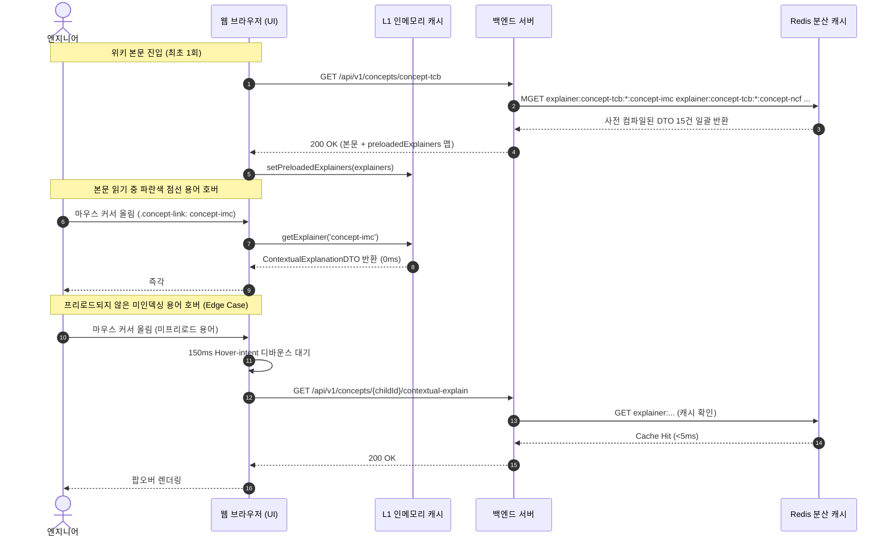

- **실제 응답 페이로드 내 `preloadedExplainers` 조립 샘플**:
  ```json
  {
    "id": "concept-tcb",
    "title": "열압착 본딩",
    "preloadedExplainers": {
      "concept-imc": {
        "childConceptId": "concept-imc",
        "parentConceptId": "concept-tcb",
        "perspectiveId": "yield",
        "title": "금속간 화합물 (Intermetallic Compound, IMC)",
        "definition": "서로 다른 금속(Cu와 Sn)이 고온 확산 반응하여 계면에 형성되는 합금층.",
        "contextSentence": "본 문서(열압착 본딩)에서는 Cu 범프와 Sn 솔더 캡이 열압착될 때 Cu6Sn5를 형성하여 접합 신뢰성을 결정하는 핵심 계면입니다.",
        "cached": true,
        "deepLink": "/wiki/concept-imc"
      },
      "concept-ncf": {
        "childConceptId": "concept-ncf",
        "parentConceptId": "concept-tcb",
        "perspectiveId": "yield",
        "title": "비도전성 필름 (Non-Conductive Film, NCF)",
        "definition": "마이크로범프 사이 절연과 칩 접착을 위해 본딩 전 도포하는 절연 수지 필름.",
        "contextSentence": "본 문서에서는 본딩 헤드 가압 시 범프 사이를 보이드 없이 충진해야 하며, 180N 초과 시 과유출 결함을 유발하는 주요 소재입니다.",
        "cached": true,
        "deepLink": "/wiki/concept-ncf"
      }
    }
  }
  ```

#### 5.1.5 원자적 캐시 무효화 및 사전 컴파일 웜업 파이프라인 (Atomic Invalidation & Pre-compilation)

[Tab 3] 검토·승인 센터에서 신규 판본이 승인 배포(`POST /api/v1/review-tickets/{id}/approve`)될 때, 시스템은 캐시 불일치(Stale Data)를 방지하기 위해 다음 4단계 파이프라인을 트랜잭션 방식으로 실행합니다:

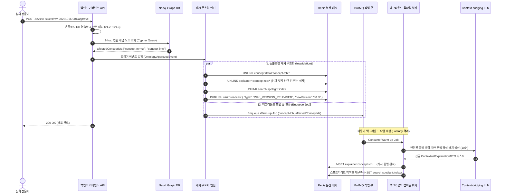

1. **Neo4j 그래프 역방향 영향 분석 Cypher 쿼리**:
   - 승인된 개념 노드를 참조하고 있거나 인과 엣지로 묶인 연관 노드를 1~2 hop 깊이로 정밀 탐색:
     ```cypher
     MATCH (target:Concept {id: $conceptId})
     OPTIONAL MATCH (target)<-[:causes|caused_by|alternative_to|part_of*1..2]-(affected:Concept)
     RETURN target.id AS updatedId, collect(DISTINCT affected.id) AS affectedIds;
     ```
2. **비동기 이벤트 페이로드 (`OntologyApprovedEvent`) 스키마**:
   ```typescript
   interface OntologyApprovedEvent {
     eventId: string;             // "evt-20261016-appr-01"
     ticketId: string;            // "rev-20261016-001"
     conceptId: string;           // "concept-tcb"
     oldVersion: string;          // "v1.2"
     newVersion: string;          // "v1.3"
     affectedConceptIds: string[];// ["concept-mrmuf", "concept-imc", "defect-warpage"]
     approvedBy: string;          // "Dr. 김수석"
     approvedAt: string;          // "2026-10-16T15:30:00Z"
   }
   ```
3. **작업 큐(Worker Queue) 재시도 및 실패 격리**:
   - BullMQ / Redis Streams 워커는 백그라운드에서 LLM 배치를 가동하며, LLM 응답 실패 시 **지수 백오프 (Exponential Backoff: 1초, 2초, 4초, 최대 3회 재시도)** 후 실패 건은 Dead Letter Queue (DLQ)로 격리하여 시스템 다운을 원천 방지.

#### 5.1.6 캐시 스탬피드 및 동시성 방어 (Redlock & XFetch 알고리즘)

- **문제 상황**: 팹 라인 정기 점검 직후 수백 명의 엔지니어가 동시에 접속하여 스포트라이트 검색이나 특정 핫스팟 개념(`concept-tcb`)을 호출할 때, 캐시 만료 시 DB/LLM으로 트래픽이 일시 집중되는 현상(Cache Stampede)을 원천 차단합니다.
- **분산 뮤텍스 락 (Redis Distributed Mutex - Redlock) 의사코드**:
  ```python
  import time, uuid

  def get_concept_detail_with_lock(concept_id: str, perspective: str, user_role: str):
      cache_key = f"concept:detail:{concept_id}:{perspective}"
      lock_key = f"lock:concept:{concept_id}"
      lock_token = str(uuid.uuid4())
      
      # 1. 캐시 조회 후 인메모리 런타임 권한 마스킹(Post-Cache RBAC Filter) 적용
      cached_data = redis_client.get(cache_key)
      if cached_data:
          raw_dto = decompress_zlib_json(cached_data)
          return apply_rbac_tier3_masking(raw_dto, user_role)
      
      # 2. 캐시 미스 시 분산 락 획득 시도 (3초 TTL)
      acquired = redis_client.set(lock_key, lock_token, nx=True, px=3000)
      
      if acquired:
          try:
              # 최초 1개 스레드만 무거운 DB 조회 및 원본(Raw) DTO 패킹 실행
              db_data = fetch_from_graph_and_doc_db(concept_id, perspective)
              compressed = compress_zlib_json(db_data)
              redis_client.setex(cache_key, 86400, compressed) # 24시간 보관
              return apply_rbac_tier3_masking(db_data, user_role)
          finally:
              # 본인이 획득한 락만 안전하게 해제 (Lua Script)
              release_lock_lua(lock_key, lock_token)
      else:
          # 락을 획득하지 못한 나머지 스레드는 50ms 대기 후 캐시에서 읽기 (최대 3회 스핀)
          for _ in range(3):
              time.sleep(0.05)
              cached_data = redis_client.get(cache_key)
              if cached_data:
                  raw_dto = decompress_zlib_json(cached_data)
                  return apply_rbac_tier3_masking(raw_dto, user_role)
          
          # 타임아웃 시 읽기 전용 폴백 DB 조회
          fallback_data = fetch_from_read_replica(concept_id, perspective)
          return apply_rbac_tier3_masking(fallback_data, user_role)
  ```

- **XFetch 확률적 조기 갱신 (Probabilistic Early Expiration) 알고리즘**:
  - 캐시 만료 직전 자연스럽게 백그라운드에서 캐시를 사전 갱신하여 캐시 미스를 0에 가깝게 유지합니다:
  \[
  -\beta \cdot \delta \cdot \ln(\text{rand()}) > \text{TTL}_{\text{remaining}}
  \]
  - \(\delta\): DTO를 생성하는 데 소요된 계산 시간 (초 단위, 평균 0.35초).
  - \(\beta\): 갱신 공격성 가중치 계수 (\(\beta = 1.2\)).
  - \(\text{rand()}\): \((0, 1]\) 범위의 균등 난수.
  - 잔여 유효 시간(\(\text{TTL}_{\text{remaining}}\))이 확률적 임계치보다 작아질 경우, 요청을 처리하는 스레드가 사용자에게는 현재 캐시를 0ms로 즉각 서빙하고 백그라운드 비동기 태스크로 Redis 캐시를 갱신합니다.

---

### 5.2 실시간 이벤트 스트리밍 및 전역 동기화 아키텍처 (Real-Time Streaming & Event Sync)

반도체 팹 라인과 R&D 연구소 환경에서는 수백 명의 엔지니어가 동시에 온톨로지 지식을 참조하고 비교 분석하며 지식을 거버넌스합니다. 시스템은 **단방향 AI 추론 스트리밍**과 **전역 지식 승인 브로드캐스트**를 효율적으로 분리 지원하기 위해 **SSE(Server-Sent Events)와 WebSocket/Redis Pub-Sub을 결합한 하이브리드 실시간 아키텍처**를 채택합니다.

#### 5.2.1 실시간 통신 토폴로지 및 이원화 프로토콜 전략

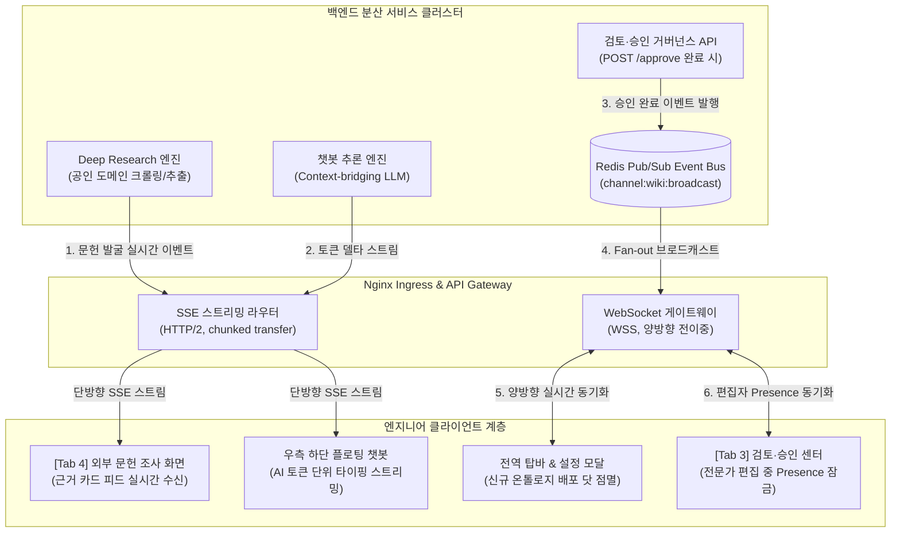

- **이원화 프로토콜 선정 사유**:
  1. **단방향 스트리밍 (SSE - Server-Sent Events)**:
     - **적용 대상**: [Tab 4] 외부 문헌 실시간 수집 피드(`[화면 4-A]`), 플로팅 챗봇 토큰 스트리밍.
     - **선정 이유**: 클라이언트에서 서버로의 역방향 메시징이 필요 없는 순수 수신 스트림이며, 기존 HTTP/HTTPS 포트(80/443)를 그대로 사용하여 팹 사내 방화벽 프록시 통과가 완벽히 보장됨. 브라우저 내장 `EventSource`의 자동 재연결(Auto-reconnect with `Last-Event-ID`)을 무상으로 활용 가능.
  2. **전역 브로드캐스트 및 협업 (WebSocket + Redis Pub-Sub)**:
     - **적용 대상**: 신규 온톨로지 판본 배포 알림(탑바 배너), 검토 센터 편집 중 동시성 Presence 알림.
     - **선정 이유**: 다중 백엔드 노드 환경에서 모든 연결된 클라이언트로의 즉각적인 1:N Fan-out 및 양방향 Heartbeat 핑퐁이 필수적이므로 전이중(Full-duplex) WebSocket을 채택.

---

#### 5.2.2 [단방향 스트리밍] SSE 기반 문헌 조사 및 챗봇 토큰 스트리밍 규격

##### 1. 전송 계층 헤더 및 Nginx 프록시 설정
SSE 스트림의 중간 버퍼링으로 인한 체감 지연(Latency)과 보안 유출을 원천 방지하기 위해 다음 응답 헤더 및 인증 방식을 필수 적용합니다:
```http
HTTP/1.1 200 OK
Content-Type: text/event-stream; charset=utf-8
Cache-Control: no-cache, no-transform
Connection: keep-alive
X-Accel-Buffering: no
Access-Control-Allow-Origin: *
```
- **Nginx 버퍼링 차단**: Nginx 또는 기업용 리버스 프록시 뒤에 위치할 경우 `X-Accel-Buffering: no`를 명시하여 프록시가 청크를 쥐고 있지 않고 즉시 클라이언트로 바이패스(Bypass)하도록 강제.
- **인증 토큰 유출 방지 (fetch-event-source)**: 브라우저 표준 `EventSource`는 커스텀 헤더를 지원하지 않아 쿼리스트링(`?token=...`)에 인증키를 노출하기 쉽습니다. 시스템은 사내 프록시 로그에 토큰이 기록되는 취약점을 차단하기 위해 `@microsoft/fetch-event-source` 패턴을 채택하여 정식 `Authorization: Bearer <JWT>` 헤더로 전송.

##### 2. [Tab 4] 외부 문헌 조사 실시간 이벤트 스트림 (`GET /api/v1/research/sessions/{id}/stream`)
조사 세션이 시작되면 백엔드 에이전트가 탐색 과정을 단계별 이벤트로 방출합니다:

```text
event: progress
id: evt-001
data: {"step": "domain_search", "percent": 25, "activeDomain": "ieeexplore.ieee.org", "message": "IEEE Xplore 공인 학술 문헌 탐색 중..."}

event: evidence_discovered
id: evt-002
data: {"evidenceId": "E-2026-TGV-01", "sourceName": "Intel Glass Substrate Reliability Whitepaper", "sourceType": "official_whitepaper", "publisher": "Intel Corporation", "publishedDate": "2026.01", "quote": "In 500μm thick glass cores, TGV thermal expansion mismatch induces micro-cracking at aspect ratios exceeding 10:1.", "sectionContext": "Section 3.1 Failure Mechanisms, p.8 Table 1", "relevanceScore": 0.96, "externalUrl": "https://www.intel.com/content/www/us/en/newsroom/news/glass-substrates-breakthrough.html", "credibilityTier": "Tier 1 (공식 제조사)"}

event: progress
id: evt-003
data: {"step": "cross_synthesis", "percent": 80, "message": "다중 출처 3건 교차 대조 및 지식 갭 분석 중..."}

event: candidate_ready
id: evt-004
data: {"candidateId": "cand-20261019-01", "candidateType": "신규 개념", "title": "유리기판 관통전극 (TGV)", "summary": "차세대 유리기판 인터포저에서 TSV를 대체하여 미세 피치 전기적 인터커넥트를 형성하는 레이저 가공 관통 배선 기술.", "evidenceIds": ["E-2026-TGV-01"]}

event: complete
id: evt-005
data: {"status": "success", "totalEvidences": 4, "totalCandidates": 2, "tookMs": 3420}
```

##### 3. [플로팅 챗봇] 토큰 단위 타이핑 스트림 (`POST /api/v1/chatbot/messages/stream`)
엔지니어의 질문에 대해 LLM의 인과 추론 토큰을 실시간으로 내려보냅니다:
```text
event: token
id: chk-01
data: {"delta": "열압착 본딩(TCB) 공정에서 "}

event: token
id: chk-02
data: {"delta": "본딩 헤드의 가압력이 **180N을 초과**할 경우, "}

event: token
id: chk-03
data: {"delta": "NCF 수지 측방 과유출로 인해 마이크로 브릿지(단락) 위험이 급증합니다."}

event: action_card
id: chk-04
data: {"actionType": "navigate_comparison", "title": "TCB vs LAB 다차원 비교 분석 실행", "targetUrl": "/comparison?targetA=concept-tcb&targetB=concept-lab"}

event: done
id: chk-05
data: {"finishReason": "stop", "promptTokens": 320, "completionTokens": 78}
```
- **청크 경계 가명화 토큰 절단 방지 (Bracket-Aware Lookahead Buffer)**: [5.4.3절의 구간 인지형 가명화 토큰](#구간별-비선형-물리-법칙을-보존하는-작동-영역regime-aware-가명화-및-역치환-파이프라인)(예: `[PARAM_TEMP_RECOMMEND]`)이 실시간 스트리밍 도중 `"[PA"`, `"RAM_"`, `"TEMP_RECOMMEND]"`처럼 여러 청크로 쪼개져 생성될 때 화면에 가명화 기호가 날것으로 노출되지 않도록, 백엔드 SSE 송출단은 **대괄호 감지 슬라이딩 버퍼**를 가동합니다. 스트림 내 여는 대괄호(`[`)가 감지되면 닫는 대괄호(`]`)가 도착할 때까지(최대 30자) 버퍼에 홀딩한 뒤, 임시 세션 사전(`Dict`)에서 실제 엔지니어링 수치(`280℃`)로 완결 역치환하여 단일 `token` 청크로 방출합니다.

##### 4. 네트워크 단절 시 `Last-Event-ID` 무손실 복구 메커니즘
- 팹 라인 이동 중 일시적 Wi-Fi 패킷 드랍 발생 시, 브라우저 `EventSource`는 백엔드에 자동 재연결하며 헤더에 `Last-Event-ID: evt-002`를 전송합니다.
- 백엔드 Redis의 스트림 캐시(`stream:session:{id}`)에서 `evt-002` 이후의 누락된 이벤트를 찾아 즉시 재전송(Replay)함으로써 화면 누락 없는 무손실 복원력을 제공합니다.

---

#### 5.2.3 [전역 브로드캐스트] WebSocket & Redis Pub-Sub 배포 동기화 클러스터

##### 1. 분산 환경의 WebSocket & Redis Pub-Sub 구조 및 보안 가드레일
다중 백엔드 Pod/인스턴스 환경에서 클라이언트가 각각 다른 서버에 WebSocket으로 물려 있더라도, 전역 이벤트가 누락 없이 모든 클라이언트에 전달되도록 Redis Pub-Sub 버스를 중계자로 둡니다:

- **웹소켓 보안 가드레일 (CSWSH & 커넥션 DoS 방어)**:
  - **Origin 화이트리스트 검증**: 인가된 사내 도메인(`*.corp`, `localhost:8000`) 외의 외부 웹사이트에서 발생한 웹소켓 핸드셰이크 요청은 즉시 차단(HTTP 403 Forbidden)하여 크로스사이트 웹소켓 하이재킹(CSWSH)을 원천 방어.
  - **1회용 단기 티켓 토큰 (Ticket Auth)**: 웹소켓 연결 시 URL 파라미터로 직접 영구 토큰을 넘기지 않고, REST API로 사전 발급받은 30초 유효한 1회용 티켓(`wss://.../ws/v1/events?ticket=ws_ticket_xxx`)으로 핸드셰이크 검증.
  - **계정당 커넥션 상한 (Rate Limit)**: 사번 계정 및 IP당 최대 동시 연결 수(5개)를 초과할 경우 신규 소켓 연결을 차단하여 자원 고갈(DoS) 방어.

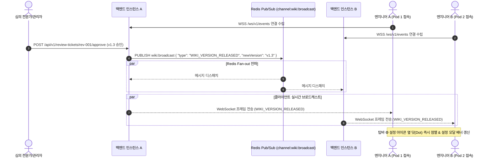

##### 2. 전역 브로드캐스트 메시지 스키마

- **신규 판본 배포 브로드캐스트 (`WIKI_VERSION_RELEASED`)**:
  ```json
  {
    "type": "WIKI_VERSION_RELEASED",
    "timestamp": "2026-10-19T08:15:00Z",
    "payload": {
      "oldVersion": "v1.2",
      "newVersion": "v1.3",
      "approvedConceptId": "concept-tcb",
      "approvedConceptTitle": "열압착 본딩 (TCB)",
      "releaseSummary": "TCB 16단 적층 시 145N 가압 조건 및 시간 보상 파라미터 개정",
      "approvedBy": "Dr. 김수석 (수율분석팀)",
      "totalConcepts": 148,
      "requiresRefresh": false,
      "bannerMessage": "온톨로지 v1.3이 공식 배포되었습니다. 최신 규격이 반영되었습니다."
    }
  }
  ```
  ➔ **UI 연동**: 탑바 우측 `⚙️ 설정` 버튼 옆 상태 인디케이터가 **노란색/초록색 점멸**로 변경되며, 클릭 시 열리는 설정 모달(`#settings-modal`) 상단에 `[신규 온톨로지 v1.3 배포 알림 배너]`가 렌더링됩니다.

- **[Tab 3] 티켓 실시간 편집 중 Presence 감지 (`TICKET_LOCK_PRESENCE`)**:
  ```json
  {
    "type": "TICKET_LOCK_PRESENCE",
    "timestamp": "2026-10-19T08:15:30Z",
    "payload": {
      "ticketId": "rev-20261016-001",
      "status": "locked",
      "lockedBy": "최책임 (패키징공정팀)",
      "lockedUntil": "2026-10-19T08:25:30Z",
      "message": "현재 최책임님이 직접 편집기로 수정 중입니다. (동시 수정 충돌 방지)"
    }
  }
  ```
  ➔ **UI 연동**: 다른 전문가가 동일 티켓의 `[✏️ 직접 편집 모드]` 버튼을 누르려 할 때 버튼이 비활성화되며 `"현재 최책임님이 편집 중입니다"` 툴팁이 노출되어 편집 충돌을 사전 차단합니다.

---

#### 5.2.4 네트워크 단절 복구, 하트비트 및 백프레셔(Backpressure) 제어

##### 1. 팹 라인 음영 구역 대응 Ping/Pong 하트비트 규격
- 반도체 클린룸 내부 챔버 사이 이동 시 무선 패킷 유실을 감지하기 위해 서버와 클라이언트는 30초 주기로 WebSocket Ping/Pong 프레임을 교환합니다:
  - 서버 ➔ 클라이언트: `{"type": "PING", "ts": 1792364000000}`
  - 클라이언트 ➔ 서버: `{"type": "PONG", "ts": 1792364000100}`
- **자동 재연결(Exponential Backoff)**: 2회 연속 PING 실패(60초 타임아웃) 시 소켓을 능동 종료하고, 클라이언트는 `min(1000 * 2^attempt, 15000)` ms 주기의 지수 백오프로 무음 재연결을 시도합니다.

##### 2. 클라이언트 렌더링 백프레셔(Backpressure) 제어 의사코드
초당 80~100 토큰이 고속으로 유입될 때 브라우저 메인 스레드가 DOM 리플로우(Reflow)로 멈칫거리는 현상(Jank)을 방지하기 위해 `requestAnimationFrame`(RAF) 배치 큐를 적용합니다:

```javascript
// 프론트엔드 토큰 렌더링 백프레셔 완충 버퍼 (js/app.js)
class StreamingTokenBuffer {
  constructor(targetElement) {
    this.target = targetElement;
    this.tokenQueue = [];
    this.isRendering = false;
  }

  // SSE 온메시지 수신 시 큐에 적재 (비차단)
  public push(tokenDelta) {
    this.tokenQueue.push(tokenDelta);
    if (!this.isRendering) {
      this.isRendering = true;
      requestAnimationFrame(() => this.flush());
    }
  }

  // 16.6ms(60fps) 주기로 모인 토큰을 한 번에 DOM에 플러시
  private flush() {
    if (this.tokenQueue.length > 0) {
      const batchText = this.tokenQueue.join("");
      this.tokenQueue = [];
      this.target.textContent += batchText;
      // 자동 하단 스크롤 동기화
      this.target.scrollTop = this.target.scrollHeight;
    }
    if (this.tokenQueue.length > 0) {
      requestAnimationFrame(() => this.flush());
    } else {
      this.isRendering = false;
    }
  }
}
```

---

### 5.3 분산 동시성 제어 및 지식 불변 감사 추적 (Concurrency Control & Audit Trail)

반도체 엔지니어링 온톨로지는 수천억 원 규모의 웨이퍼 수율과 패키징 신뢰성을 좌우하는 핵심 기준선(Baseline)입니다. 따라서 **동일 개념/티켓에 대한 동시 수정 충돌을 100% 방지**하고, 승인 과정에서 발생한 모든 기술적 판단과 **사유(`overrideReason`)를 사후에 절대로 조작·인멸할 수 없는 불변 감사 추적(Immutable Audit Trail)** 구조를 확립해야 합니다.

#### 5.3.1 이중 동시성 방어 아키텍처 (Pessimistic Presence + Optimistic Versioning)

시스템은 UI 레벨의 **실시간 비관적 잠금(5.2절 Presence Lock)**과 DB 저장소 레벨의 **낙관적 락(Optimistic Locking with Versioning)**을 결합한 2계층 방어 체계를 가동합니다:

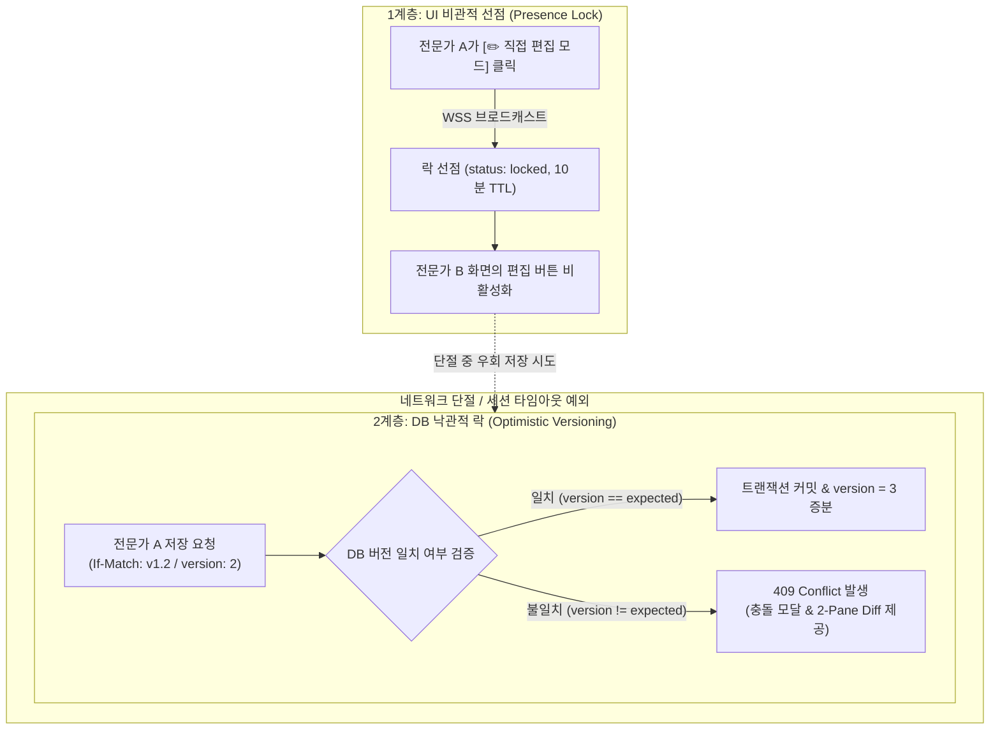

##### 1. HTTP `If-Match` 헤더 및 낙관적 락 트랜잭션 로직
엔지니어가 티켓 직접 편집 내용을 저장하거나(`PUT /api/v1/review-tickets/{id}/human-edits`), 승인을 단행할 때(`POST /api/v1/review-tickets/{id}/approve`), 클라이언트는 반드시 자신이 마지막으로 확인한 판본 해시(`If-Match`) 또는 버전을 실어 보냅니다:

```http
PUT /api/v1/review-tickets/rev-20261016-001/human-edits HTTP/1.1
Host: wiki-api.fab.corp
Authorization: Bearer <JWT>
If-Match: "v1.2-rev04"
Content-Type: application/json

{
  "ticketVersion": 4,
  "humanEdits": "본딩 인가 하중 임계치를 145N으로 재설정하고, 초음파 시간 보상 수치를 +120ms로 명시."
}
```

- **백엔드 트랜잭션 갱신 SQL (원자적 CAS 연산)**:
  ```sql
  -- 동시 수정 시 0 rows updated가 발생하여 충돌을 감지
  UPDATE review_tickets
  SET human_edits = :humanEdits,
      ticket_version = ticket_version + 1,
      updated_at = NOW()
  WHERE id = :ticketId
    AND ticket_version = :expectedVersion;
  ```

##### 2. `409 Conflict` 발생 시 시퀀스 및 UI 연동 대책
만약 타 전문가가 먼저 수정을 반영하여 버전이 어긋난 경우, 백엔드는 즉시 `409 Conflict`를 반환하며 최신 스냅샷을 함께 내려줍니다:

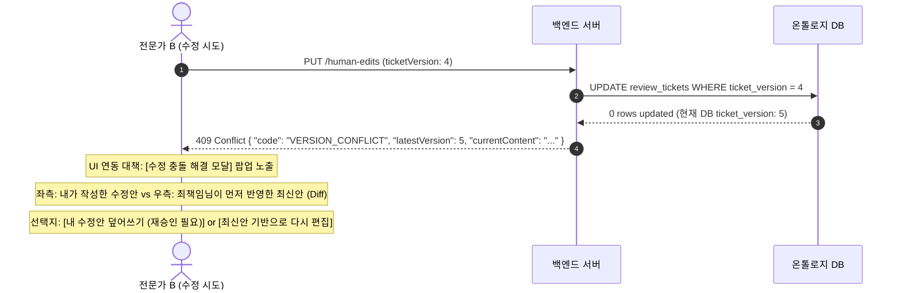

---

#### 5.3.2 불변 지식 거버넌스 감사 추적 (Immutable Audit Trail & WORM)

반도체 팹 라인에서는 *"누가, 언제, 어떤 공인 출처에 근거하여, 왜(사유) 이 가압력 수치를 변경했는가?"*를 사후 10년 이상 법적·품질적으로 소명할 수 있어야 합니다.

##### 1. 감사 추적 4대 핵심 불변 필드
검토 센터에서 승인(`POST /approve`) 또는 반려(`POST /reject`) 시 다음 4개 항목이 영구 동결(Snapshot Freeze)됩니다:
1. **승인 전/후 텍스트 Diff (Before/After Raw Markdown)**: 위키 본문 v1.2와 승인된 v1.3의 완전한 원문 스냅샷.
2. **에이전트 초안 보완 지시 이력 (`directiveHistory`)**: 전문가가 AI에게 내린 지시문과 AI가 수정한 차수별 초안 전문.
3. **공인 출처 충돌 시 입력한 사유 (`overrideReason`)**: 3.4절/4.4.3절 가드레일에 의해 공인 백서 수치와 충돌함에도 전문가가 강제 반영한 구체적 엔지니어링 근거.
4. **무결성 점검 리포트 스냅샷 (`integrityReport`)**: 출처 일치도, 온톨로지 충돌 유무, 영향 범위 카운트.

##### 2. `AuditLogEntry` 엔티티 스키마
```typescript
interface AuditLogEntry {
  auditId: string;                // "aud-20261019-tcb-001"
  ticketId: string;               // "rev-20261016-001"
  conceptId: string;              // "concept-tcb"
  actionType: "TICKET_APPROVED" | "TICKET_REJECTED" | "DIRECTIVE_OVERRIDE";
  
  // 행위자 메타데이터
  actor: {
    userId: string;               // "EMP-91823"
    userName: string;             // "Dr. 김수석"
    department: "수율분석팀";
    ipAddress: string;            // "10.24.112.55 (팹 라인 내부망)"
    role: "chief_reviewer";
  };
  
  // 거버넌스 스냅샷 (불변)
  governanceSnapshot: {
    previousVersion: string;      // "v1.2"
    publishedVersion: string;     // "v1.3"
    overrideReason?: string;      // 충돌 강제 승인 시 사유 (예: "2026.02 최신 파일럿 팹 실측 결과 반영")
    evidenceMatchRate: number;    // 0.98 (98%)
    diffPatch: string;            // Unified Git Diff 형식의 패치 문자열
  };

  // 암호화 무결성 서명 (해시 체이닝)
  previousLogHash: string;        // 직전 감사 로그의 SHA-256 해시값 (초기: "00000000...0000")
  entryHash: string;              // SHA-256(auditId + timestamp + actor + snapshot + previousLogHash)
  digitalSignature: string;       // 감사 서버 비대칭 개인키(RSA-4096) 전자 서명
  timestamp: string;              // "2026-10-19T08:20:00.123Z"
}
```

##### 3. Append-Only WORM(Write Once, Read Many) 저장소 격리
- **DB 권한 분리**: 애플리케이션 백엔드 DB 계정은 `audit_logs` 테이블에 대해 **오직 `INSERT` 권한만 부여**받으며, `UPDATE`, `DELETE`, `DROP` 권한은 원천 박탈됩니다.
- **테이블 파티셔닝**: `audit_logs`는 연월 단위(`audit_logs_y2026m10`)로 파티셔닝되며, 파티션 마감 시 읽기 전용 테이블스페이스(`READ ONLY TABLESPACE`)로 동결되어 물리적 변조를 차단합니다.

---

#### 5.3.3 블록체인급 무결성을 위한 암호학적 해시 체이닝 (Cryptographic Hash Chain)

감사 데이터베이스 관리자(DBA)나 인프라 관리자라 할지라도 감사 로그를 사후에 임의 조작하거나 중간 레코드를 삭제할 수 없도록, 비트코인 블록 헤더와 유사한 **단방향 머클 해시 체이닝(Merkle Hash Chaining)**을 적용합니다:

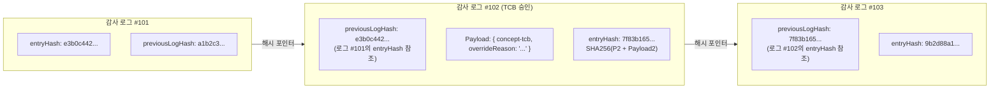

- **해시 계산 알고리즘**:
  \[
  H_n = \text{HMAC-SHA256}\Big(K_{\text{audit}}, \, H_{n-1} \,\|\, \text{auditId} \,\|\, \text{timestamp} \,\|\, \text{actorId} \,\|\, \text{canonicalJSON}(\text{payload})\Big)
  \]
- **정기 무결성 검증 백그라운드 워커 (Audit Integrity Verifier)**:
  - 매일 새벽 02:00, 독립된 보안 감사 워커가 `audit_logs` 테이블의 전 레코드를 1번부터 N번까지 순차 탐색하며 직전 해시(\(H_{n-1}\))와 현재 해시(\(H_n\))의 수학적 연쇄를 재계산합니다.
  - 만에 하나 단 한 글자라도 위조되거나 중간 레코드가 삭제된 경우, **해시 불일치(Broken Chain)** 경보가 발령되고 사내 보안관제센터(SOC)로 비상 차단 웹훅을 전송합니다.

#### 5.3.4 감사 무결성 및 암호키 보안 가드레일 (Audit Security Guardrails)

불변 감사 저장소와 암호학적 해시 체이닝을 운영할 때 발생할 수 있는 4대 보안 위협을 원천 차단하기 위해 다음 기술 가드레일을 강제합니다:

1. **KMS / HSM 하드웨어 암호키 격리 (Key Compromise Defense)**:
   - 감사 서명용 비밀키(\(K_{\text{audit}}\))는 애플리케이션 서버의 파일시스템이나 환경변수(`.env`)에 평문으로 보관하지 않습니다.
   - 사내 하드웨어 보안 모듈(HSM) 또는 클라우드 **KMS(Key Management Service)** 내부 격리 엔클레이브(Enclave)에서만 HMAC-SHA256 연산을 수행하도록 통제하여, 서버 인스턴스가 루트 탈취(Host Compromise)당하더라도 서명키 자체의 물리적 유출을 원천 방지합니다.
2. **시간 조작 방어 단조 증가 검증 (Monotonic Clock Enforcement)**:
   - 서버의 시스템 시간을 임의로 되돌려 과거 시점에 불법 승인을 단행한 것처럼 알리바이를 조작하는 행위(Time Travel Attack)를 방어합니다.
   - DB 트리거 및 비즈니스 로직 레벨에서 신규 감사 로그의 생성 일시(\(t_n\))가 반드시 직전 감사 로그의 일시(\(t_{n-1}\))보다 미래여야만 저장을 승인합니다 (\(t_n \ge t_{n-1}\)). 시간 역전 발생 시 트랜잭션이 즉시 롤백되며 감사 변조 침해 경보가 발행됩니다.
3. **불변 저장소 내 시크릿 사전 마스킹 (Pre-Commit DLP Filter)**:
   - WORM(Write Once, Read Many) 저장소는 한 번 기록되면 삭제가 불가능하므로, 전문가 지시문(`directiveHistory`)이나 본문 Diff 내에 사내 API 키, 데이터베이스 패스워드, 엔지니어 개인식별정보(PII)가 실수로 포함될 경우 보안 규정(개인정보보호법/GDPR)을 위반할 위험이 있습니다.
   - 감사 레코드를 영속화하기 직전, 백엔드 정규식 기반 **DLP(Data Loss Prevention) 필터**가 동작하여 패스워드 패턴, JWT 토큰, 주민등록번호, 기밀 네트워크 IP 대역을 감지하고 `[MASKED_SECRET]`으로 자동 마스킹 후 해싱 및 보존합니다.
4. **찰나의 경쟁 상태 차단 (TOCTOU Defense via Atomic CAS)**:
   - 애플리케이션 메모리에서 버전을 확인(Check)하고 DB에 반영(Use)하는 사이 수 밀리초(ms)의 틈을 노린 동시성 경쟁(Time-of-Check to Time-of-Use) 취약점을 배제합니다.
   - `SELECT` 후 메모리 비교가 아닌, 데이터베이스 트랜잭션 엔진이 단일 CPU 사이클 수준에서 직렬성을 보장하는 **원자적 단일 쿼리 (`UPDATE ... WHERE ticket_version = :expectedVersion`)**만을 강제하여 버전 우회 저장을 물리적으로 차단합니다.

---

### 5.4 반도체 데이터 보안 및 권한 거버넌스 (Security & Access Governance: RBAC/ABAC)

반도체 기업의 공정 레시피와 불량 메커니즘은 국가 핵심 기술이자 기업의 명운을 가르는 1급 영업 비밀입니다. 따라서 시스템은 **업계 공용 학술 지식은 전사 개방**하되, **특정 고객사·팹 라인의 양산 조건은 철저히 격리**하는 데이터 등급 체계와 **엄격한 3단계 역할 기반 접근 제어(RBAC)**, 그리고 **사내 폐쇄망 온프레미스 LLM Gateway 가드레일**을 확립합니다.

#### 5.4.1 반도체 지식 자산 3단계 데이터 등급 분류 및 격리 정책 (Data Classification)

시스템에 저장되는 모든 온톨로지 엔티티는 기밀도에 따라 3개 등급으로 엄격히 분리 관리됩니다:

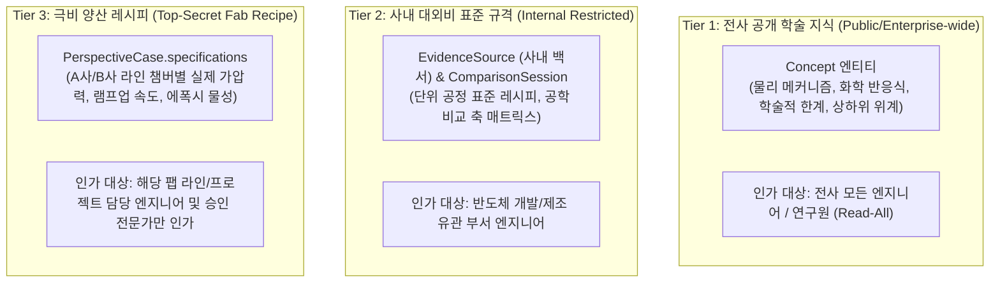

- **행 단위 보안 (Row-Level Security - RLS) 및 동적 마스킹**:
  - PostgreSQL 16의 RLS 정책을 활성화하여, `PerspectiveCase` 조회 시 미인가 부서 엔지니어에게는 절대 세팅값 수치가 동적 마스킹 처리되어 반환됩니다.
- **미인가 엔지니어 정보 퀄리티 보존 대책 (Dual-Layer Abstraction & Trend Preservation)**:
  - 수치를 완전히 가려버릴 경우(Black-box), 신입 연구원이나 타 부서 설계자가 공정 맥락을 이해하지 못해 **정보 사일로화 및 엔지니어링 퀄리티 저하**가 발생합니다.
  - 이를 방지하기 위해 **"절대 세팅값은 보호하되, 지배 물리 법칙과 상대적 경향성(Delta %)은 100% 공개"**하는 이중 추상화 기법을 적용합니다:
  ```json
  {
    "label": "본딩 헤드 인가 하중",
    "value": "[RESTRICTED: 수율분석팀 인가 필요]",
    "relativeTrend": "기준 공인 레시피(185N) 대비 약 -21.6% 감압 조정 권장",
    "underlyingMechanism": "NCF 수지 용융 측방 유출 억제 및 Cu-Sn IMC 취성 파괴 완화",
    "expectedImpact": "패키지 휨(Warpage) 48.3% 개선, 범프 접합 결함률 92.8% 감소",
    "role": "control_knob",
    "isMasked": true,
    "accessRequest": {
      "requiresApproval": true,
      "approverRole": "수율분석팀장",
      "buttonLabel": "🔑 이 관점 상세 절대 수치 열람 권한 신청 ➔"
    }
  }
  ```
  ➔ **효과**: 미인가 엔지니어도 반도체 물리 원리와 트레이드오프 인사이트를 100% 온전히 학습할 수 있으며, 실제 양산 라인 설비에 직접 입력하는 절대 수치만 안전하게 보호됩니다.

---

#### 5.4.2 3단계 역할 기반 접근 제어 (RBAC) 매트릭스

시스템의 접근 권한은 명확한 3대 엔지니어링 역할로 구분되며, JWT 페이로드의 `role` 클레임(`roles: string[]`)을 기반으로 인가(Authorization)를 판정합니다:

| API 기능 그룹 | 엔드포인트 | 일반 엔지니어<br>(`line_engineer`) | 심의 전문가<br>(`chief_reviewer`) | 거버넌스 관리자<br>(`ontology_admin`) | 비고 |
| :--- | :--- | :---: | :---: | :---: | :--- |
| **시스템 & 검색** | `GET /system/*`, `GET /search/*` | ✅ 허용 | ✅ 허용 | ✅ 허용 | 전사 공통 서비스 |
| **위키 본문 열람** | `GET /concepts/*` | ✅ 허용 | ✅ 허용 | ✅ 허용 | 미인가 시 Tier 3 사양 마스킹 (경향성은 공개) |
| **근거 출처 열람** | `GET /evidences/*` | ✅ 허용 | ✅ 허용 | ✅ 허용 | Tier 1~2 출처 원문 |
| **위키 간이 제안** | `POST /review-tickets` | ✅ 허용 | ✅ 허용 | ✅ 허용 | 누구나 오류 수정 제안 가능 |
| **비교 분석 스튜디오**| `POST /comparison-sessions/*` | ✅ 허용 | ✅ 허용 | ✅ 허용 | 자유로운 기술 대안 비교 실행 |
| **비교 결과 이관** | `POST /comparison-sessions/{id}/export-ticket` | ✅ 허용 | ✅ 허용 | ✅ 허용 | 검토 센터 큐로 티켓 발행 |
| **외부 문헌 조사** | `POST /research/*` | ✅ 허용 | ✅ 허용 | ✅ 허용 | 공인 문헌 발굴 및 후보 이관 |
| **플로팅 챗봇** | `POST /chatbot/messages/*` | ✅ 허용 | ✅ 허용 | ✅ 허용 | AI 실시간 질의응답 |
| **티켓 목록/상세** | `GET /review-tickets/*` | ✅ 허용 | ✅ 허용 | ✅ 허용 | 대기 중 / 승인 이력 열람 |
| **AI 초안 보완 지시** | `POST /review-tickets/{id}/directive` | ❌ 차단 | ✅ 허용 | ✅ 허용 | 심의 전문가 이상만 지시 가능 |
| **전문가 직접 편집** | `PUT /review-tickets/{id}/human-edits` | ❌ 차단 | ✅ 허용 | ✅ 허용 | 위키 본문 직접 수정 권한 |
| **최종 승인 / 반려** | `POST /review-tickets/{id}/approve`, `/reject` | ❌ 차단 | ✅ 허용 | ✅ 허용 | 신규 판본 배포 결정 권한 |
| **충돌 강제 승인** | `overrideReason` 동반 승인 | ❌ 차단 | ✅ 허용 | ✅ 허용 | 공인 출처 충돌 시 사유 필수 |
| **전역 시스템 정책 설정** | `PUT /system/config` | ❌ 차단 | ❌ 차단 | ✅ 허용 | 사내 표준 고정 정책(0.35) 설정 |
| **온톨로지 판본 롤백** | `POST /system/rollback` | ❌ 차단 | ❌ 차단 | ✅ 허용 | 긴급 롤백 및 감사 로그 전수 검사 |

---

#### 5.4.3 사내 폐쇄망 온프레미스 LLM Gateway 연동 및 기밀 유출 방지(DLP)

반도체 양산 조건(온도, 가압력, 가스비)이 외부 상용 클라우드 AI(OpenAI, Anthropic 등)의 학습 데이터로 유입되는 보안 사고를 원천 차단하기 위해 **사내 전용 폐쇄망 온프레미스 LLM Gateway 아키텍처**를 구축합니다:

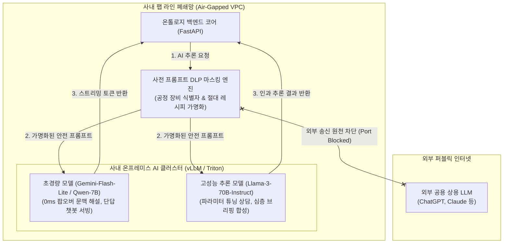

##### 구간별 비선형 물리 법칙을 보존하는 작동 영역(Regime-Aware) 가명화 및 역치환 파이프라인
반도체 물리 공학은 수치 구간에 따라 지배하는 결함 모드와 물리 방정식이 비선형적으로 완전히 바뀝니다. 단순히 숫자를 가리기만 하면 AI가 공정 영역을 오판하여 잘못된 보상 로직을 적용할 위험이 있습니다.

시스템은 **수치의 절대값은 숨기되, 해당 수치가 속한 물리적 작동 구간(Operating Regime) 메타데이터를 온톨로지 기반으로 자동 추출하여 함께 주입**하는 3단계 가명화/역치환 파이프라인을 가동합니다:

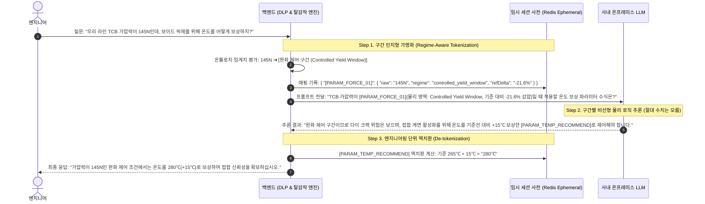

1. **온톨로지 물리 구간(Regime) 자동 분류 기준표**:
   - **극저하중 임계 구간 (Sub-critical Regime, <110N)**: 접합 에너지 부족 ➔ 미접합(Non-wetting/Open) 지배 ➔ *초음파 진폭 및 가압 시간 연장 로직 분기*.
   - **적정 완화 구간 (Controlled Yield Window, 120N ~ 160N)**: NCF 과유출 억제 ➔ 휨 제어 지배 ➔ *미세 온도 램프업 PID 보상 로직 분기*.
   - **과가압 파괴 구간 (Over-force Limit, >180N)**: NCF 측방 유출 ➔ 다이 크랙 및 범프 간 단락 지배 ➔ *온도 제어 불능, 하중 강제 하향 제한 로직 분기*.
2. **보안 및 정밀성 보장 효과**:
   - 사내 AI 모델에는 기업의 절대 기밀 세팅값(`145N`)이 단 한 번도 노출되지 않아 **보안성 100%**를 유지합니다.
   - 동시에 AI는 공정이 어느 물리 영역에 속해 있는지 정확히 인지하므로, 비선형 구간에 최적화된 **정밀한 공학 보상 로직 100%**를 적용하여 엔지니어에게 실제 팹 단위(`280℃`)로 결과를 회신합니다.

---

### 5.5 결함 감내 (Fault Tolerance) 및 우아한 성능 저하 (Graceful Degradation)

외부 LLM API 호출 지연, 사내 온프레미스 AI 클러스터의 일시적 OOM, 네트워크 파티션, 분산 캐시 장애 등 예기치 않은 시스템 결함이 발생하더라도, 반도체 엔지니어의 핵심 업무가 중단되지 않도록 보장하는 **다계층 결함 감내 및 우아한 성능 저하(Graceful Degradation) 아키텍처**입니다.

#### 5.5.1 고가용성 및 복원력 기본 원칙

1. **에러 화면(500 Internal Server Error) 노출 원천 금지**: AI 추론 엔진이 다운되더라도 엔지니어는 위키 문서 열람, 수식 대조, 기본 정의 확인을 100% 정상 수행할 수 있어야 합니다.
2. **결함 격리 (Fault Compartmentalization)**: 특정 기능(예: [Tab 4] 외부 문헌 조사)의 장애가 [Tab 1] 위키 브라우저나 [Tab 2] 비교 스튜디오 등 다른 독립 화면으로 전파(Cascading Failure)되지 않도록 서킷 브레이커로 격리합니다.
3. **투명한 서비스 상태 안내 (Self-Explaining UI)**: 장애 발생 시 불친절한 에러 코드 대신, 현재 "안전 성능 저하 모드(Degraded Mode)"가 가동 중임을 탑바 인디케이터와 노란색 안내 배너로 명확히 고지합니다.

---

#### 5.5.2 서킷 브레이커 (Circuit Breaker) 상태 전이 아키텍처

AI 게이트웨이 및 외부 학술 API 호출 구간에 **Resilience4j / pybreaker 기반 서킷 브레이커**를 배치하여 백엔드 스레드 풀 고갈을 방지합니다:

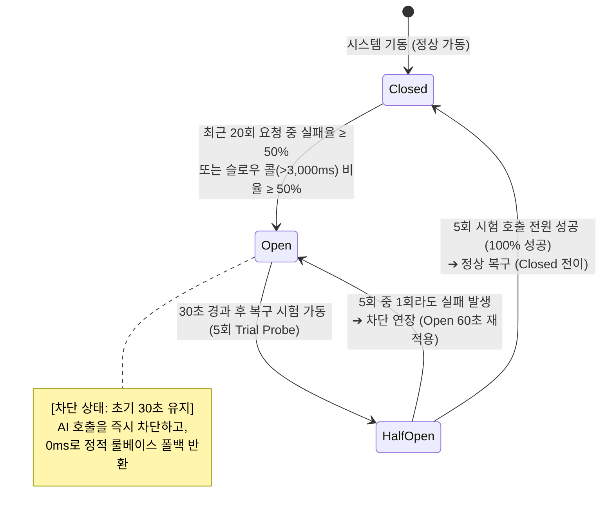

- **서킷 브레이커 세부 파라미터 설정**:
  - `slidingWindowSize`: 최근 20개 호출.
  - `failureRateThreshold`: 50% (10회 이상 실패 시 즉시 OPEN).
  - `slowCallRateThreshold`: 50% (응답 시간 3,000ms 초과 시 슬로우 콜로 간주, 10회 이상 지연 시 즉시 OPEN).
  - `waitDurationInOpenState`: 초기 30초 (차단 지속 시간, Half-Open 복구 시험 실패 시 60초로 자동 연장).
  - `permittedNumberOfCallsInHalfOpenState`: 5회 (복구 시험 호출 수 - 5회 전원 성공 시에만 정상 복구, 1회라도 실패 시 차단 연장).

---

#### 5.5.3 4대 기능별 정적 온톨로지 룰베이스 폴백 매트릭스

AI 엔진이나 외부망이 차단되었을 때, 시스템은 기저장된 온톨로지 지식 그래프와 룰베이스를 활용하여 다음과 같이 매끄럽게 폴백(Fallback)합니다:

| 화면 기능 | AI 정상 가동 시 (`CLOSED`) | AI 장애 시 우아한 성능 저하 (`OPEN`) | UI 안내 및 대책 |
| :--- | :--- | :--- | :--- |
| **[Tab 1] 문맥 맞춤 해설 팝오버 (`#concept-popover`)** | 부모 공정 맥락에 맞춤화된 1~2문장 실시간 AI 해설 스트리밍 | Redis 사전 컴파일 캐시 우선 서빙 ➔ 캐시 미스 시 온톨로지 코어 DB의 **기본 사전적 정의([`fallbackDefinition`](#3-get-apiv1conceptschildidcontextual-explain)) 및 1-hop 연관 칩** 즉시 렌더링 | 팝오버 하단에 `[⚠️ AI 맞춤 해설 점검 중 (기본 정의 표시)]` 뱃지 노출 |
| **[Tab 2] AI 파라미터 튜닝 상담 (`#tuning-advisor-card`)** | 온톨로지 인과 모델 기반 추천안 A/B 및 트레이드오프 수치 실시간 생성 | `PerspectiveCase.specifications`에 기등록된 **정적 표준 보상 파라미터 표**를 즉각 매핑하여 서빙 | "AI 실시간 추천이 일시 지연 중입니다. 사내 표준 가이드 레시피를 제안합니다." 안내 |
| **[Tab 2] 비교 매트릭스 종합 인과 분석 (`aiCausalNote`)** | 다차원 축 간 물리적 상충관계 및 종합 결함 리스크 심층 해설 | AI 줄글 코멘트만 비우고, **온톨로지 실측 수치 대조표 및 공인 출처 칩([`[E-01]`](#25-evidencesource-및-knowledgecandidate-공인-출처-및-지식-후보-dto))은 100% 정상 렌더링** | 매트릭스 상단에 `[ℹ️ 실측 데이터 정상 표기 중]` 배너 노출 |
| **[Tab 4] 외부 문헌 실시간 조사 (`[화면 4-A]`)** | IEEE, SEMI, 제조사 백서 타깃팅 실시간 웹 크롤링 및 인용구 추출 | 외부 웹 요청 차단 시, 사내 DB에 이미 구축된 **312건의 공인 출처 로컬 백서 아카이브(`EvidenceSource`)** 내 유사도 검색으로 즉시 전환 | "외부 학술망 접속이 원활하지 않아 사내 공인 백서 아카이브 검색 결과(N건)를 표시합니다." |

---

#### 5.5.4 분산 캐시(Redis) 및 그래프 DB 장애 격리

백엔드 인프라의 핵심 저장소에 결함이 발생했을 때의 계층별 안전망입니다:

1. **Redis 캐시 클러스터 다운 시**:
   - **위키 본문 조회 우회**: 백엔드는 Redis 연결 실패 감지 즉시 서킷을 열고, **PostgreSQL 16 Read-Replica(읽기 전용 복제본)**로 직접 쿼리하여 서비스 연속성을 유지합니다.
   - **클라이언트 L1 캐시 수명 자동 연장**: 프론트엔드는 시스템 상태 헤더(`X-Cache-Degraded: true`)를 수신하고, **L1 브라우저 캐시(`WikiClientCache`)의 TTL을 기존 5분에서 60분으로 자동 연장**하여 클라이언트 메모리 기반으로 백엔드 트래픽을 자체 분산 완충합니다.
   - **동시성 제어 및 가명화 사전 무중단 폴백**:
     - [5.3.1절](#531-이중-동시성-방어-아키텍처-pessimistic-presence--optimistic-versioning)의 Redis 기반 1계층 UI Presence Lock이 일시 비활성화되더라도, **2계층 RDBMS 낙관적 버전 검증(`If-Match` / `ticket_version` 원자적 CAS)**이 100% 독립 작동하여 동시 편집 덮어쓰기 결함을 원천 방어합니다.
     - [5.4.3절](#구간별-비선형-물리-법칙을-보존하는-작동-영역regime-aware-가명화-및-역치환-파이프라인)의 임시 가명화 세션 사전(`Redis Ephemeral Dict`)은 즉시 **백엔드 워커 프로세스 로컬 인메모리(`Local Ephemeral Map`)**로 자동 전환되어 AI 추론 시 기밀 가명화 및 역치환이 중단 없이 수행됩니다.
2. **Neo4j Graph DB 장애 시**:
   - 복잡한 다중 홉 인과 경로 탐색(`GET /causal-subgraph`)에 데드락이나 타임아웃 발생 시, 백엔드는 PostgreSQL에 주기적으로 동기화 저장되는 **단순 1-hop 인과 엣지 스냅샷 테이블(`causal_edges_snapshot`)**을 읽어 Cytoscape 캔버스에 중심 노드와 1-hop 인접 노드를 정상 렌더링합니다.

---

#### 5.5.5 시스템 상태 인디케이터 및 통합 헬스체크 연동

전역 탑바 우측의 `⚙️ 설정` 버튼 옆 상태 인디케이터 닷(Dot)은 4.1.1절 [`GET /api/v1/system/health`](#1-get-apiv1systemhealth) API와 연동되어 시스템의 가동 상태를 직관적인 3단계 인디케이터로 엔지니어에게 알립니다:

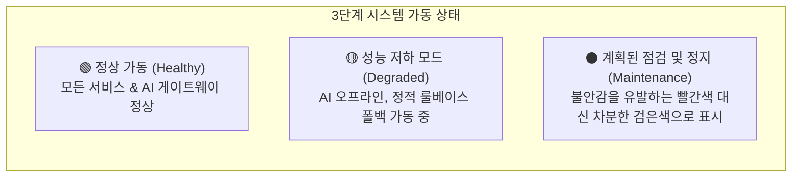

> **[UI 색상 심리학 및 현장 신뢰성 가드레일]**:
> 반도체 라인 대시보드에서 빨간색 점멸은 긴급 비상 화재/폭발 알람과 혼동되어 불필요한 공포와 불신을 유발할 수 있습니다. 따라서 심각한 장애나 점검 상태일지라도 시스템이 통제 하에 조용히 안전 정지되어 있음을 나타내기 위해 **차분하고 신뢰성 있는 검은색 인디케이터(⚫ Maintenance / Controlled Standby)**를 채택합니다.

- **`degraded` 상태 시 헬스체크 응답 샘플 (HTTP 200 OK)**:
  ```json
  {
    "status": "degraded",
    "timestamp": "2026-10-19T08:35:00Z",
    "services": {
      "database": "connected",
      "redisCache": "connected",
      "llmGateway": "offline (circuit_open)"
    },
    "message": "AI 추론 엔진 점검 중입니다. 온톨로지 정적 지식 및 기본 정의 모드로 안전하게 서비스 중입니다.",
    "activeFallbacks": [
      "contextual_explainer: rule_based_definition",
      "tuning_advisor: static_recipe_table",
      "deep_research: internal_archive_only"
    ]
  }
  ```
  ➔ **UI 연동**: 탑바 닷이 **노란색**으로 전환되며, 엔지니어가 클릭 시 열리는 설정 모달에 *"현재 AI 실시간 분석이 점검 중이며, 검증된 정적 온톨로지 지식으로 안전하게 서비스되고 있습니다"* 안내 배너가 표시되어 현장 혼란을 원천 예방합니다.


